# 基本設計

| 項目 | 内容 |
|---|---|
| 作成日 | 2026-11-16 |
| 状態 | 初版。実装の前に書いた案であり、実装で分かったことに合わせて改訂する |
| 位置づけ | [要件定義](requirements.md)を満たすための構成を定める。プロセスの分け方、パッケージの分け方、プロセスの間でやり取りするデータを対象にする |
| 詳細設計 | 文書としては作らない。コードと、コードの doc コメントを詳細設計として扱う |

要件定義の「6. 決定事項」に書いた内容は、この文書では前提として扱う。
この文書で新しく定めた内容のうち、名前と数値には「仮」と付けた。
仮の名前と数値は、実装の段階で変えてよい。

## 1. 全体の構成

エディタは、本体のプロセス 1 個と、拡張機能ごとの子プロセスで構成する。


**図 1　本体は拡張機能を別の実行ファイルの子プロセスとして起動し、JSON-RPC で呼び出す。**
破線の枠が 1 つのプロセス、青い箱は本体が持つ部分である。
箱の大きさは量を表さない。

バッファの内容を持つのは本体だけである（FR-15）。
拡張機能は、本体から受け取った内容の複製を持ち、編集したいときは編集の内容を本体へ送る。
この形にすると、拡張機能がどのように異常終了しても、バッファは本体のメモリに残る（NFR-03）。

### 1.1 実行ファイル

| 実行ファイル（仮） | 役割 | cgo | 関係する要件 |
|---|---|---|---|
| `modal-editor` | 本体 | 不使用 | NFR-02 |
| `modal-editor-ext-lsp` | LSP のクライアント | 不使用 | FR-30 |
| `modal-editor-ext-dap` | DAP のクライアント | 不使用 | FR-31 |
| `modal-editor-ext-mcp` | MCP のサーバー | 不使用 | FR-32 |
| `modal-editor-mcp-bridge` | MCP の中継コマンド | 不使用 | FR-33 |
| `modal-editor-ext-acp` | ACP のクライアント | 不使用 | FR-34 |
| `modal-editor-ext-treesitter` | tree-sitter による構文解析 | 使用 | FR-35 |
| `modal-editor-ext-script` | yaegi によるスクリプトの拡張機能の実行 | 不使用 | FR-36 |

利用者が足す拡張機能も、標準の拡張機能と同じ仕組みで起動する。

## 2. 本体のパッケージ構成


**図 2　パッケージは 4 つの層に分け、上の層だけが下の層を import する。**
同じ層のパッケージどうしは import しない。
緑の箱は、拡張機能の作者が import する公開のパッケージである。

| パッケージ（仮） | 責務 | 持たないもの |
|---|---|---|
| `internal/buffer` | テキストの保持、編集の適用、バージョン番号、アンドゥの履歴 | カーソル、モード、画面 |
| `internal/rpc` | JSON-RPC のメッセージの読み書き、リクエストとレスポンスの対応付け | メッセージの中身の意味 |
| `ext` | 拡張機能 API の型と、拡張機能の側で使う補助の関数 | 本体の内部の型 |
| `internal/input` | 端末のバイト列からキーへの解読、キーの列から編集コマンドの値への解釈 | バッファの変更 |
| `internal/command` | 編集コマンドの値の実行、レジスター、ドットリピートとマクロの記録 | キーの解釈、画面 |
| `internal/ui` | 端末への描画 | バッファの変更 |
| `internal/exthost` | 拡張機能のプロセスの起動、監視、期限、再起動、差分の送信 | 個々の拡張機能の機能 |
| `internal/config` | 設定ファイルと、拡張機能の宣言ファイルの読み込み | 設定の適用 |
| `internal/editor` | イベントループ。上の部品をつなぎ、キー入力と拡張機能からのメッセージを 1 件ずつ処理する | 個々の部品の中身 |

Go は、パッケージが互いを import する循環を、コンパイルエラーにする。
層を決めておくのは、実装の途中で循環に行き当たるのを避けるためである。

`internal` という名前のディレクトリの下のパッケージは、このリポジトリの外から import できない。
これは Go の仕様である。
拡張機能の作者に見せる型だけを `ext` に置き、それ以外を `internal` の下に置くことで、公開した API だけに互換性を保つ対象を絞る。

### 2.1 並行処理の方針

バッファ、モード、レジスターなどの編集の状態は、イベントループの goroutine 1 つだけが読み書きする。
端末からの入力の読み取りと、拡張機能との通信は別の goroutine で行い、結果をチャネルでイベントループへ送る。
この形にすると、編集の状態に排他制御（mutex）が要らない。

## 3. キー入力の処理


**図 3　キー入力は編集コマンドの値に解釈されてから実行され、マクロはキーを、ドットリピートは編集コマンドの値を記録する。**
実線は処理の流れ、破線は記録である。
黄色の箱は、拡張機能が追加した操作のときだけ通る。

入力の解釈は、キーを 1 個ずつ受け取る状態機械として実装する。
`d2w` の `d` と `2` を受け取った時点では編集コマンドは完成しておらず、`w` を受け取った時点で値が 1 つ完成する。

編集コマンドの値は、次の項目で構成する（FR-02、FR-06）。

| 項目 | 例（`"a3dw`） | 内容 |
|---|---|---|
| レジスター | `a` | 省略した場合は既定のレジスター |
| 回数 | 3 | 省略した場合は 1 |
| オペレーター | 削除 | モーションだけの移動では無し |
| 対象 | モーション「次の単語」 | モーションまたはテキストオブジェクト |
| 挿入したテキスト | 無し | `c` や `i` のように挿入を伴うコマンドで、入力された文字列 |
| 提供元 | 本体 | 拡張機能が追加した操作では、拡張機能の ID とコマンドの ID |

マクロはキーの列を記録し、再生のときはキーを 1 個ずつ「入力の解釈」へ渡す（FR-05）。
ドットリピートは、直前の編集コマンドの値を保持し、その値をもう一度「コマンドの実行」へ渡す（FR-06）。

拡張機能が追加した操作は、提供元の ID を値に記録する。
再実行のときは、本体が現在のバッファに対して同じ拡張機能へ問い合わせ直す。
拡張機能の側は、繰り返しのための処理を書かなくてよい（FR-12）。

## 4. バッファと編集

### 4.1 位置の表し方

バッファの中の位置は、行の番号と、行の先頭からのバイト数の組で表す。
どちらも 0 から数える。
テキストは UTF-8 で保持する。

LSP は、既定では位置を UTF-16 の単位で数える。
この変換は LSP の拡張機能の中で行い、本体と拡張機能 API には持ち込まない。

### 4.2 編集とバージョン番号

バッファは、変更されるたびに 1 増えるバージョン番号を持つ。

| データ | 内容 |
|---|---|
| 編集 | 置き換える範囲（開始と終了の位置）と、置き換えた後のテキスト。挿入と削除は、置き換えの特別な場合として表す |
| トランザクション | 1 回の操作でまとめて適用する編集の列と、元にしたバージョン番号 |

拡張機能が返すトランザクションは、元にしたバージョン番号が現在の番号と一致した場合だけ適用する（FR-15）。
一致しない場合、本体はトランザクションを破棄する。
本体が古い編集を新しい内容に合わせて書き換えることは行わない。

アンドゥは、トランザクションを単位にする（FR-07）。

### 4.3 テキストの保持の方法

テキストを保持するデータ構造は、`internal/buffer` の中に隠し、外からは「範囲を読む」「編集を適用する」の操作だけを見せる。
最初の実装は、行の配列のような単純な構造でよい。
大きなファイルで遅いことが計測で分かった時点で、外から見える操作を変えずに、構造を取り替える。

## 5. 拡張機能

### 5.1 宣言ファイル

拡張機能は、実行ファイルと同じディレクトリに宣言ファイルを置く（FR-13）。
本体は、起動時に宣言ファイルだけを読み、拡張機能のプロセスは起動しない（FR-14、NFR-04）。

宣言ファイルの例を示す。
項目の名前は仮である。

```jsonc
{
  // 拡張機能の ID。ドットリピートの記録と設定で使う
  "id": "surround",
  "command": "./modal-editor-ext-surround",
  // 起動の契機。どれか 1 つが成り立った時点で起動する
  "activation": [
    { "on": "operator", "id": "surround.add" },
    { "on": "filetype", "pattern": "markdown" }
  ],
  // 追加する操作。キーとの対応は利用者の設定で上書きできる
  "contributes": {
    "operators": [{ "id": "surround.add", "keys": "ys" }],
    "textObjects": [{ "id": "surround.inner", "keys": "is" }]
  }
}
```

### 5.2 拡張機能の状態



**図 4　拡張機能は起動の契機で初めて起動し、異常があれば本体が再起動し、失敗が続けば無効にする。**
赤い矢印は異常による遷移である。
どの状態でも、本体はキー入力を受け付け続ける。

| 状態 | その拡張機能の操作が呼ばれたとき |
|---|---|
| 未起動 | 起動を始める。キー入力ごとに結果が要る操作は、5.4 の期限の中で起動と応答が終わらなければ失敗する |
| 起動中 | 同上 |
| 稼働中 | 問い合わせる |
| 再起動待ち | 失敗する |
| 無効 | 失敗する |

本体が異常と判断する条件は次のとおりである（NFR-03）。

- 子プロセスが終了した
- 起動してから、初期化の応答が期限までに届かない
- 定期的な生存確認に、期限までに応答しない
- JSON-RPC として解釈できないメッセージを送ってきた

応答しない子プロセスは、本体が強制終了する。
再起動した拡張機能には、開いているバッファの全文を送り直す（FR-16）。

### 5.3 メッセージ

本体と拡張機能は、子プロセスの標準入力と標準出力で JSON-RPC 2.0 のメッセージをやり取りする。
メッセージの区切りは、LSP と同じ `Content-Length` ヘッダーの形式にする。
拡張機能の標準エラー出力は、本体がログとして記録する。

メソッドの名前は仮である。

| 向き | メソッド | 種類 | 内容 |
|---|---|---|---|
| 本体 → 拡張機能 | `initialize` | リクエスト | API のバージョンと設定を渡す。応答で稼働中になる |
| 本体 → 拡張機能 | `buffer/open` | 通知 | バッファの全文とバージョン番号を渡す |
| 本体 → 拡張機能 | `buffer/change` | 通知 | 編集の列と、適用の前後のバージョン番号を渡す |
| 本体 → 拡張機能 | `buffer/close` | 通知 | バッファを閉じたことを知らせる |
| 本体 → 拡張機能 | `motion/resolve` | リクエスト | モーションの移動先を問い合わせる |
| 本体 → 拡張機能 | `textObject/resolve` | リクエスト | テキストオブジェクトの範囲を問い合わせる |
| 本体 → 拡張機能 | `operator/apply` | リクエスト | 範囲に対するオペレーターの編集を問い合わせる。応答はトランザクション |
| 本体 → 拡張機能 | `ping` | リクエスト | 生存確認 |
| 本体 → 拡張機能 | `$/cancel` | 通知 | 期限を超えたリクエストの取り消しを知らせる |
| 拡張機能 → 本体 | `buffer/edit` | リクエスト | トランザクションの適用を求める。補完の確定や整形など、拡張機能の側から始める編集に使う |
| 拡張機能 → 本体 | `decoration/set` | 通知 | 色を付ける範囲の一覧を、元にしたバージョン番号と一緒に渡す |
| 拡張機能 → 本体 | `message/show` | 通知 | 利用者へのメッセージを表示する |

`buffer/change` の「適用の前のバージョン番号」が、拡張機能の持つ番号と一致しない場合、拡張機能は差分が欠けたと判断し、全文の送り直しを本体に求める。

### 5.4 キー入力ごとに結果が要る問い合わせ

`motion/resolve`、`textObject/resolve`、`operator/apply` の 3 つは、結果が届くまで次のキー入力を処理できない。


**図 5　拡張機能への同期の問い合わせは期限付きで待ち、期限内に届いてバージョン番号が一致した結果だけを適用する。**
緑は適用する場合、赤は操作が失敗する場合、黄色は期限を 0 に設定した場合である。

期限の扱いは次のとおりである。

| 設定 | 動作 | 関係する要件 |
|---|---|---|
| 期限が正の値 | 期限まで待つ。待つ間も画面描画は続ける。期限を超えたら操作を失敗させ、`$/cancel` を送る。後から届いた結果は破棄する | FR-17 |
| 期限が 0 | 待たずに次のキー入力を受け付ける。結果が届いた時点で、バージョン番号とカーソル位置が問い合わせたときと同じなら適用し、違えば破棄する | FR-18 |
| マクロとドットリピートの再生中 | 設定に関わらず、前の操作の完了を待つ。応答が無ければ、その位置で再生を止める | FR-19 |

期限の既定値は未定で、段階 1 の計測で決める。

## 6. 標準の拡張機能

### 6.1 tree-sitter

tree-sitter の拡張機能は、`buffer/open` と `buffer/change` を受け取って構文を解析し、色を付ける範囲の一覧を `decoration/set` で本体へ送る（FR-35）。
本体は、描画のたびに拡張機能へ問い合わせることはせず、受け取り済みの一覧で描画する。
一覧には元にしたバージョン番号が付いているので、本体は、それより後に編集された範囲の色を、新しい一覧が届くまで前の色のまま表示する。

### 6.2 MCP


**図 6　エージェントは中継コマンドを標準入出力の MCP サーバーとして起動し、中継コマンドが起動中のエディタへソケットで接続する。**
破線の枠は、左がエージェントとその子プロセス、右がエディタとその子プロセスである。

MCP の標準入出力での接続は、クライアントがサーバーを子プロセスとして起動する形を取る。
起動済みのエディタはエージェントの子プロセスになれないので、中継コマンドを間に置く（FR-33）。
中継コマンドは、標準入出力とソケットの間でメッセージを転送するだけで、内容を解釈しない。

ACP でエージェントを起動する場合は、ACP の拡張機能が、セッションを作るときに中継コマンドを MCP サーバーとしてエージェントへ渡す。

## 7. 設定

設定ファイルは JSONC で書き、本体が起動時に直接読む（FR-40、FR-41）。
項目の名前は仮である。

```jsonc
{
  "keymap": {
    "normal": { "<Space>w": ":w<CR>" }
  },
  "extensions": {
    // キー入力ごとに結果が要る問い合わせの期限（ミリ秒）。0 は「待たない」
    "syncTimeoutMs": 50,
    // 拡張機能ごとのメモリの上限（MB）。0 は「上限なし」
    "memoryLimitMb": 0
  }
}
```

## 8. エラーの扱い

| 起きたこと | 本体の動作 |
|---|---|
| 拡張機能の異常（5.2 の条件） | 強制終了して再起動待ちにする。利用者には 1 行のメッセージで知らせる |
| 拡張機能の操作の失敗（期限切れ、バージョン番号の不一致） | 操作を無かったことにし、利用者には 1 行のメッセージで知らせる。バッファは変更しない |
| 設定ファイルの誤り | 誤りのある項目を既定値にして起動し、位置と内容を知らせる |
| 本体の panic | 端末を元の状態に戻してから終了する。未保存のバッファを退避する仕組みは、段階 1 では作らない |

## 9. 要件との対応

要件定義の ID を、ソースとテストのコメントに注釈として書く。
注釈と要件定義を突き合わせた一覧を、[progress.md](progress.md) として生成する。

注釈は、コメントの行頭に `req:` と書き、その後に ID をカンマ区切りで並べる。

```go
// NextWord は、次の単語の先頭の位置を返す。
//
// req: FR-03
func NextWord(b *Buffer, from Position) Position {
```

```go
// req: FR-03
func TestNextWord(t *testing.T) {
```

| 注釈を書く場所 | 意味 |
|---|---|
| テスト以外のファイル | その要件を実装している |
| `_test.go` で終わるファイル | その要件を検証している |

| コマンド | 内容 |
|---|---|
| `make progress` | `docs/progress.md` を生成する |
| `make progress-check` | `docs/progress.md` が最新でなければ失敗する。要件定義に無い ID の注釈があっても失敗する。`make check` に含まれる |

一覧の「状態」は、注釈の有無だけから決まる。
「実装とテスト」は、実装とテストの両方に注釈があることを表し、要件を満たし終えたことは表さない。
要件を満たしたかどうかは、テストの内容で判断する。

NFR-01 や NFR-05 のように、Go のテストで検証しにくい要件は、検証の方法が決まるまで「未着手」または「実装のみ」のままになる。

## 10. 未決の項目

要件定義の「7. 未決事項」に加えて、この文書で新しく生じた未決の項目は次のとおりである。

| 項目 | 関係する節 |
|---|---|
| 端末の制御に使うライブラリ（自前で書くか、既存のライブラリを使うか） | 2 |
| テキストを保持するデータ構造 | 4.3 |
| 生存確認の間隔と、再起動の待ち時間と、連続の失敗の上限 | 5.2 |
| 拡張機能 API のバージョンの付け方 | 5.3 |
| 未保存のバッファを本体の panic から守る仕組み | 8 |
