# 基本設計

| 項目 | 内容 |
|---|---|
| 作成日 | 2026-11-16 |
| 状態 | 初版。実装の前に書いた案であり、実装で分かったことに合わせて改訂する |
| 位置づけ | [要件定義](requirements.md)を満たすための構成を定める。プロセスの分け方、パッケージの分け方、プロセスの間でやり取りするデータを対象にする |
| 詳細設計 | 文書としては作らない。コードと、コードの doc コメントを詳細設計として扱う |

要件定義の「6. 決定事項」に書いた内容は、この文書では前提として扱う。
この文書で新しく定めた内容のうち、名前と数値には「仮」と付けた。
仮の名前と数値は、実装の段階で変えてよい。

## 1. 全体の構成

エディタは、本体のプロセス 1 個と、拡張機能ごとの子プロセスで構成する。


**図 1　本体は拡張機能を別の実行ファイルの子プロセスとして起動し、JSON-RPC で呼び出す。**
破線の枠が 1 つのプロセス、青い箱は本体が持つ部分である。
箱の大きさは量を表さない。

バッファの内容を持つのは本体だけである（FR-15）。
拡張機能は、本体から受け取った内容の複製を持ち、編集したいときは編集の内容を本体へ送る。
この形にすると、拡張機能がどのように異常終了しても、バッファは本体のメモリに残る（NFR-03）。

図 1 は段階 2 までの構成である。
段階 3 では、本体を server と client に分ける（1.2。FR-58）。
拡張機能を子プロセスとして起動し、バッファの内容を持つのは server で、図 1 の「本体」は server に当たる。

### 1.1 実行ファイル

| 実行ファイル（仮） | 役割 | cgo | 関係する要件 |
|---|---|---|---|
| `modal-editor` | 本体 | 不使用 | NFR-02 |
| `modal-editor-ext-lsp` | LSP のクライアント | 不使用 | FR-30 |
| `modal-editor-ext-dap` | DAP のクライアント | 不使用 | FR-31 |
| `modal-editor-ext-mcp` | MCP のサーバー | 不使用 | FR-32 |
| `modal-editor-mcp-bridge` | MCP の中継コマンド | 不使用 | FR-33 |
| `modal-editor-ext-acp` | ACP のクライアント | 不使用 | FR-34 |
| `modal-editor-ext-treesitter` | tree-sitter による構文解析 | 使用 | FR-35 |
| `modal-editor-ext-script` | yaegi によるスクリプトの拡張機能の実行 | 不使用 | FR-36 |

利用者が足す拡張機能も、標準の拡張機能と同じ仕組みで起動する。

段階 3 の server、client、ポップアップの client（1.4）は、どれも同じ実行ファイル `modal-editor` を起動の引数と環境変数で動かし分ける（仮）。
実行ファイルを分けないのは、server と client の間の取り決めを同じビルドの中で閉じ、版の食い違いを起こさないためである。
段階 3 で足す標準の拡張機能（6.9）の実行ファイルの名前は、上の表と同じく `modal-editor-ext-<名前>` にする（仮）。
配布物には、herdr のプラグインの宣言ファイル（`herdr-plugin.toml`。1.4）と、diff のライブラリ go-udiff のライセンスの文面（`licenses/`。9.1）を足す。

### 1.2 server と client

段階 3 では、本体を server と client の 2 種類のプロセスに分ける（FR-58）。

| プロセス | 持つもの | 持たないもの |
|---|---|---|
| server | バッファ、アンドゥの履歴、レジスターとその履歴、直前の検索、直前の `:s`、直前の `f`、マクロ、ドットリピート、拡張機能のプロセス、端末多重化ソフトを操作する層（1.3）、client ごとのタブの並び、表示のデータ（6.7） | 端末 |
| client | 端末（raw モード、代替画面、キーの解読、画面の出力） | 編集の状態 |

client は次の 4 種類に分ける（要件定義 4.6）。

| 種類 | 起動するもの | 端末 | タブの行 | 関係する要件 |
|---|---|---|---|---|
| 編集の client | 利用者がペインで起動した `modal-editor` | 持つ | 持つ | FR-58、FR-61、FR-62 |
| ポップアップの部品の client | server が中央のポップアップの中で起動する `modal-editor --popup`（仮） | 持つ | 持たない | FR-67 |
| ペインの部品の client | server が `pane/open`（5.3）で開いたペインの中で起動する `modal-editor --pane`（仮） | 持つ | 持たない | FR-115 |
| 待つだけの client | `MODAL_EDITOR_SOCKET` のもとで起動した `modal-editor`（4.9） | 使わない | 持たない | FR-83 |

部品の client は、自分を開いた元の編集の client（以後、元の client）を server に覚えてもらう。
部品の client で受けたキーと、一覧や木で選んだ結果は、元の client の操作として扱う。
操作中の client は、編集の client のうち最後にキーを受けたもので、部品の client で受けたキーはその元の client が受けたものとして数える。
このため、ファイラのペインやファジーファインダーのポップアップで項目を選んだ後に拡張機能が送る `editor/open` も、元の client のタブに開く。
拡張機能が後から届けるもの（`editor/open`、`message/show`、`choice/ask`、期限 0 の問い合わせの結果）は、操作中の client ではなく、
その拡張機能へ最後に問い合わせ（`command/execute`、`provider/invoke` など）を始めた client に出す（PR #223 のレビューの裁定要 2 へのオーケストレータの決定。仮）。
定義へ移動の応答を待つ間に別のペインで 1 キー打っても、結果は問い合わせたペインに出る。
始めた client が終わっていれば（または、その拡張機能へまだ問い合わせていなければ。DAP の停止の知らせなど）、操作中の client に出す（`internal/editor` の `extView`）。
ホバー（`popup/show`）は、そのバッファをカーソルのあるタブに持つ client に出す。
server は、最後の編集の client が終わったら、残った部品の client（ファイラ、DAP のペインなど）を閉じてから終わる（仮。FR-61）。
待つだけの client は、server の終わりを止めない。

キーの列の解釈と編集コマンドの実行（3 章）は server のイベントループで行う。
マクロがキーの列を記録し（FR-05）、ドットリピートが解釈済みの値を記録する（FR-06）ので、どちらも解釈と実行を持つ側に置く。
client は端末のバイト列をキーに解読し（`internal/term`）、キーを server へ送る。
ESC の単独と ESC で始まる列の区別は読み取りの時間に依存するので（2 章）、解読は端末を持つ client に残す。
server は client ごとの画面の内容を組み立て、client へ送る。
送る単位は `internal/ui` の格子の差分にする（#190）。
server のイベントループは `internal/ui` の格子の全体を組み立て、ソケットの接続は、前回送った格子から変わった行だけを載せる。
client は届いた行を手元の格子に当て、`internal/term` が前回の格子とのセルの差分を端末へ出す。
この単位で、他の作業を止めた静かな状態で、要件定義 8.1 の応答の基準を満たした（[段階 3 の計測](measurements/stage3-client-server-latency.md) の 3 組目）。
1 組目と 2 組目は、数 ms の外れ値で p99 の遅れの基準を満たさなかった。
外れ値を調べたのは 3 組目の後の診断の回だけである（同じ文書の「外れ値の原因」）。
静かな状態の回の 1.5 ms 以上の外れ値 4 回は、server と client の GC と時刻が重ならず、`go build` を繰り返す負荷を掛けた回では外れ値が 247 回に増えた。
1 組目と 2 組目の外れ値も、同じマシンの他の作業が CPU を使ったためと推測するが、その時刻の回ごとの記録と GC の記録が無いので、確かめていない。
もう一方の案（表示のデータを送り、client で格子に描く）は採らない。

server は、画面とクリップボードへの書き込みを、client ごとの置き場に入れて別の goroutine で送り、イベントループは送り終えるのを待たない（#190。PR #187 のレビューの推奨 2）。
画面とクリップボードへの書き込みは、どちらも最新の 1 つだけを置き、送る前に次が来たら古い方を捨てる。
クリップボードは、OSC 52 でホストのクリップボードに残るのが最後の 1 つなので、まとめても利用者から見て変わらない（PR #200 のレビューの推奨 7）。
この置き場は「クリップボード、画面」の順だけを保つ。`:!` の端末の受け渡し（FR-80、FR-117）のように画面との前後が要るメッセージを足すときは、順序を保つ列に変える。
読み取りの遅い client（固まったペイン）があっても、イベントループと他の client は止まらない。

server と client は、server のソケット（Unix ドメインソケット）の上で JSON-RPC のメッセージをやり取りする（仮。5.3 と同じ `Content-Length` の区切り）。
メッセージはどれも応答を求めない通知で、メソッドは次のとおりにした（仮。#190）。

| 向き | メソッド | 内容 |
|---|---|---|
| client → server | `client/hello` | 接続の最初のメッセージ。client の種類（`edit`、`popup`、`pane`、`wait`）と端末の大きさ。編集の client の起動の引数のファイルと `-R`（#201）、ペインの ID と作業ディレクトリと環境変数（#215）。元の client、待つだけの client が開くファイルは、それぞれを動かす issue で足す |
| client → server | `client/event` | キー、貼り付け、端末の大きさの変化 |
| server → client | `screen/draw` | 画面の格子の差分（変わった行）とカーソル |
| server → client | `clipboard/set` | ホストのクリップボードへの書き込みの依頼（FR-56） |
| server → client | `server/exit` | 接続を閉じる前の終わりの知らせ。理由が空なら正常な終わり（`:q` など） |

server は、最初のメッセージが `client/hello` でない接続と、まだ受け付けない種類の client の接続を閉じる。
画面の格子の大きさには、メモリを使い切る値を防ぐ上限を置く（1 辺 10000、セルの数 200 万。`protocol.MaxWidth`、`protocol.MaxHeight`、`protocol.MaxCells`。根拠は doc コメント。仮）。
server は端末の大きさを断らず、`client/hello` と `client/event` の大きさが上限を超えれば上限へ切り詰めて格子を作る（`protocol.ClampSize`）。実際の端末で起こりうる大きさ（2100 列 20 行など）は切り詰めない（PR #200 の再レビューの必須 2）。0 以下の大きさの変化は捨てる。
client は、上限を超える画面を受けたら接続を誤りとして閉じる（正しい server からは届かない）。
知らないメソッドの通知は、接続を切らずに読み飛ばす（版の違う server と client が繋いでも編集を失わないため）。
client は、`server/exit` を受けずに接続が閉じたら、server が異常終了したとみなし、端末を戻した後に標準エラー出力へ 1 行出して、0 でない終了コードで終わる。理由付きの `server/exit` でも、理由を出して 0 でない終了コードで終わる。
後段の待つだけの client（FR-83）、`:!` の端末の受け渡し（FR-80）、受け付けの結果の返事には問いと応答が要るので、`client/hello` を JSON-RPC の要求（`id` 付き）にする（仮。後の issue）。
server のソケットのパスは、次の順に決める（仮。FR-59）。

1. 環境変数 `MODAL_EDITOR_SOCKET`（仮。FR-82）があれば、そのパス
2. tmux の中（環境変数 `TMUX` がある）なら、`tmux display -p -t "$TMUX_PANE" '#{socket_path}:#{window_id}'` の結果から作った名前
3. herdr の中なら、herdr のタブの ID から作った名前
4. どれでもなければ、プロセス ID と乱数から作った名前で、server と編集の client を 1 つのプロセスで動かす（FR-60）

規則 2 の `-t "$TMUX_PANE"` は省けない。
`-t` を省くと、起動したペインの window ではなく、アクティブな window の ID が返る（PR #178 のレビューで、2026-11-18 に tmux 3.4 で確かめた）。
`new-window -d` や、server が `split-window -d` で開いたペイン（1.3）で起動したときに、別の window の server に繋いでしまう。
`TMUX_PANE` には、ペインの子プロセスにペインの ID が入る（tmux 3.4 の `tmux(1)` の「The pane ID is passed to the child process of the pane in the TMUX_PANE environment variable」）。
tmux の window の ID は、1 つの tmux のサーバーの中で一意である（同じく `tmux(1)` の「Sessions, window and panes are each numbered with a unique ID」）。
名前にセッションの ID は含めない。
グループにしたセッション（`new-session -t`）では、同じペインの `#{session_id}` が、セッションを足したり消したりするたびに変わった（PR #188 のレビューで、2026-11-18 に tmux 3.4 で確かめた）。
セッションの ID を含めると、同じ window で後から起動した `modal-editor` が別の名前を作り、2 つ目の server を立ててしまう。
window の ID だけなら、セッションに依らずに「tmux の window ごとに 1 つ」の server を指せる。
リンクした window（複数のセッションに出ている同じ window）は、1 つの server になる（PR #188 のオーケストレータの決定）。
`tmux -L` で別の tmux のサーバーを動かすと ID が重なりうるので、名前には tmux のサーバーのソケットのパス（書式の `socket_path`）も含める（仮）。
名前は、これらの文字列のハッシュで作る（仮。パスの長さの上限 103 バイト（6.2）に収めるため）。
#201 で、`mux.Mux.Unit` の文字列（`<ソケットのパス>:<window か タブの ID>`）の SHA-256 の 16 進の先頭 16 桁に `u-` を付けた名前にした（`server.UnitDirName`。仮）。
herdr のプロセスは、自分のペインの ID（`HERDR_PANE_ID`）を herdr の socket API の `pane.get` で引き、返るペインの `tab_id` で自分のタブの ID を知る（1.3。#184 で確かめた）。
名前には、tmux と同じく herdr のソケットのパス（`HERDR_SOCKET_PATH`）も含める（仮）。
2026-11-18 に herdr 0.9.0 で確かめた時点で、ポップアップの中のプロセスには `HERDR_PANE_ID` などの環境変数が入らなかった（#177 の「参考」）。

server ごとにディレクトリ `<名前>/` を作り、その下に server のソケット `server.sock` と MCP のソケット `mcp.sock`（6.2）を置く（仮）。
#201 の時点では、`<名前>/` に置くのは `server.sock` とロックのファイル `server.lock` だけで、MCP のソケットは段階 2 と同じくプロセス ID と乱数の名前のディレクトリに置いている。`mcp.sock` を `<名前>/` へ移すのは、中継コマンドが server を見つける規則（6.2）と合わせて行う。
`<名前>/` は、`$XDG_RUNTIME_DIR/modal-editor/` の下に置き、使えなければ一時ディレクトリの `modal-editor-<利用者 ID>/` の下に置く。
親のディレクトリ（`$XDG_RUNTIME_DIR/modal-editor/` と `modal-editor-<利用者 ID>/`）と `<名前>/` は、無ければ権限 0700 で作る。
既にあれば、シンボリックリンクでないディレクトリで、持ち主が本体の実効ユーザー ID で、他の利用者の権限が無いことを確かめてから使い、満たさなければ使わない（6.2 の `$XDG_RUNTIME_DIR/modal-editor` の検査と同じ）。
段階 2 の MCP のソケットは、既にあるディレクトリを使わず、プロセス ID と乱数の名前で新しく作ることで安全を保っていた。
段階 3 の server のディレクトリは、同じ window の他の client が見つけられるように名前を決めておく必要があるので、作り直す代わりに持ち主と権限を検査する。
一時ディレクトリで他の利用者が先に同じ名前を作った場合は、持ち主の検査で使わずに失敗し、そのことをメッセージに出して 1 つのプロセスで動かす（仮）。
#201 では、`$XDG_RUNTIME_DIR` が既にある絶対パスのディレクトリのときだけ規則の 1 つ目の置き場所を使い、ソケットのパスが 103 バイトを超える置き場所も使わない（`server.SocketPathForUnit`）。
tmux か herdr の中なのに server を使えないとき（単位を引けない、どちらのディレクトリも使えない、server を起動できない）は、理由を起動後のメッセージで知らせて 1 つのプロセスで動かす。

`modal-editor` を起動すると、まず上の規則でソケットのパスを決め、そのパスの server に繋いでみる。
繋がれば編集の client として動き、繋がらなければ自分の子として server を起動してから繋ぐ（仮）。
server を子にしても、client が終わったときに server を終わらせない（FR-61。他の client が繋いでいる）ので、server は client のプロセスグループから外して起動する（仮）。
同じ window の 2 つのペインで同時に起動したときに server が 2 つ立たないように、`<名前>/` の下のロックのファイル（仮に `server.lock`）に `flock` を掛けた側だけが server になる（仮）。
ロックを取った server は、繋げない古い `server.sock`（server が SIGKILL で終わった後に残ったもの）を消してから `bind` する。
ロックを取れなかった側は、`server.sock` に繋げるまで待ってから繋ぐ（仮に 1 秒まで）。
`MODAL_EDITOR_SOCKET` の指す server がもう無い（シェルが server より長く残った）ときは、規則 1 を飛ばして規則 2 以降で決める（仮）。

#201 で、この手順を次のとおりに実装した（`cmd/modal-editor` の `autostart.go`。どれも仮）。

- client は、server を内部用のオプション `-server <パス>` で、新しいセッション（`setsid`。したがって新しいプロセスグループ）の子として起動する。標準入出力は `/dev/null` にし、端末の SIGHUP と SIGINT が server に届かないようにする
- ロックは server の側が取る。client はロックを取らずに server を起動し、起動した server が、ロックを取れたか（`ready`）、取れなかったか（`locked`）、起動の誤りかを、3 番のファイル記述子のパイプで 1 行知らせる。ロックを取れなかった server はすぐ終わり、その client は、ロックを取った server のソケットに繋げるまで待つ
- ロックを持つのは、起動の途中か、終わりの途中の server である。終わりの途中の server は、ソケットを閉じた直後、拡張機能を止める（数秒かかりうる）前にロックを外す。client は、ロックを取れなかった後 200 ms 繋げなければ、もう一度 server を起動する
- 待つ上限は、全体で 5 秒にした。上の「1 秒まで」より長いのは、server の起動で設定と宣言ファイルを読み、`-race` のテストでは 1 秒を超えうるためである
- server は起動の引数のファイルを持たない。編集の client は、引数のファイルの絶対パスと `-R` を `client/hello` に載せ、server はその client を繋いだ後、イベントループを動かす前に、その client の操作として開く。同じ window でほぼ同時に起動した 2 つの client で、server を起動した側の引数のファイルが、先に繋いだ他方のペインに開くことを避けるためである（PR #207 のレビュー）。開けなければ、理由付きの `server/exit` を送って終わる
- server は、最初の編集の client を 10 秒（仮。`firstClientTimeout`）まで待ち、来なければ終わってソケットを消す。server を起動した client が、繋ぐ前に終わった（`kill -9`、ペインを閉じた、待つ上限で諦めた）ときに、誰も繋がない server が残らないようにするためである

#### 複数の編集の client（#215）

server は、編集の client を何個でも同時に繋ぐ（FR-62）。
#201 から #215 までの間の「FR-62 までの扱い」（2 つ目の編集の client に理由付きの `server/exit` を送って断り、断られた client は 1 つのプロセスの構成で動く）は外した。
server のソケットに届いた接続は、接続ごとの goroutine で `client/hello` を待ち（5 秒まで）、編集の client なら、最初のものはイベントループを動かす前に、後のものはイベントループへ渡して（`editor.Editor.Attach`）足す。
後から足した client の引数のファイルは、イベントループの中で、その client の操作としてタブに開く。
開けなければ、その client だけに理由付きの `server/exit` を送って閉じる。
編集の client でない種類（`popup`、`pane`、`wait`）は、まだ受け付けず、理由付きの `server/exit`（`server.UnsupportedReason`）を送って閉じる。
1 つのプロセスの構成（FR-60）でも、ソケットで繋いだ編集の client を同じく足す。

client は、`client/hello` に次の 3 つを載せる（PR #207 の未確認事項。server のプロセスが、server を起動した最初の client のペインと作業ディレクトリを持ち続けていた件）。

| 項目 | 中身 | server の使い方 |
|---|---|---|
| ペイン | tmux の中なら `TMUX_PANE`、herdr の中なら `HERDR_PANE_ID` | FR-63 で、その client のペインへフォーカスを移す |
| 作業ディレクトリ | client の `os.Getwd` | その client で打った `:e` などの相対パス、`:ls` の名前、外部のコマンド（`:{範囲}!`、`:r !`）の作業ディレクトリ |
| 環境変数 | `TMUX_PANE`、`HERDR_PANE_ID`、`HERDR_TAB_ID` のうち client にあるもの | その client で打った外部のコマンドの環境変数に、server の環境の後に足して上書きする |

イベントループの中の client ごとの状態の持ち方、共有する状態、問いと外部のコマンドの扱いは、`internal/editor` の `clients.go` の doc に書いた。要点は次のとおりである。

- 画面に関わる状態（描画の部品、カーソルのあるタブ、裏のタブ、ジャンプリスト、メッセージ、ホバー、レジスターの一覧の窓、出力の欄、キーマップの途中の状態）は client ごとに持つ。曖昧なキーの列を確定させる時間切れも client ごとに数える
- 描画は、キーや拡張機能のイベントを 1 件処理するたびに、繋いでいるすべての client の画面を組み立てる（どの client の画面が変わったかを調べずに描く。変わっていない行はソケットで送らない。1.2 の送る単位）
- client が `:q` などで最後のタブを閉じたら、その client にだけ `server/exit` を送って閉じ、ほかの client は続ける（FR-114）。最後の client が終われば server が終わる（FR-61）
- 端末の入力が閉じた client（ペインを閉じた、client が異常終了した）は外す。その client のタブのうち、未保存の変更の無いバッファは閉じ、未保存の変更のあるバッファはどのタブでもないバッファとして残して、ほかのすべての client に知らせる（仮。変更を失わないため。`:b` でタブにできる）
- 確認の問いと選択肢の問いは、問いを出した client にだけ出し、答えるまでほかの client のキーを待たせる。待たせている client には「client N の問いの答えを待っています」を出す（仮）
- 問いを出した client が終わったら、問いをほかの client へ移さずに取り下げる（確認の問いは n、書き込みと読み直しの問いは `<Esc>` と同じく何もせず、選択肢の問いは取り消しで答える）。取り下げたことは、ほかのすべての client に知らせる（PR #223 のレビューの必須 2。ほかの client の利用者は、問いがどのファイルのものかを知らないため）

応答の計測（要件定義 8.1）のために、server だけを指定したソケットで起動するオプション（`-listen <パス>`）と、指定したソケットの server に編集の client として繋ぐオプション（`-connect <パス>`）を持つ（#190）。
`-listen` の server は端末を使わず、最後の編集の client が終わると終わる（#215 の前は、最初に繋いだ編集の client が終わると終わった）。
これを使うと、tmux と herdr の外でも server と編集の client を別のプロセスで動かせる。利用者向けの機能ではない。

server は、最後の編集の client の接続が切れたら、部品の client を閉じてから終わる（FR-61）。
編集の client が異常終了して接続が切れた場合も、同じく数える。
ペインを別の window へ動かした編集の client は、起動したときに決めたソケットのパスに繋いだままにする（FR-112）。

server は、ペインとその client の組を覚える。
ペインは、tmux では client の環境変数 `TMUX_PANE` のペインの ID で、herdr では `HERDR_PANE_ID` で表す（仮）。
フォーカスを移す（FR-63）ときは、端末多重化ソフトを操作する層（1.3）でこのペインを選ぶ。
#215 で、client が `client/hello` でペインを知らせ、server は `mux.Mux.FocusPane` を、操作した client のペインから移る先の client のペインへ、
イベントループと別の goroutine で呼ぶ形にした（待つ上限は 2 秒。仮）。
移す前に、移る先の client のカーソルのあるタブを、開こうとしたファイルのタブにする。
ただし、移る先の client が入力の途中（インサートモード、コマンドラインモード、ビジュアルモード、キーの列とキーマップの展開の途中、hit-enter の問い、`:registers` の窓）なら、
タブは替えずに、「client N が `<ファイル>` を開こうとしました（入力の途中なのでタブは替えません）」をその client に出す（PR #223 のレビューの必須 1）。
フォーカスの移った先で利用者が打ち続けたキーが、見ていないファイルのコマンドにならないためである。別の client のタブを指すジャンプリストの項目への `<C-o>` も同じで、そのときはカーソルも動かさない。
端末多重化ソフトの外（FR-60）とペインを知らないときは、フォーカスを移さず、「`<ファイル>` は client N のタブです」とメッセージの行に出す。

1 つのプロセスで動かすとき（FR-60）も、server のソケットは待ち受ける。
端末を持つ client は、同じプロセスの中の編集の client 1 つで、server との間はプロセスの中の呼び出しでつなぐ。
待つだけの client（4.9）と MCP の中継コマンド（6.2）は、ソケットで繋げる。
#215 で、ソケットで繋いだ編集の client（`-connect`、`MODAL_EDITOR_SOCKET` の規則 1）も、2 つ目の編集の client として足すようにした。
server のソケットは、MCP のソケット（6.2）と同じディレクトリ（プロセス ID と乱数の名前）に置く（#190）。
このディレクトリは `os.MkdirTemp` で排他的に作るので、親のディレクトリの検査は省く（`server.ListenInOwnDir`）。親を検査する `server.Listen` は、名前の決まったディレクトリ（`-listen` と、FR-59 の規則）で使う。
待つだけの client はまだ無いので、その種類の接続は理由付きの `server/exit` を送って閉じる（#215）。
server と編集の client の間の取り決めは同じにし、端末多重化ソフトの中と外で編集の動作を変えない。
このとき端末多重化ソフトを操作する層は使えないので、ポップアップは編集の client が自分の画面の中央に描く（FR-67）。
ペインを開く依頼（`pane/open`。FR-115）は、ペインに代えて、同じ部品を中身にした中央のポップアップを編集の client の画面に描いて応える（FR-123）。
対象は、ACP の返答（6.5）、DAP のデバッグの情報（変数、スタック）とデバッグ対象の出力（6.4）、ファイラ（6.9）である（2026-11-18 の #179 の 2 つのコメントの裁定）。
ペインに代えたポップアップの扱いは次のとおりである（どれも仮）。

- `pane/open` の応答の ID は、そのポップアップを指す。拡張機能は、ペインとポップアップの違いを知らずに `view/update` と `view/close` を送れる
- ポップアップは、他の中央のポップアップと同じく、開いている間はそれだけを操作し、`<Esc>` で閉じる（1.4。FR-68）
- 1 つの拡張機能が開いたものは 1 枚のポップアップにまとめ、部品を開いた順に上から並べる。部品の間は `<C-w>w`（1.4 のフォーカスを入れるキーと同じ）で移る。`<Esc>` 1 回でその 1 枚を閉じる。DAP の 3 つのペイン（6.4）も 1 枚になり、編集に戻るのに `<Esc>` を 3 回打たずに済む
- 別の拡張機能のポップアップが開いている間に `pane/open` が届いたら、前のポップアップの上に重ねて開き、`<Esc>` で上から順に閉じる

利用者がペインかポップアップを閉じたとき（tmux と herdr でペインを閉じた、ペインの部品の client が終わった、外でポップアップを `<Esc>` で閉じた）は、本体は開いた拡張機能へ `view/closed`（5.3）で知らせ、その ID を無効にする（仮）。
拡張機能は、閉じた後に届いた返答や出力を自分の写しに書き足すだけにし、開き直すまで `view/update` を送らない。
返答の断片が届くたびに開き直すと、外では編集のキーが中央のポップアップに取られるためである。
開き直す操作は、次のとおりにする（仮）。
tmux と herdr の中ではペインを、外では中央のポップアップを開き直す同じ操作で、拡張機能は写しを中身にして `pane/open` を送り直す。

| 機能 | 開き直す操作 |
|---|---|
| DAP のデバッグの情報とデバッグ対象の出力 | 既定のキー `<leader>du`（`debug.toggleUI`。FR-108）。開いていれば閉じ、閉じていれば開く |
| ACP の返答 | コマンド `acp.show`（仮。`:acp.show` と打つ）。閉じていれば開き、開いていれば何もしない |
| ファイラ | ファイラを開く操作（名前は実装のときに決める。6.9）をもう一度行う |

編集の client が 1 つなので、diff（6.8）は使えない（仮）。

### 1.3 端末多重化ソフトを操作する層

端末多重化ソフトを操作する層は server が持つ（FR-66）。
層は、ペインを分割して開く、ポップアップを開く、ペインとポップアップを閉じる、フォーカスを移すの操作をまとめた口（interface）で、tmux 用と herdr 用の 2 つの実装を持つ。
どちらの実装を使うかは、server を起動したときの環境（1.2 のソケットのパスの規則と同じ判定）で決める。

層は `internal/mux` にある（#184）。
操作ごとの手段は次のとおりである（tmux 3.4 と herdr 0.9.0 で、2026-11-18 に確かめた）。

| 操作 | tmux | herdr |
|---|---|---|
| ペインを分割して開く | `split-window -t <元の client のペイン>`。フォーカスを移さないときは `-d` | 同梱するプラグインの entrypoint を、`placement` を `split` にして `plugin.pane.open` で開く（`target_pane_id` に元の client のペイン） |
| 中央のポップアップを開く | `display-popup -E -c <tmux の client> -t <元の client のペイン>` | 同梱するプラグインの entrypoint を、`placement` を `popup` にして `plugin.pane.open` で開く |
| ポップアップが既に開いているとき | 何も開かずに終了コード 0 で戻る。層はこれを見分けて `ErrPopupBusy` を返す | `ui_busy` が返る。層は `ErrPopupBusy` を返す |
| ポップアップを閉じる | 中の client が終わると閉じる（`-E`）。外から閉じるときは、層が開いたものがまだ開いているときだけ `display-popup -C -c <tmux の client>` | 中の client が終わると閉じる。外から閉じるときは `popup.close`（誰が開いたものかを問わず閉じる） |
| フォーカスを移す | 元の client のペインの window を表示している tmux の client が、移る先のペインの window を表示していれば `select-pane`、そうでなければ `switch-client -c <tmux の client> -t <ペイン>` | `pane.focus`。ペインが別のタブにあれば、そのタブへ移る |
| ペインを閉じる | `kill-pane` | `pane.close` |
| 自分のペイン | `TMUX_PANE` | `HERDR_PANE_ID` を `pane.get` で引いた今の ID |
| server の単位の識別子 | `display -p -t "$TMUX_PANE" '#{socket_path}:#{window_id}'` | `HERDR_SOCKET_PATH` と、`pane.get` で引いた自分のペインの `tab_id` |

tmux 3.4 に `display-popup` があることは、2026-11-18 に `tmux list-commands` で確かめた（#177 の「参考」）。
server は tmux のペインの中のプロセスではないので、tmux のコマンドには、元の client のペイン（`TMUX_PANE`）を `-t` で渡す。
`-t` を省いたときの対象はアクティブなものになると推測され（1.2 の `display -p` と同じ）、別の window に開くおそれがあるためである。
server の環境変数のペイン（server を起動した編集の client のペイン）は、そのペインが閉じたり別の window へ動いたりする（FR-61、FR-112）ので、層は元の client のペインを省いた呼び出しを誤りにする。

`display-popup` には `-c`（どの tmux の client の上に出すか）が要る。
tmux の client に繋いでいないプロセスから `-c` を省いて打つと、tmux の client が 1 つも無いときは `no current client` で失敗した（2026-11-18、tmux 3.4）。
client があれば `-c` を省いても開いたが、tmux の client が複数あるときにどれの上に出るかを、元の client のペインから決められない。
このため層は、`list-clients` で、元の client のペインの window を表示している tmux の client を選び（無ければ同じセッションのもの、複数なら最後に操作されたもの）、`-c` に渡す。
window は ID だけで比べる。グループにしたセッションでは、同じ window を表示している client のセッションの ID が、ペインから引いたセッションの ID と異なりうるためである（PR #188 のレビュー）。

`display-popup` は、ポップアップが閉じるまで戻らなかった。
一方、その tmux の client にポップアップが既に開いていると、何も開かずにすぐ終了コード 0 で戻った（PR #188 のレビューで、2026-11-18 に tmux 3.4 で確かめた）。
層はこの 2 つを見分けるため、中のコマンドの前に一時ディレクトリの印のファイルを作らせ、印ができたら開いたとして戻り、印ができないまま `display-popup` が 0 で終わったら `ErrPopupBusy` を返す。
外から閉じる `display-popup -C` は、その tmux の client のポップアップを、誰が開いたかを問わず閉じる。
層が開いたポップアップが開いている間は同じ tmux の client に別のポップアップは開けないので、層は自分の `display-popup` のプロセスが動いている間だけ `-C` を打つ。

herdr の `popup.close` は引数を取らず、`plugin.pane.open` はポップアップのペインの ID を返さず、ポップアップは `pane.list` にも出なかった（2026-11-18、herdr 0.9.0）。
このため herdr では、層が開いたポップアップかを確かめられず、利用者が入れた他のプラグイン（starkeep など）のポップアップも閉じうる。
server が自分のポップアップを閉じるときは、ポップアップの部品の client へ server のソケットで終わりを伝える形を基本にし、層の `ClosePopup` は部品の client が応答しないときの最後の手段にする（仮）。

開いたか分かる前に呼び出しの期限が切れたときは、層は誤りを返し、その後も `display-popup` を見張って、開いたら `-C` で閉じる（PR #188 の再レビュー）。
このため、誤りが返った後に中のコマンドが一瞬起動して閉じられることはあるが、開いたまま残ることはない。

tmux の `FocusPane` は、元の client のペイン（操作を受けた編集の client のペイン）も受け取り、ポップアップと同じ規則で、そのペインの window を表示している tmux の client を切り替える。
最後に操作された tmux の client を選ぶ形にしなかったのは、`client_activity` が秒の単位で、同じ秒に操作された tmux の client を見分けられないためである（PR #188 の再レビュー）。
同じ window を表示している tmux の client が複数あるときは、その中で最後に操作されたものを選び、同じ秒なら `list-clients` の先に出たものを選ぶ。
どれを選んでも元の client のペインの window を表示している client だが、同じ window を 2 つの端末で表示していると、利用者が見ていない方の端末を切り替えることはある。

herdr の層は、CLI ではなく socket API（`HERDR_SOCKET_PATH` のソケットに、改行で区切った JSON のリクエストを送る。protocol 22）を使う。
herdr 0.9.0 の CLI には、ペインの ID を指定してフォーカスを移す操作が無く（`herdr pane focus` は向きだけを受け付ける）、socket API には `pane.focus` があるためである。
socket API の `pane.split` は起動するコマンドを受け付けないので、コマンドを起動するペインは、ポップアップと同じく同梱するプラグインの entrypoint を `plugin.pane.open` で開く。
2026-11-18 に herdr 0.9.0 で確かめた結果は次のとおりである（仮のプラグインと、`internal/mux` の `TestHerdrLive`）。

- `plugin.pane.open` の `placement` は、宣言ファイルの値を開くたびに上書きできた。`split` では応答に新しいペインの ID が入り、`target_pane_id` と `direction` のとおりに開いた。中のプロセスには `HERDR_PANE_ID` と `HERDR_TAB_ID` が入った
- `split` では `width` と `height` を受け付けなかった（`invalid_params`）。このため herdr では、分割したペインの大きさを指定できない
- `popup` では `target_pane_id` を受け付けなかった（`overlay and popup plugin panes target the active pane`）。ポップアップは、アクティブなペインの上に開く。元の client のペインでキーを受けて開くときは、ふつうそのペインがアクティブだが、キーを受けてから層の呼び出しが herdr に届くまでの間に利用者が別のタブへ移ると、移った先に開く
- `popup` の応答には、ペインの ID が入らなかった。外から閉じるには `popup.close` を使い、開いていなければ `popup_not_open` が返った。ポップアップが開いている間の 2 つ目の `popup` には `ui_busy`（`a popup pane is already open`）が返った
- `80%` の大きさは端末全体に対する割合で、`env` で渡した環境変数はポップアップの中から読めた。ポップアップと分割したペインは、中のコマンドが終わると閉じた
- `pane.focus` は、別のタブのペインを指定すると、そのタブへ移ってフォーカスを移した
- 起動したときの `HERDR_TAB_ID` は、ペインが別のワークスペースへ動いた後、`tab.get` が `tab_not_found` を返す古い ID になっていた。`HERDR_PANE_ID` も古い ID になっていたが、`pane.get` はその古い ID で今のペイン（今の ID と `tab_id`）を返した。このため、自分のタブの ID は `HERDR_TAB_ID` ではなく `pane.get` で得る

同梱するプラグインの宣言ファイルの雛形は `internal/mux/herdr-plugin/herdr-plugin.toml` に置き、本体に埋め込む（仮）。
宣言ファイルには entrypoint を 1 つだけ書き、その `command` は、server が環境変数 `MODAL_EDITOR_MUX_COMMAND` に入れたコマンドの文字列（引数をシェルの引用で囲んでつないだもの）を `sh -c` で `exec` する。
宣言ファイルに本体の実行ファイルのパスを書かずに済ませるためである。
宣言ファイルを置く場所と、herdr へ登録する（`herdr plugin link`）手順は、配布物の作り方と合わせて決める（10 章）。

拡張機能は、この層を直接触らず、本体へのリクエスト（5.3 で足す `pane/open` と `popup/open`。仮）で頼む（FR-115）。
本体は、開いたペインかポップアップの中で、表示の部品を描く client（1.4）を起動する。
ペインとポップアップの中のプロセスは、server のソケットのパスを環境変数 `MODAL_EDITOR_SOCKET`（仮）で受け取り、どの部品を描くかを起動の引数で受け取る（仮）。

### 1.4 ポップアップとペインの表示の部品

ポップアップとペインに出す中身は、本体の表示の部品をデータで渡して指定する（FR-72）。

| 部品 | 中身 | 使う例 |
|---|---|---|
| テキストのバッファ | バッファの番号。ふつうのバッファと同じく編集のキーが効く（FR-71）。編集を禁止したバッファ（4.6）も出せる | ホバーの説明、定義の周りの写し（FR-110）、DAP のデバッグ対象の出力、ACP の返答 |
| 一覧 | 項目の列。各項目は表示の文字列、色を付ける範囲、選んだときに拡張機能へ返す ID を持つ | 参照の一覧、診断の一覧、ファジーファインダーの結果、`:registers`（4.5） |
| 木 | 項目の木。一覧の項目に、子の項目と開閉の状態を足したもの | ツリー型のファイラ、DAP の変数 |
| 入力の行 | 1 行の入力。中身が変わるたびに拡張機能へ知らせる | ファジーファインダーの入力、名前の変更の新しい名前 |

どの部品も、色を付ける範囲を 7.1 の色の名前で指定する（FR-91）。
拡張機能が端末のセルを直接描く手段は持たない（FR-72）。
外部の TUI のプログラムは、端末多重化ソフトのポップアップか `:!`（4.9）で動かす。

ポップアップには、置き場所が 2 つある。

| 置き場所 | 描くもの | 使う場面 |
|---|---|---|
| 編集の client の画面の中の浮かべた窓 | その編集の client が自分の画面の上に描く | カーソルの位置に結びつく表示（ホバー、定義などをポップアップで見る。#177 のコメントの裁定） |
| 中央のポップアップ | 端末多重化ソフトのポップアップ（1.3）の中で起動した、ポップアップの部品の client | 位置に結びつかない一覧（ファジーファインダー、キーの一覧、参照の一覧。仮） |

中央のポップアップが使えない（端末多重化ソフトの外）ときは、編集の client が自分の画面の中央に浮かべた窓で描く（FR-67）。
外では、ペインに出す部品（ACP の返答、DAP のデバッグ対象の出力など）も、同じく編集の client の画面の中央に描く（FR-123。1.2）。
ポップアップの部品の client は、自分を開いたペインを知らない（herdr のポップアップの中のプロセスには `HERDR_PANE_ID` が入らなかった。#177 の「参考」）。
このため server は、ポップアップを開くときに元の client を覚えておき、ポップアップで受けたキーと選んだ結果を元の client の操作として扱う（1.2）。

ポップアップは操作できる窓である（FR-68）。
`j`、`k`、`<C-d>`、`<C-u>` などでスクロールでき、`<Esc>` で閉じる。
テキストのバッファを出したポップアップでは、`<Esc>` はインサートモードを抜けるキーと重なるので、ノーマルモードの `<Esc>` だけで閉じる（仮）。
`q` は、ポップアップの中でもマクロの記録（FR-05）であり、閉じるキーにしない（#177 のコメントの裁定）。
フォーカスを入れられるのは、編集の client の画面の中の浮かべた窓である（ホバーの説明をスクロールするなど）。
入れる操作のキーは仮に `<C-w>w` とし（Vim でウィンドウを移るキー）、`<Esc>` で窓を閉じて元のバッファへ戻る。
中央のポップアップは、開いている間はそれだけを操作し、下のペインとの間でフォーカスを行き来しない。
tmux 3.4 の `tmux(1)` の `display-popup` に「Panes are not updated while a popup is present」とあり、下のペインを見ながら操作する形を取れないためである（#177 のコメントの裁定）。
拡張機能は、宣言ファイルでポップアップの中だけで効くキーを宣言できる（FR-69。5.1）。

テキストのバッファを出したポップアップは、コマンド（仮に `:tabopen` と `:popup`）でタブへ広げ、タブからポップアップへ縮められる（FR-70）。
ファイルのバッファを移すときは、表示の場所だけを移し、バッファの番号と内容と未保存の変更は変えない。
ポップアップへ縮めたバッファは、縮めた編集の client のタブとして数え、ポップアップを閉じたらタブへ戻す（仮。タブとバッファの 1 対 1 と、隠れたバッファを持たない方針（FR-64）を保つため）。

定義などを「ポップアップで見る」操作（FR-110）は、移動先のファイルのバッファそのものを出さない。
移動先の位置の周りのテキストの写しを、編集を禁止したファイルでないバッファ（4.6）として作って出す。
このため、移動先のファイルが自分か別の編集の client のタブで開いていても、タブとバッファの 1 対 1 は崩れない。
写しのポップアップをタブへ広げると、写しを閉じて、本物のファイルを新しいタブで開き、移動先の位置へカーソルを置く。
本物のファイルが既に自分のタブなら、そのタブへ移り、別の編集の client のタブなら、FR-63 と同じくその client のペインへフォーカスを移す。
写しを作る範囲（移動先の前後の何行か）は実装のときに決める。

## 2. 本体のパッケージ構成


**図 2　パッケージは 4 つの層に分け、上の層だけが下の層を import する。**
同じ層のパッケージどうしは import しない。
緑の箱は、拡張機能の作者が import する公開のパッケージである。

| パッケージ（仮） | 責務 | 持たないもの |
|---|---|---|
| `internal/buffer` | テキストの保持、編集の適用、バージョン番号、アンドゥの履歴（単位ごとに、呼び出し側が渡した変更の前のカーソルの位置を記録する） | 現在のカーソル、モード、画面 |
| `internal/rpc` | JSON-RPC のメッセージの読み書き、リクエストとレスポンスの対応付け | メッセージの中身の意味 |
| `ext` | 拡張機能 API の型と、拡張機能の側で使う補助の関数 | 本体の内部の型 |
| `internal/editcmd` | キー入力の型と、キーの列から解釈した編集コマンドの値の型（3 章の表）。`internal/input` と `internal/command` が共有する | キーの解釈、値の実行 |
| `internal/input` | キーの列から編集コマンドの値への解釈 | バッファの変更、端末のバイト列の解読（`internal/term`） |
| `internal/command` | 編集コマンドの値の実行、レジスター、ドットリピートとマクロの記録 | キーの解釈、画面 |
| `internal/ui` | 端末への描画（バッファの表示領域、印の列、ステータス行、コマンドラインの行、出力の欄、浮かべた窓。6.7 の表示のデータの描き方） | バッファの変更、表示のデータの保持と位置のずらし（`internal/editor`） |
| `internal/term` | 端末の制御（raw モード、代替画面、端末のバイト列からキーへの解読、`internal/ui` の格子の差分の出力）。`internal/ui` を import するので `internal/editor` と同じ層に置き、`internal/editor` を import しない。使うのは編集の client（`internal/client`）である | 画面の内容の組み立て、編集の状態 |
| `internal/exthost` | 拡張機能のプロセスの起動、監視、期限、再起動、差分の送信 | 個々の拡張機能の機能 |
| `internal/config` | 設定ファイルと、拡張機能の宣言ファイルの読み込み | 設定の適用 |
| `internal/editor` | イベントループ。上の部品をつなぎ、キー入力と拡張機能からのメッセージを 1 件ずつ処理する | 個々の部品の中身 |

段階 3 では、次のパッケージを足す（名前と層は仮。実装のときに図 2 の層のどこに置くかを決める）。

| パッケージ（仮） | 責務 | 持たないもの |
|---|---|---|
| `internal/mux` | 端末多重化ソフトを操作する層（1.3）。tmux 用と herdr 用の実装 | どのペインに何を出すか |
| `internal/server` | server のソケットの待ち受け、client の接続の管理、client ごとのタブの並び、client からのキーのイベントループへの受け渡し（1.2） | 端末 |
| `internal/client` | server への接続、キーの送信、画面の内容の受信と端末への出力（1.2） | 編集の状態 |
| `internal/diff` | 2 つのバッファの差分の計算と、行の対応の表、`do` と `dp` の編集（6.8）。`github.com/aymanbagabas/go-udiff` を使う。図 2 の機能の層に置き、土台の `internal/buffer` だけを import する（#185） | 表示 |
| `internal/extmgr` | 拡張機能の取得、ビルド、更新、削除と、ロックファイル（5.6） | 拡張機能のプロセスの管理（`internal/exthost`） |
| `internal/protocol` | server と client の間のメッセージ（接続の始めの Hello、キー、画面の内容、クリップボードへの書き込み）と、接続の口。1 つのプロセスの中の接続（チャネル）と、server のソケットの上の接続（JSON-RPC）。画面を格子の差分にして送る部分（1.2） | メッセージの意味の処理 |

`internal/server`、`internal/client`、`internal/protocol` の層は、#182 で次のとおりに決めた。

- `internal/protocol` は `internal/editcmd` と `internal/ui` を import するので、「組み立て」の層（`internal/editor`、`internal/term` と同じ層）に置く。ソケットの上の接続で、土台の `internal/rpc`（メッセージの区切り）も import する（#190）
- `internal/server` は `internal/editor` を、`internal/client` は `internal/term` を import するので、「組み立て」と「入口」の間に層を 1 つ足して置く。2 つは同じ層で、互いに import しない。両方が `internal/protocol` を import し、`cmd/modal-editor` が両者をつなぐ
- client から届いたキーには、server が接続ごとに割り当てた識別子（`editor.ClientID`）を付けてイベントループへ渡す（2.1）

図 2 は段階 2 までの層で、この 3 つはまだ描いていない。

Go は、パッケージが互いを import する循環を、コンパイルエラーにする。
層を決めておくのは、実装の途中で循環に行き当たるのを避けるためである。

`internal` という名前のディレクトリの下のパッケージは、このリポジトリの外から import できない。
これは Go の仕様である。
拡張機能の作者に見せる型だけを `ext` に置き、それ以外を `internal` の下に置くことで、公開した API だけに互換性を保つ対象を絞る。

端末の制御には既存の端末のライブラリを使わず、本体が自前で書く（#9 の裁定）。
`golang.org/x/term` で端末を raw モードにし、画面への出力は ANSI のエスケープシーケンスで書く。
端末のバイト列からキーへの解読も `internal/term` が持つ。
ESC の単独と ESC で始まる列の区別は読み取りの時間に依存するので、端末の読み取りと同じパッケージに閉じ込める。

### 2.1 並行処理の方針

バッファ、モード、レジスターなどの編集の状態は、イベントループの goroutine 1 つだけが読み書きする。
端末からの入力の読み取りと、拡張機能との通信は別の goroutine で行い、結果をチャネルでイベントループへ送る。
一覧の大きさに比例する重い計算（構文の色の描画用の表。6.1）も別の goroutine で行い、結果をチャネルで送る。
その goroutine には、受け取った後に誰も変えない値（拡張機能から受け取った一覧のスライス）を共有して渡すか、イベントループで写した値を渡す。イベントループが書き換える状態は渡さない。
この形にすると、編集の状態に排他制御（mutex）が要らない。

段階 3 では、イベントループは server に 1 つだけ置く（1.2）。
client の接続ごとの読み取りは別の goroutine で行い、キーを、どの client から届いたかと一緒にチャネルでイベントループへ送る。
このため、複数の client のキーは届いた順に 1 件ずつ処理され、レジスターやバッファを共有しても排他制御は要らない。

## 3. キー入力の処理


**図 3　キー入力は編集コマンドの値に解釈されてから実行され、マクロはキーを、ドットリピートは編集コマンドの値を記録する。**
実線は処理の流れ、破線は記録である。
黄色の箱は、拡張機能が追加した操作のときだけ通る。

入力の解釈は、キーを 1 個ずつ受け取る状態機械として実装する。
`d2w` の `d` と `2` を受け取った時点では編集コマンドは完成しておらず、`w` を受け取った時点で値が 1 つ完成する。

編集コマンドの値は、次の項目で構成する（FR-02、FR-06）。

| 項目 | 例（`"a3dw`） | 内容 |
|---|---|---|
| レジスター | `a` | `a`〜`z`、`A`〜`Z`、`_` のどれか。省略した場合は無名のレジスター（4.5） |
| 回数 | 3 | 省略した場合は 1 |
| オペレーター | 削除 | モーションだけの移動では無し |
| 対象 | モーション「次の単語」 | モーションまたはテキストオブジェクト |
| 文字の引数 | 無し | `f`、`t`、`r` の文字、`sa` と `sd` の囲みの文字。`sr` は前と後の 2 文字を持つ。`<CR>` は改行、`<Tab>` はタブとして入る |
| 挿入したテキスト | 無し | `c` や `i` のように挿入を伴うコマンドで、入力された文字列 |
| 提供元 | 本体 | 拡張機能が追加した操作では、拡張機能の ID とコマンドの ID |

マクロはキーの列を記録し、再生のときはキーを 1 個ずつ「入力の解釈」へ渡す（FR-05）。
`internal/command` は同じ層の `internal/input` を import しないので、「入力の解釈」は `internal/editor` が `internal/command` へ口（interface）として渡す。
キーと値の型は、両方が import する土台の `internal/editcmd` に置く。
ドットリピートは、直前の編集コマンドの値を保持し、その値をもう一度「コマンドの実行」へ渡す（FR-06）。

マクロの再生（`@a`、`@@`）も編集コマンドの値の 1 つで、ドットリピートの対象にする（FR-57）。
`@@` は、記録するときに直前に再生したレジスターの名前へ読み替えて記録する（`@a` の後の `@@` の後の `.` は `@a`）。
再生の中で変更が起きたかどうかは問わず、移動だけのマクロも記録する。
`.` は記録した名前のレジスターの今の中身を再生するので、`.` の前に `qa` で記録し直せば、新しい中身を再生する。
回数の扱いは他の値と同じで、`3@a` の後の `.` は 3 回再生し、`2.` は 2 回再生する。
ドットリピートの対象とは別に、マクロの再生ではない直前の変更を持つ。
再生の間は、ドットリピートの対象を再生専用の置き場で持つ。
置き場は、再生を始める時点の、マクロの再生ではない直前の変更で始め、再生の中の変更で更新し、再生の中の `.` はこの置き場の値を繰り返す。
対象が `@a` のときに、`@a` の中の変更の前の `.` が `@a` を再生し直して自分を再帰しないように、置き場は対象ではなく再生ではない変更で始める（`let @a="j."` の後の `dd@a@a` は、Vim 9.1 と同じく 3 行消える。2026-11-18 の裁定、PR #165）。
再生が終わったら、置き場の最後の値（マクロの中で変更があればその最後の変更、無ければ元のまま）を、再生ではない直前の変更にする。
置き場を捨て、再生の外のドットリピートの対象を、再生した値（`@a`）にする。
再生が入れ子になったとき（`a` の中の `@b`）は、内側の再生も同じ規則で置き場を持つ。
内側の再生が終わったら、外側の置き場の対象を `@b` にし、再生ではない直前の変更を内側の置き場の最後の値にする。
再生が失敗で止まったときも、再生した値を対象にする（Vim のマクロと同じく、途中までの変更は残る）。
再生を始める前に失敗したとき（`@@` で前に再生したレジスターが無い、レジスターの名前が無効、入れ子の上限）は、対象を変えない。
マクロがインサートモードで終わったとき（`@a` の中身が `iX`）は、再生の終わりに対象を `@a` にするが、その後の `<Esc>` で挿入を終えると、その挿入が対象になる。挿入を終えたのは再生の外の利用者の入力だからである（2026-11-18 の裁定、PR #165）。
再生の途中で拡張機能の操作が別のバッファへ移ったときは、再生の残りのキーに、再生が終わる位置の印（`ReplaySegment.Dot`）を挟んで、移った先のバッファの状態へ渡す。
移った先は、印に来たところで上と同じく再生の終わりの処理をし、途中で失敗したら残りの印を順に処理して、いちばん外側の再生を対象にする。

拡張機能が追加した操作は、提供元の ID を値に記録する。
再実行のときは、本体が現在のバッファに対して同じ拡張機能へ問い合わせ直す。
拡張機能の側は、繰り返しのための処理を書かなくてよい（FR-12）。

段階 3 では、キーの列の解釈の途中の状態（`d2` まで受け取った状態など）とモードは編集の client ごとに持つ（仮）。
部品の client で受けたキーは、元の client（1.2）の操作として扱う。
ある client で `d` を打った後に別の client で打ったキーが、`d` の続きにならないようにするためである。
マクロとドットリピートの記録は、server が 1 つ持つ（FR-58）。
マクロの記録は、記録を始めた client のキーだけを記録する（仮）。
ある client で記録した `a` のマクロと `.` の対象は、別の client でも再生できる。
記録の途中に他の client で打ったキーの扱いは、この仮の決定のまま 10 章の未決の項目に挙げる。

## 4. バッファと編集

### 4.1 位置の表し方

バッファの中の位置は、行の番号と、行の先頭からのバイト数の組で表す。
どちらも 0 から数える。
テキストは UTF-8 で保持する。
行は Vim と同じく改行を行の終わりとして数え、`"a\nb\n"` と `"a\nb"` はどちらも 2 行、空のファイルは空の行 1 つとする。
末尾の改行の有無はバッファが読み込み時に記録し、位置と編集の対象には含めない。

書き出し時の末尾の改行は、Vim 9.1 の `endofline` と `fixendofline` に合わせる。
バッファごとに、末尾の改行を補う設定（`fixendofline` に当たる。既定は有効。名前は仮）を持つ。

| 読み込んだファイルと操作 | 設定が有効（既定） | 設定が無効 |
|---|---|---|
| 末尾の改行あり（`"a\nb\n"`） | `"a\nb\n"` | `"a\nb\n"` |
| 末尾の改行なし（`"a\nb"`） | `"a\nb\n"`（改行を足す） | `"a\nb"`（無いまま復元する） |
| 空のファイル（`""`）を編集せずに書き出す | `""` | `""` |
| 空のファイル（`""`）に `x` を入力する | `"x\n"` | `"x\n"` |
| 全ての行を行単位で消す（`dd`、`dG`、`:%d` など） | `""` | `""` |
| 行の中を消して空の行 1 つにする（`"abc"` に `0d$`） | `"\n"` | `""` |

Vim の「行の無いバッファ」（`--No lines in buffer--`）は、設定によらず空のファイルとして書き出す。
空のファイルを開いて編集する前と、行単位の削除で全ての行を消した後が、これに当たる。
アンドゥとリドゥでその時点へ戻れば、また行の無いバッファになる。
空のファイルは、Vim と同じく末尾の改行があるものとして記録する。
行の削除と行の中の削除はテキストからは見分けられないので、行単位の削除をした `internal/command` が `internal/buffer` へ知らせる（`MarkNoLines`）。
新しいファイル（無いファイルを開いたもの）も、空のファイルと同じく行の無いバッファとして始める。
`:e` で読み直したファイルが空でなければ、テキストが同じ（空の行 1 つの `"\n"`）でも行の無いバッファの記録を外す。
行の無いバッファへの行単位の削除（`dd`、`:d`）は、Vim と同じく、レジスターを変えずに何もしない。
拡張機能の API は行の削除を表す手段を持たないので、拡張機能が `buffer/edit` で全文を消しても行の無いバッファにはならず、空の行 1 つ（`"\n"`）として書き出す。
Vim でも、テキストの書き換え（`:%s/\_.*//` や、最後の行の中身を消す操作）は行の無いバッファにならないのと同じ扱いである。
ただし `buffer/edit` に `noLines` を付けると、適用した後のバッファを行の無いバッファにするか、行の無いバッファでなくすかを指定できる。
同じく `endOfLine` で、末尾の改行の記録（`endofline` に当たる）を変えられる。
どちらも、外から書き換えたファイルを読み直したのと同じ状態にするためのもので、ACP の書き込みが使う（5.3、6.5）。
`noLines` の記録はアンドゥの履歴の位置に付き、`endOfLine` はアンドゥで戻らない（Vim の `endofline` と同じ）。
設定ファイルの項目は、設定ファイルの読み込み（7 章）を実装するときに足す。それまでは既定の有効で動く。

拡張機能へは、書き出したときに末尾に改行が付くかどうか（記録した改行があるか、設定が有効か）を `buffer/open` の `finalNewline` で渡す（5.3）。
行の無いバッファは空のファイルとして書き出すので、`finalNewline` は false にする。

LSP は、既定では位置を UTF-16 の単位で数える。
この変換は LSP の拡張機能の中で行い、本体と拡張機能 API には持ち込まない。

不正な UTF-8 のバイトを含むファイルも、バイトを変えずに保持する。
位置を数えるときは、不正なバイトを 1 バイトで 1 文字として数え、その前後はどちらも文字の境界とする（`internal/buffer`）。
拡張機能 API はテキストを JSON の文字列で送るが、JSON の文字列は不正なバイトを表せない。
Go の `encoding/json` は不正なバイトを U+FFFD（UTF-8 で 3 バイト）に置き換えるので、送ると本体と拡張機能の複製で行頭からのバイト数がずれる（#62）。
このため、本体は不正な UTF-8 を含むバッファを拡張機能へ送らず、拡張機能はそのバッファを扱わない（5.3）。
拡張機能へ送るバッファのテキスト（`buffer/open` の全文と `buffer/change` の編集のテキスト）は、常に正しい UTF-8 である。
ファイルのパスも JSON の文字列で送るので、不正な UTF-8 を含むパスの扱いは未決である（10 章）。

### 4.2 編集とバージョン番号

バッファは、変更されるたびに 1 増えるバージョン番号を持つ。
バージョン番号が数えるのはテキストの変更だけで、行の無いバッファかどうかと末尾の改行の記録（4.1）は含めない。
このため、`noLines` と `endOfLine` だけを変える `buffer/edit`（編集の無いもの）は、バージョン番号を進めずに書き出す内容を変える（`"\n"` が `""` になる、など）。
そのときの result の `Applied` は false である。
拡張機能の複製の `finalNewline` は `buffer/open` の送り直しで揃うので、位置の照合（FR-15）は崩れない。

| データ | 内容 |
|---|---|
| 編集 | 置き換える範囲（開始と終了の位置）と、置き換えた後のテキスト。挿入と削除は、置き換えの特別な場合として表す |
| トランザクション | 1 回の操作でまとめて適用する編集の列と、元にしたバージョン番号 |

拡張機能が返すトランザクションは、元にしたバージョン番号が現在の番号と一致した場合だけ適用する（FR-15）。
一致しない場合、本体はトランザクションを破棄する。
本体が古い編集を新しい内容に合わせて書き換えることは行わない。

アンドゥは、トランザクションを単位にする（FR-07）。

### 4.3 テキストの保持の方法

テキストを保持するデータ構造は、`internal/buffer` の中に隠し、外からは「範囲を読む」「編集を適用する」の操作だけを見せる。
いまの実装は、行の文字列の配列（`internal/buffer` の `Buffer` の `lines`）である。
この構造で、NFR-05 の条件（拡張機能なしで 10,000 行のファイルを開く）の起動時間と RSS の目標を満たしている（`make footprint-check`。実測は [measurements/nfr05-footprint.md](measurements/nfr05-footprint.md)）。
大きなファイルで遅いことが計測で分かった時点で、外から見える操作を変えずに、構造を取り替える。

### 4.4 バッファの切り替えとジャンプリスト

この節の前半は段階 2 までの実装で、後半の「段階 3 のタブとバッファ」が段階 3 で置き換える規則である。
段階 3 では、隠れたバッファ（Vim の `hidden`）を持たないので、この節の前半の隠れたバッファと E37 の規則は使わなくなる。

ウィンドウは 1 つで、開いているバッファのうち 1 つを表示する（カーソルのあるバッファ）。
`:ls`、`:b`、`:bn`、`:bp`、`<C-^>` で、表示するバッファを切り替える（#142）。
バッファの番号は開いた順に 1 から付け、起動の引数のファイルは引数の順に番号を付ける。

切り替えで画面から外れたバッファは、閉じずに読み込んだまま持つ（Vim の `hidden` がオンのときの隠れたバッファに当たる）。
拡張機能へは開いたときの `buffer/open` だけを送り、切り替えでは `buffer/open` も `buffer/close` も送らない。
拡張機能は、画面に出ていないバッファの複製も持ち続ける（LSP の拡張機能は `textDocument/didOpen` の状態を保つ）。
未保存の変更のあるバッファから離れる操作は、Vim の `hidden` がオフの既定と同じく E37 で断り、`!` を付けた `:b!` などは変更を残したまま離れる（Vim 9.1 の `:b!` と同じ）。
離れたバッファの未保存の変更は、`:q` と `:qa` が E162 でバッファの名前を出して知らせ、そのバッファへ移る（Vim 9.1 と同じ）。
`:wa` は未保存の変更のあるバッファをすべて書き出し、`:qa!` は変更を捨てて終わり、`:wqa`（`:xa`）は書き出してから終わる。
`:bd` はバッファを閉じ、拡張機能へ `buffer/close` を送り、一覧とジャンプリストから除く。
カーソルのあるバッファを閉じたら裏のバッファ（無ければ一覧の隣）へ移り、最後のバッファなら名前の無い空のバッファを作る。
レジスターとその履歴、直前の検索、直前の `:s`、直前の `f`、ドットリピート、`@@`、マクロの記録は、Vim と同じくエディタ全体で 1 つとし、
バッファを切り替えるたびに前のバッファの `command.State` から引き継ぐ（`State.TakeOver`）。マクロの記録の途中で切り替えても、記録は移った先で続く。
拡張機能の `editor/open` による移動は、未保存の変更があっても移る。
起動したときの名前の無い空のバッファから `:e` か `editor/open` でファイルを開くと、そのバッファの番号をファイルのバッファに使い直し、拡張機能へは同じ番号で `buffer/close` と `buffer/open` を送る。

ジャンプリストは、Vim のウィンドウごとのものに当たり、エディタに 1 つ持つ。
項目はバッファの番号と位置の組で、上限は 100 件である。
次の操作を「ジャンプ」として、移る前の位置を記録する。

| 種類 | 操作 |
|---|---|
| モーション | `G`、`gg`、`/`、`?`、`n`、`N`、`*`、`#`、`%`、`{`、`}`。オペレーターの対象とビジュアルモードの移動でも記録する |
| Ex コマンド | 一致のあった `:s`、印の付いた行のある `:g` と `:v`、`:d`、`:e`（読み直し） |
| バッファの切り替え | `:e <ファイル>`、`:b`、`:bn`、`:bp`、`<C-^>` |
| 拡張機能 | `editor/open` と `command/execute` の結果の `open` による移動（LSP の定義へ移動など） |

`<C-o>` と `<C-i>`（端末では `<Tab>` と同じ）で、記録した位置へ戻り、進む。
`:jumps` で一覧を出す。
最後の行より後ろを指す項目（`dG` で消した行の中の項目）へは、Vim 9.1 と同じく E19 で移らない。
記録と移動の規則（同じ行の項目の整理、最初の `<C-o>` で現在の位置を足すこと、行の挿入と削除に合わせたずらし方）は Vim 9.1（`jumpoptions` が空）に合わせ、`internal/editor` の `buffers.go` の doc に書く。
ジャンプの記録は、ジャンプを行う `internal/command` が、`internal/editor` の差し込む口（`command.Navigator`）を通して頼む。
`<C-o>` などでバッファをまたぐときも同じ口を通すので、マクロの再生の途中で別のバッファへ移ったら、残りのキーは移った先のバッファで続く。
Ex コマンドの動作（`:w`、`:e`、`:b`、`:bn`、`:bp`、`:bd` など）は、ふだんは `Result.Actions` で返して `Feed` の後に行うが、マクロの再生の途中では同じ口（`Navigator.RunActions`）を通してその場で行う（#172）。
動作の後のキーを、Vim と同じく動作の後の状態（移った先のバッファ、書き出した後のファイル）で動かすためである。
起動したときの名前の無い空のバッファでの `:e` は、同じ番号のまま `command.State` を作り直すので、これも別のバッファへ移ったものとして扱い、残りのキーは作り直した `State` で続ける。

#### 段階 3 のタブとバッファ

段階 3 では、各編集の client が 1 本のタブの行を画面の上の端に持ち、1 つのバッファはどれか 1 つの編集の client のタブになる（FR-62）。
この節の「client」は、断りが無ければ編集の client（1.2）を指す。
server は、client ごとのタブの並びと、その中のカーソルのあるタブを持つ。
バッファの番号は、段階 2 までと同じく server の中で開いた順に 1 から付け、client をまたいで一意にする。
画面に出ていないバッファは無いので、段階 2 までの E37（隠れたバッファへ離れる前の未保存の確認）は、タブを移る操作では出さない。

| 操作 | 段階 3 の動作（「仮」の無いものは裁定による） |
|---|---|
| `<Tab>`、`<S-Tab>` | client の中の次と前のタブへ移る（FR-98）。端の次は反対の端へ回る（仮） |
| `:e {ファイル}` | そのファイルを新しいタブで開き、そのタブへ移る（FR-113）。元のタブは残す。ファイルが別の client のタブなら、開かずにその client のペインへフォーカスを移す（FR-63）。自分の client のタブなら、そのタブへ移る。起動したときの名前の無い空のバッファのタブは、段階 2 までと同じく開いたファイルに使い直す |
| `:b {番号}`、`:b {名前}` | そのバッファのタブへ移る。別の client のタブなら、その client のペインへフォーカスを移す（FR-63） |
| `:bn`、`:bp` | client の中の次と前のタブへ移る（仮。`<Tab>` と `<S-Tab>` と同じ） |
| `<C-^>` | client の中で直前にいたタブへ移る（仮） |
| `:ls` | server の全てのバッファを出し、どの client のタブかを添える（仮） |
| `:bd`、`:q` | カーソルのあるタブを閉じ、そのバッファも閉じる（FR-64）。拡張機能へ `buffer/close` を送る。未保存の変更があれば E37 か E89 で断り、`!` を付ければ変更を捨てて閉じる |
| 最後のタブを閉じる | その client を終わる（FR-114。Vim で最後のウィンドウを閉じるとエディタが終わるのに合わせる）。最後の編集の client が終われば server も終わる（FR-61） |
| `:qa`、`:wqa`、`:qa!` | その client の全てのタブを対象にし、閉じ終えたら client を終わる（FR-114、FR-124）。他の client のタブは閉じない |
| `:wa` | server の全てのバッファを書き出す（仮） |
| タブの並びの変更 | コマンド（仮に `:tabmove {位置}`）で、カーソルのあるタブを並びの中で動かす（FR-65） |

VS Code のプレビューのタブ（開いただけのファイルを、次に開いたファイルで置き換えるタブ）は作らない（要件定義 6 章）。
このため、定義へ移動などで開いたファイルも、閉じるまでタブとして残る。

#215 で、上の表を実装した。表に無い点は次のとおりに決めた（どれも仮）。

- 新しいタブは、カーソルのあるタブの右に置く（Vim の `:tabedit` と同じ）
- カーソルのあるタブを閉じたら、裏のタブ（無ければ右の、右が無ければ左のタブ）へ移る（段階 2 までの `:bd` と同じ順）
- `:tabmove` の引数は Vim 9.1 と同じ書き方（無し、`$`、`N`、`+N`、`-N`）にし、並びの外を指せば E475 にした。期待値は、Vim 9.1 で 4 つのタブの 2 つ目から打って確かめた
- `:bd {番号}` で別の client のタブを指したら、閉じずに誤りを出す（別の client の画面のタブを、利用者が見ないうちに消さないため）
- `:e {ファイル}` は新しいタブで開くので、いまのタブに未保存の変更があっても E37 を出さない。`:e`（読み直し）は段階 2 までと同じく E37 を出す
- `:q` と `:qa` の E162（ほかの未保存のバッファ）は、閉じると server が終わるとき（最後の client）だけ、どのタブでもないバッファまで含めて確かめる。そうでなければ、`:qa` は閉じる client のタブだけを確かめる
- `:wqa` と `:xa` は、閉じる client のタブだけを書き出す（`:wa` は表のとおり server のすべてのバッファ）
- `:ls` の `a` は、どれかの client のカーソルのあるタブに付ける。別の client のタブの行には ` [client N]` を、どのタブでもないバッファの行には ` [タブなし]` を、行の後に添える
- タブの行は、タブが 2 つ以上のときだけ画面の一番上に出す（Vim の `showtabline` の既定。7.1）。見出しはファイル名で、未保存の印と編集の禁止の印を後に付ける（FR-87）。幅に収まらなければ、カーソルのあるタブが収まるまで左のタブを省き、左の端に `<` を出す
- 拡張機能の `popup/show`（ホバー）は、そのバッファをカーソルのあるタブに持つ client の画面に出す（応答が届く前に、別の client がキーを打っていてもよい）
- 起動したときの名前の無い空のタブは、段階 2 までと同じく、開いたファイルのタブに使い直す。client が繋いだときにファイルを渡さなければ、その client に名前の無い空のタブを作る

拡張機能の `editor/open`（6.7）で `focus` が true のときは、その拡張機能へ問い合わせを始めた client（1.2。終わっていれば操作中の client）の新しいタブとして開いて移る。
ファイルが別の client のタブなら、FR-63 と同じくその client のペインへフォーカスを移す。
`focus` が false のときの扱いは、次の「画面に出さないバッファ」による。

#### 画面に出さないバッファ

拡張機能が、どのタブにもなっていないファイルを編集するとき（ACP の `fs/write_text_file`、MCP の `open_file` で開いたファイルの編集、LSP の複数のファイルにまたがる名前の変更）は、タブを増やさない（FR-109。#177 のコメントの裁定）。
本体は、そのファイルを画面に出さないバッファとして開き、拡張機能の編集を適用し、保存してすぐ閉じる。
要件定義 6 章の「拡張機能による開いていないファイルへの書き込み」（#43）の「本体にバッファとして開かせる」は、この形で保つ。
拡張機能の手順は段階 2 までと変えず、`editor/open`（`focus` が false）で開き、`buffer/edit` で編集し、`buffer/save` で書き出す（6.5）。

| 場面 | 本体の動作 |
|---|---|
| `editor/open` の `focus` が false で、ファイルがどのタブでもない | 画面に出さないバッファとして開く。どの client のタブにも足さない。拡張機能へは段階 2 までと同じく `buffer/open` を送る |
| `editor/open` の `focus` が false で、ファイルがどれかのタブ | そのタブのバッファを使う。タブは移らない |
| 画面に出さないバッファへの `buffer/save` が成功した | 書き出した後にすぐバッファを閉じ、拡張機能へ `buffer/close` を送る |
| 画面に出さないバッファを、利用者が `:e` などで開いた | 画面に出さないバッファをそのまま新しいタブにする（仮）。保存の後に閉じる扱いは外す |

閉じたファイルの一覧は、メッセージの行に 1 行で出す（例: 「拡張機能 acp が 3 個のファイルを変えました: a.go、b.go、c.go」。文言は仮）。
同じイベントループの処理の切れ目までに閉じたものは 1 行にまとめ、入りきらなければ件数だけを出す（仮）。
LSP の名前の変更のように、拡張機能が `buffer/save` を送らずに終わる編集では、画面に出さないバッファが残る。
LSP の拡張機能は、名前の変更で画面に出さないバッファを編集したら `buffer/save` も送る（仮）。
`buffer/save` が来ないまま残ったバッファの扱い（開いた拡張機能が止まったときに保存するか、捨てるか）は、10 章の未決の項目である。
エージェントの書き込みの途中で利用者がそのファイルのタブを閉じた場合は、タブのバッファが閉じるので、拡張機能のその後の `buffer/edit` は、段階 2 までと同じく開いていないバッファへの編集として失敗する。

#### 段階 3 のジャンプリスト

ジャンプリストは client ごとに持つ（仮）。
裁定（#177）が server に置くとしたものにジャンプリストは入っておらず、Vim でもジャンプリストはウィンドウごとのものだからである。
項目が別の client のタブのバッファを指していれば、`<C-o>` はその client のペインへフォーカスを移し、移った先のカーソルを項目の位置へ動かす（仮）。
閉じたバッファの項目は、段階 2 までと同じく除く。
`<C-i>` は端末では `<Tab>` と同じバイトで、`<Tab>` をタブの移動に使うので、既定ではジャンプリストを進めない（要件定義 1.1）。
進める操作は、設定で別のキーに割り当てる。
#215 で、ジャンプリストを client ごとに持つ形にした（`internal/editor` の `viewFields`）。
`<C-i>` の既定の割り当ては、CTRL-I を `<Tab>` と区別して送る端末（CSI u）と、`keymap` で別のキーを `<C-i>` に展開する設定のために残した。
別の client のタブを指す項目へ `<C-o>` で移るときは、その client のペインへフォーカスを移し（FR-63）、その client のカーソルを項目の位置へ動かす。
どのタブでもないバッファを指す項目へ移るときは、そのバッファを新しいタブにする。
バッファを閉じたら、すべての client のジャンプリストからその項目を除く。

マクロの再生の途中で、別の client のタブのバッファへ移る操作（`:b` など）が起きたときの残りのキーの扱いは、10 章の未決の項目である。
段階 2 までは、残りのキーを移った先のバッファで続ける（この節の前半）。
#215 では、別の client のタブへは移らない（フォーカスを移すだけ）ので、残りのキーは移る前のタブで続く（仮）。
再生の途中で client の最後のタブを閉じたら（`:q`）、再生の残りは捨てる。

### 4.5 レジスターと履歴

レジスターは `internal/command` の `Registers` が持つ（FR-04、FR-50〜FR-53）。
名前は `a`〜`z`、`_`、名前の省略だけで、`A`〜`Z` は `a`〜`z` への追記を表す（FR-50）。
それ以外の名前（`"0`、`"+` など）を指定した操作は、失敗させてメッセージの行に出す。
入力の解釈は `"` に続く 1 文字を名前として受け取ったまま値に入れ、名前の検査は `Registers` が行う。

`Registers` は、名前付きの 26 個のレジスターと、レジスターの履歴（以後、履歴）を持つ（FR-51）。
無名のレジスターは別の置き場を持たず、履歴の先頭を読む。
次の表は、操作ごとに何が変わるかである。

| 操作 | 名前付きのレジスター | 履歴 |
|---|---|---|
| 名前を省略したヤンク | 変えない | 先頭に積む |
| 名前を省略した削除と変更 | 変えない | `deleteToHistory` が真（既定）なら先頭に積む。偽なら何もしない（FR-52） |
| 名前を指定したヤンク、削除、変更（`"ayw`、`"ad`） | `a` に書く | 書いた内容を先頭に積む（`deleteToHistory` によらない） |
| 大文字での追記（`"Ayw`） | `a` に追記する | 追記した後の `a` の内容全体を先頭に積む |
| `_` を指定した操作 | 変えない | 変えない |
| マクロの記録（`qa`〜`q`） | `a` に書く（`qA` は追記） | 変えない |
| ビジュアルモードの貼り付けで置き換えられたテキスト（未実装） | 変えない | 変えない |

1 回の Ex コマンドの行の中で何度も消すとき（`:g/pat/d`、`:d|d`）は、履歴の 1 件として扱い、最初の削除で積み、後の削除は履歴の先頭を置き換える（Vim の無名のレジスターが最後に消した行を持つのと同じ。PR #166 のレビュー）。

履歴の件数の上限は `historySize`（既定 100）で、超えたら最も古いものから捨てる（FR-53）。
1 件の大きさは、テキストのバイト数で数える。
`maxEntryBytes`（既定 1 MiB）を超えたテキストは、履歴に積まずに「上限を超えた無名のレジスター」として 1 つだけ持ち、積まなかったことをメッセージの行に出す。
この間は、名前を省略した貼り付けはこのテキストを貼る。
次に履歴の先頭に積んだときに捨てる。
名前を指定した書き込みは、大きさによらず名前付きのレジスターに書く（履歴に積むかどうかだけを `maxEntryBytes` で決める）。

テキストの貼り付けは、Vim と同じく `p` と `P` で、名前を省略したら履歴の先頭（上限を超えた無名のレジスターがあればそれ）を、名前を指定したらそのレジスターを貼る。
貼り付けは履歴の順を変えない。

履歴の一覧（FR-54）は、Ex コマンド `:registers`（`:reg`。名前は仮）で浮かべる窓に出す。
窓には、履歴の各項目の 1 行目を新しい順に番号を付けて並べ、続けて中身のある名前付きのレジスターの 1 行目を `a` から順に並べる。
窓はバッファの表示領域の上の端の横の中央に置き、収まらなければ選んでいる項目が見える位置までずらす（`internal/ui` の `drawList`）。
表示領域が 2 行に満たず窓を描けないときは、開かずにメッセージの行に出す。
`j`、`k` で選び、`<CR>` でカーソルの後に貼り（`p` と同じ）、`<Esc>` で閉じる。窓を出している間の他のキーは捨てる。
選んで貼った履歴の項目は履歴の先頭へ移す（仮。他のエディタのクリップボードの履歴と同じく、使ったものを最新にする）。
名前付きのレジスターを選んだときは `"ap` と同じく貼り、履歴は変えない。
一覧は `Registers.List` が作り、窓とキーは `internal/editor` が持ち、貼り付けは `State.PutFromList` が行う。
一覧を出した後に履歴の先頭が変わっていれば（`Pushes` で判定）、貼らずに失敗させる。
マクロの再生の途中で出した一覧は、再生の残りがレジスターを変えるので、再生が終わった後に、再生の終わったバッファのレジスターから作り直す。
キーで開きたいときは、設定ファイルの `keymap` で `:registers<CR>` に割り当てる。

貼り付けの直後の置き換え（FR-55）は、`p`、`P`、一覧からの貼り付けの直後に `<C-p>` を打つと、貼ったテキストを取り消して、履歴の 1 つ後ろ（古いほう）の項目を同じ位置に貼る（キーは仮）。
続けて打つと、さらに古い項目に置き換える。
`<C-n>` は新しいほうへ戻る。
貼り付けの後に別の操作を挟むと、置き換えの対象は無くなり、`<C-p>` と `<C-n>` は失敗する（2026-11-18 の時点で、ノーマルモードの `<C-p>` と `<C-n>` には他の操作を割り当てていない）。
置き換えは、元の貼り付けと 1 つのアンドゥの単位にまとめる。
置き換えでは履歴の順を変えない。
`State` は直前に実行した値が貼り付けのときだけ、その記録（向き、回数、貼る前のカーソル、いま入っている項目、バッファのバージョン番号、`Pushes`）を持ち、どの値を実行しても記録を消す。
置き換えは、元の貼り付けのアンドゥの単位を取り消してから入れ直すことで 1 単位にする（マクロの再生の中は、再生全体が 1 単位なので、入れた範囲を消してから入れ直す）。
`"ap` のように名前を指定した貼り付けの直後の `<C-p>` は履歴の先頭に置き換え、そこからの `<C-n>` は元のレジスターの内容に戻す。
貼り直しでは、いま貼っているテキストと同じ内容（テキストと行単位かどうか）の項目と、何も入らない空の文字単位の項目を飛ばし、飛ばした先に項目が無ければ失敗する（`"ayiw` の後の `"ap` の直後の `<C-p>` が、同じ内容の履歴の先頭に置き換わって画面が変わらないのを避ける。PR #171 のレビュー）。
貼り直す項目が貼り付けの上限を超えるなど、入れ直せないときは、元の貼り付けを取り除く前に失敗させ、バッファを変えずにメッセージの行に出す。
ドットリピートの対象は、置き換えても元の貼り付けのままである。

ホストのクリップボードへの送り出し（FR-56）は、`clipboard` が `"osc52"`（既定）のとき、履歴の先頭が変わるたびに行う（上限を超えた無名のレジスターに置いたときは送らない）。
`internal/command` は端末を知らないので、`Registers` が履歴の先頭が変わった回数を `Pushes()` で返し、`internal/editor` が前に判定したときの値（`clipPushes`）と比べて、変わっていれば端末の口（`editor.Terminal`）の `SetClipboard` で送る。
`State` を呼ぶ入り口（`Feed`、`Paste`、`Confirm`、`ContinueReplay`、保留した拡張機能の結果の適用など）は多いので、結果をまとめて扱う `handleResult` の 1 か所で、前回送ったときの値と比べる。
比べるのは、結果を扱い終えた時点のカーソルのあるバッファの `Pushes()` である。1 つの結果の中で先頭が何度変わっても（`:1d|1d`、マクロの再生）、送るのは最後の先頭だけである。
切り替えの前のバッファの `State` に保留した拡張機能の結果が書き込んだレジスターは、カーソルのあるバッファの履歴ではないので送らない。
送る内容は `Registers.Head()`（上限を超えた無名のレジスターを読まない履歴の先頭）で読む。
`Pushes()` は `TakeOver` で引き継ぐので、バッファの切り替えをまたいでも単調に増える。
`clipboard` が `"off"` のときは、`editor.Config.NoClipboard` を真にして渡し、送らない。
`internal/term` は、テキストを base64 にした `ESC ] 52 ; c ; <base64> BEL` を、画面の出力と混ざらないよう `Draw` と同じロックの中で書く。
端末を戻した後（`Restore`）と一時停止の間は書かない。端末の応答は待たない。
送るテキストは、base64 にした後の大きさが 1,000,000 バイト（元のテキストでおよそ 750,000 バイト）以下に限る（仮。`editor.MaxClipboardEncoded`）。
超えたら送らず、送らなかったことをメッセージの行に出す。
上限の根拠は、tmux 3.4 が base64 で 1 MiB を超える OSC 52 を黙って捨てた実測である（PR #170 のレビュー。base64 で 800,200 バイトは届き、1,066,936 バイトは届かなかった）。
送り出しはイベントループの上で同期に書くので、書き終わるまで入力と描画が止まるが、その時間もこの上限で抑える（別の goroutine にはしない）。
行単位のテキストは、Vim と同じく最後に改行を付けて送る。
tmux の中では、tmux の `set-clipboard` が `on` のときに、tmux が外側の端末へ転送する。
ホストのクリップボードは読まない。
ホストでコピーしたテキストは、端末の貼り付け（bracketed paste）で受ける。

#### 段階 3 のレジスター

段階 3 では、レジスターとその履歴は server が 1 つ持ち、同じ server の全ての client で共有する（FR-04、FR-58）。
段階 2 までのバッファの切り替えでの引き継ぎ（`State.TakeOver`）は、client をまたいでも同じ `Registers` を使う形に置き換える。
`:registers` の一覧は、浮かべた窓に代えて表示の部品の一覧（1.4）で出す（仮）。
OSC 52 は、履歴の先頭を変えた操作のキーを送った編集の client の端末へ書く（仮。要件定義の FR-56 の注）。
キーを伴わない変更（拡張機能の操作の結果）で先頭が変わったときは、操作中の client（1.2）の端末へ書く（仮）。
どの client の端末も tmux（herdr）のペインなので、外側の端末へ届くかどうかは、段階 2 までと同じく端末多重化ソフトの転送の設定（tmux の `set-clipboard`）で決まる。

### 4.6 編集の禁止

編集の禁止は、`internal/buffer` のバッファごとの真偽値として持つ（FR-85）。
モードではないので、禁止中のバッファでもノーマルモード、ビジュアルモード、コマンドラインの各モードに入れ、移動、検索、ヤンクはできる。
インサートモードに入る操作（`i`、`o` など）と、テキストを変える操作（オペレーター、`x`、`p`、`u`、`:s`、`:d` など）は、実行の前に断り、メッセージの行に 1 行で出す（文言は仮に「E21: 編集を禁止したバッファは変更できません」。Vim の `'modifiable'` が切れたときのエラー番号に合わせる）。
断る判定は、利用者の操作と拡張機能の `buffer/edit` が通る編集の入り口で行い、操作ごとの判定の漏れを無くす。
入り口は `internal/buffer` の `Apply`、`Undo`、`Redo` で、禁止中は何も変えずに `buffer.ErrReadOnly`（文言は上の E21）を返す（#198）。
ただし `Apply` で断ると、`d` や `x` がレジスターを書き換えた後になるので、`internal/command` は値を実行する前にも判定する（`State.checkReadOnly`）。
本体のオペレーターは `y` 以外、本体の操作はテキストを変えないものの表（`keepsTextActions`）に無いもの、ドットリピートを断る。
拡張機能のオペレーターと操作は、テキストを変えるかを本体が知らないので、インサートモードへ移るものだけを前に断り、残りは返ったトランザクションを `Apply` が断る。
Ex コマンドは、テキストを変えるもの（`:s`、`:d`、`:r`、`:{範囲}!`）を、範囲と引数を確かめる前に断る（Vim 9.1 と同じ）。
本体が中身を正当に書き換える場合（外での変更の読み直し（6.7 の「外での変更の確認」）、ファイルでないバッファの中身の更新（`view/update`、ホバーの説明の差し替え）、FR-110 の写しを作ること）は、判定を通らない別の入り口で行う。
読み直しは、判定を通らない `ApplyReload` で行う。
ファイルでないバッファの中身の更新と FR-110 の写しの入り口は、それらの機能の issue で `internal/buffer` に足す（#198 の時点では、ファイルでないバッファがまだ無い）。
保存（`:w`）は断らない（#177 のコメントの裁定。禁止するのは編集で、保存ではない）。
Vim の `'readonly'` が `:w` を断るのとは違う。
禁止中のバッファの `:w` では、保存の前の編集を適用できないので、`buffer/willSave` を送らずに今の内容を書き出す（整形のたびに警告を出さず、言語サーバーへの無駄な問い合わせもしない。PR #199 のレビュー）。
端末からの貼り付け（bracketed paste）も、ノーマルモードとビジュアルモードでは E21 で断って貼ったテキストを捨て、ドットリピートとマクロの記録を変えない（Vim 9.1 と同じ）。
拡張機能の `buffer/edit` は、誤りの応答（code は `ext.ErrorCodeReadOnly` の -32001、message は E21 の文言）で断る（FR-118）。編集の無い（`noLines` と `endOfLine` だけの）要求も断る。
code は JSON-RPC 2.0 で実装が定める範囲の値で、拡張機能は `ext/server` の `IsReadOnly` で他の誤りと見分けられる。
`applied` を false にした結果で返さないのは、false が版の不一致（新しい版で作り直せば通る）を表し、拡張機能が作り直しを繰り返すためである（#198 で「`applied` を false で応答」から変えた）。
アンドゥの履歴は、禁止の前のものを残す。禁止を解けば、アンドゥで戻れる。

切り替えは、コマンド `:readonly`（仮。`:reado` まで省略できる）と、起動のオプション `-R` で行う（FR-86、FR-119）。
`:readonly` は引数を取らずに禁止と解除を切り替え、切り替えた後の状態（「編集を禁止しました」「編集の禁止を解きました」）をメッセージの行に出す。
`:readonly!` で解く形は設けない（#198）。
`-R` は、起動の引数のファイルを全て禁止の状態で開く。`:e` などで後から開くファイルには効かない。
タブの行では、禁止中のタブの名前に印（仮に `[RO]`）を付け、ステータス行にも同じ印を出す（FR-87）。
印の文字は 7.1 の記号の設定で変えられる。

次のバッファは、開いた時点で禁止にする（FR-88、FR-120）。

| バッファ | 例 |
|---|---|
| ファイルでないバッファ | ホバーの説明（1.4 のテキストのバッファ）、git の HEAD の版（6.9） |
| 設定の `readonlyPaths`（名前は仮）に並べたディレクトリの下のファイル | `~/go/pkg/mod`、`node_modules` |

`readonlyPaths` の項目は、次の 2 つの形で書き、開くファイルの絶対パス（6.7 の「バッファのパス」）と照合する（仮。PR #199 のレビューを受けたオーケストレータの決定）。

| 項目の形 | 例 | 照合 |
|---|---|---|
| `/` か `~/` で始まるパス（`~` だけも可） | `~/go/pkg/mod`、`/usr/include` | `~` を利用者のホームのディレクトリに展開し、ファイルのパスがそのディレクトリの絶対パスで始まるか。始まりはパスの区切りで比べ、`/a/b` は `/a/bc/x` に当たらない |
| `/` を含まないディレクトリの名前 | `node_modules` | ファイルのパスのどの階層のディレクトリの名前と一致しても当たる（`/p/node_modules/a/x.js` は当たり、`/p/node_modules.js` は当たらない）。プロジェクトごとにあるディレクトリを、絶対パスで並べずに書くため |

それ以外（`a/b` のような `/` を含む相対パス、`~user` の形、空の文字列、`.` と `..`）は、設定の誤りとして使わない。
シンボリックリンクは解決しない。
利用者が `:readonly` で解けば、これらのバッファも編集できる（仮）。

### 4.7 保存の先のディレクトリと権限の不足

保存の先のディレクトリが無ければ、本体は聞かずに作ってから書き出し、作ったディレクトリのパスをメッセージの行に 1 行で出す（FR-78）。
バッファのファイルへの保存（保存の流れ）と、別のファイルへの書き出し（`:w 名前`）のどちらでも作る。
作るディレクトリの権限は、Go の `os.MkdirAll` に `0o777` を渡して umask に任せる（仮。シェルの `mkdir -p` と同じ）。

書き出しが `EACCES` で失敗したら、選択肢（`choice/ask` と同じ問いの表示。6.7）で、権限を上げて書き出すかを聞く（FR-79）。
選んだら、次の順に処理する。

1. client の端末を通常の状態へ戻す（raw モードと代替画面を抜ける。`:!`（4.9）と同じ手順）
2. 設定の `elevateCommand`（名前は仮。既定は `["sudo"]`）の後に `tee <パス>` を付けたコマンドを、端末を渡して起動する。`tee` の標準出力は `/dev/null` へ捨てる
3. バッファの中身を、書き出すときと同じ規則（4.1 の末尾の改行）で、パイプから `tee` の標準入力へ渡す
4. コマンドが成功で終われば、書き出したものとして扱う。外での変更の確認（6.7）に使うファイルの状態（読み込んだときの状態と最後に確かめた状態）を取り直し、保存の流れ（6.7）の 4 の `buffer/didSave` へ進む。状態を取り直さないと、次の `:w` で外で変更されたと問われる。失敗なら、その旨をメッセージの行に出し、バッファは未保存のまま残す
5. 端末を raw モードと代替画面へ戻し、画面を描き直す

パスワードは、`sudo` が端末から直接読むので、本体は読まず、メモリにも持たない。
`sudo` の標準入力はバッファの中身のパイプだが、`sudo` は `-S` を付けなければパスワードを標準入力ではなく端末から読む（sudo(8) の `-S` の説明「read the password from the standard input instead of using the terminal device」）。
`doas` でも同じかは、実装のときに確かめる（10 章）。
保存の先のディレクトリを `EACCES` で作れないときは、同じ問いの後に、同じコマンドで `mkdir -p <ディレクトリ>` を起動してから `tee` を起動する（FR-116）。

server と client に分けた構成では、端末を戻して `sudo` を起動するのは、保存を指示した client である。
client が自分の端末で子プロセスを起動し、server からバッファの中身を受け取って `tee` へ渡す（仮）。
server は端末を持たないためである（1.2）。

### 4.8 囲み

囲みの操作は、vim-sandwich と同じキーで本体が持つ（FR-73〜FR-75）。

| キー | 動作 | 例（`|` はカーソル） |
|---|---|---|
| `sa{モーションかテキストオブジェクト}{文字}` | 範囲の前と後ろに囲みを足す | `foo|bar` で `saiw)` → `(foobar)` |
| `sd{文字}` | カーソルを含む最も内側のその文字の囲みを消す | `(fo|o)` で `sd)` → `foo` |
| `sr{前の文字}{後の文字}` | カーソルを含む最も内側の前の文字の囲みを、後の文字の囲みに替える | `"fo|o"` で `sr"'` → `'foo'` |

`(` と `)`、`[` と `]`、`{` と `}`、`<` と `>` は、開きと閉じのどちらの文字でも同じ組を指す（仮。vim-sandwich の既定と同じく、開きの文字で空白を足すかどうかは実装のときに vim-sandwich と突き合わせる）。
それ以外の文字は、同じ文字で前と後ろを囲む。
`sa` はオペレーター、`sd` と `sr` は文字を取るコマンドとして入力の解釈（3 章）に足し、ドットリピートとマクロの対象にする（FR-06、FR-05）。
囲みのキーはノーマルモードだけに置く。
ビジュアルモードの `s`（選択を消して入力する）は残すので、ビジュアルモードの `sa` は持たない（要件定義 1.1）。
`s` は既定では何にも割り当てない（要件定義 1.1）。
`s` を使いたい利用者は、設定のキーマップで `s` を `cl` に割り当てる。
挙動は、Vim の挙動を写す他の操作と同じく、手元の Vim と vim-sandwich で結果を確かめてから写す。

### 4.9 外部のコマンドとエディタの中で起動したエディタ

`:!{コマンド}` は、Vim と同じく端末を子プロセスに渡す（FR-80）。
client は端末を通常の状態へ戻し、シェル（環境変数 `SHELL`、無ければ `/bin/sh`）に `-c` でコマンドを渡して起動し、終わったら「続けるには ENTER を押してください」を出して待ち、端末を戻して描き直す（Vim と同じ）。
端末を持つのは client なので、子プロセスを起動するのは `:!` を打った client である（仮）。
`:{範囲}!{コマンド}` と `:r !{コマンド}` は端末を渡さず、server が子プロセスの標準入力と標準出力をパイプでつなぐ（FR-81）。
`:{範囲}!` は範囲の行を標準入力へ渡し、標準出力で範囲を置き換え、`:r !` は標準出力をカーソルの行の後に入れる。
どちらも 1 つのアンドゥの単位にする。
標準エラー出力は、Vim の `shellredir` の既定（`>%s 2>&1`）と同じく標準出力と合わせてバッファへ入れ、終了コードが 0 でなくても置き換える。終了コードはメッセージの行に警告で出す。
カーソル、アンドゥの後のカーソル、行の数の通知は Vim 9.1 に合わせた（#193）。
`|` を含めて行末までをコマンドとして渡し、Vim と違ってコマンドの中の `!`（直前のコマンド）、`%`、`#` は展開しない（仮）。
子プロセスはイベントループの外（別の goroutine）で動かし、終わったら結果をイベントとしてイベントループへ送り、そこで範囲の置き換えか読み込みをする。
実行中も、拡張機能のイベント、他の client、server のソケットへの接続はイベントループで処理を続ける。
FR-82 の環境変数のもとで子が起動した modal-editor（FR-83）が server に繋いでも、イベントループと待ち合わないためである。
実行中は、そのコマンドを打った client のキーを `<C-c>`（中断）のほかは処理せずに保留し、終わってから処理する（仮）。
`<C-c>` はプロセスグループごと終わらせ、バッファを変えず、`<C-c>` より前に打ったキーを捨てる（Vim と同じ）。
待つ時間に上限は置かない（Vim にも無い）。
シェルが終わった後と中断した後は、パイプを持ったままの子孫（背景に回したコマンド、`setsid` で抜けたコマンド）を 200 ミリ秒（仮）だけ待ち、過ぎたらパイプを閉じて戻る。
出力はメモリに溜めるので、標準出力と標準エラー出力の合計に 64 MiB（仮。レジスターの 1 件の上限 1 MiB と同じく、1 回の操作で入れる量として十分に大きく、溜めても本体が落ちない量として決めた）の上限を置き、超えたら子を止めてバッファを変えずに誤りを出す。
求めた後に結果を入れるまでの間にバッファが変わったら（拡張機能の編集など）、範囲がずれているので出力を捨てて知らせる。
キーマップの展開の途中で始めたら、展開の残りのキーも保留し、出力を入れてから続ける（Vim と同じく、コマンドが終わってから残りを実行する）。
マクロの再生の途中で始めたら、別のバッファへ移ったとき（4.4）と同じく再生の残りを持って止まり、出力を入れてから残りを続ける。ドットリピートで再生し直したときも同じである。
中断したときと実行できなかったときは、展開と再生の残りを捨てる（Vim の再生が誤りで止まるのと同じ）。
`:g` の cmd の中では、印のループの途中から再開する手立てが無いので使えない（Vim では使える）。
同じ行の前のコマンド（`:s/a/b/|2,3!sort` の `:s`）と、マクロの再生の中の前と後は、別のアンドゥの単位になる（Vim は 1 つの単位）。
どちらも [vim-differences.md](vim-differences.md) に書いた。
FR-83 の client が実行中に繋いだときに、その client が開かせたタブを編集できるようにする扱い（キーを保留している client のタブになる）は、FR-83 と FR-117 の issue で決める（10 章）。

本体が起動する子プロセス（`:!` と `:{範囲}!` と `:r !` のシェル、拡張機能、拡張機能の子プロセス）の環境変数には、次を入れる（FR-82）。

| 環境変数 | 値 |
|---|---|
| `MODAL_EDITOR_SOCKET`（仮） | server のソケットのパス（1.2）。1 つのプロセスで動かしているとき（FR-60）も server のソケットは待ち受けているので、同じく入れる |
| `EDITOR`、`GIT_EDITOR` | `modal-editor`（本体の実行ファイルの絶対パス。仮） |

この環境変数のもとで起動した `modal-editor` は、新しい画面を作らずに `MODAL_EDITOR_SOCKET` の server へ繋ぎ、渡されたファイルを開かせ、それらのタブが全て閉じられるまで待ってから終わる（FR-83）。
この `modal-editor` は端末に描かず、キーも受けない（以後、待つだけの client）。
開いたタブは、待つだけの client を起動したプロセスの祖先にある client（`:!` を実行した client）に足す（仮）。
server は、待つだけの client の接続が `:!` の子孫かどうかを、`:!` を実行した client が子プロセスの環境変数に入れる識別子（仮に `MODAL_EDITOR_CLIENT`）で見分ける。
`:!` の実行中にこれが起きたら、`:!` を実行した client が端末を取り戻して画面を描き、利用者がタブを閉じたら（`:wq` など）端末を再び子プロセスへ渡す（FR-117）。
例: `:!git commit` で git が起動した `modal-editor` は待つだけの client になり、親の client にコミットのメッセージのタブが開く。`:wq` でタブを閉じると、待つだけの client が終わり、git がコミットを続ける。
識別子が無い（拡張機能の子プロセスなど、`:!` の外で起動した）ときは、操作中の client（1.2）にタブを足す（仮）。

`:!` の実行中に親の client が端末を取り戻すには、子プロセスが端末を使っている間に親が端末の状態を変えることになる。
子プロセス（git）は待つだけの client が終わるまで端末を読み書きしない前提で取り戻す。
この前提が崩れる場合（`:!` が端末を使うプログラムを並行して動かす場合）の扱いは 10 章の未決の項目である。

`--new`（仮）を付けた `modal-editor` は、`MODAL_EDITOR_SOCKET` を無視して、新しい server と client を起動する（FR-84）。
このときの server のソケットのパスは、1.2 の規則の 1 を飛ばして決める。
同じ window の既存の server と重なるので、`--new` で起動した server は 1.2 の 2 と 3 の名前を使わず、プロセス ID と乱数から作った名前にする（仮）。

## 5. 拡張機能

### 5.1 宣言ファイル

拡張機能は、実行ファイルと同じディレクトリに宣言ファイルを置く（FR-13）。
本体は、起動時に宣言ファイルだけを読み、拡張機能のプロセスは起動しない（FR-14、NFR-04）。

宣言ファイルの例を示す。
項目の名前は仮である。

```jsonc
{
  // 拡張機能の ID。ドットリピートの記録と設定で使う
  "id": "surround",
  "command": "./modal-editor-ext-surround",
  // 起動の契機。どれか 1 つが成り立った時点で起動する
  "activation": [
    { "on": "operator", "id": "surround.add" },
    { "on": "filetype", "pattern": "markdown" }
  ],
  // 追加する操作。キーとの対応は利用者の設定で上書きできる
  "contributes": {
    "operators": [{ "id": "surround.add", "keys": "ys" }],
    "textObjects": [{ "id": "surround.inner", "keys": "is" }]
  }
}
```

`command` の相対パスは、宣言ファイルのあるディレクトリから解決する。
本体は `command` を `PATH` から探さない。
`args`（6.7）は解決せずにそのまま渡す。
`--socket` のように、パスでない引数もあるためである。

拡張機能の子プロセスの作業ディレクトリは、本体の作業ディレクトリを引き継ぐ。
ACP の拡張機能が `session/new` の `cwd` に本体の作業ディレクトリを渡すように（6.5）、拡張機能は作業ディレクトリから本体の作業ディレクトリを知る。
宣言ファイルのディレクトリは、本体が環境変数 `MODAL_EDITOR_EXTENSION_DIR`（名前は仮。`ext.EnvExtensionDir`）に絶対パスで入れて渡す。
宣言ファイルの隣に置いたファイル（スクリプトなど）は、拡張機能がこの環境変数から探す。

段階 3 では、宣言ファイルに次の項目を足す（名前は仮）。

| 項目（仮） | 内容 | 関係する要件 |
|---|---|---|
| `contributes` の各項目の `description` | 操作の説明文。キーの一覧（7.2）とヘルプに出す | FR-90 |
| `provides` | 引き受ける本体の操作の名前の列（`["definition", "hover"]` など。5.5） | FR-94 |
| `contributes.popupKeys` | ポップアップの中だけで効くキーと、そのキーで呼ぶコマンドの ID の組の列（1.4） | FR-69 |
| `contributes.statusline` | ステータス行とタブ行に足す部品の ID と説明文（7.1） | FR-92 |

段階 3 の拡張機能の宣言ファイルの例を示す。

```jsonc
{
  "id": "lsp",
  "command": "./modal-editor-ext-lsp",
  // 本体の操作のうち、この拡張機能が引き受けるもの（5.5）
  "provides": ["definition", "hover", "format", "references", "rename"],
  "contributes": {
    "commands": [
      { "id": "lsp.restart", "description": "言語サーバーを起動し直す" }
    ]
  }
}
```

### 5.2 拡張機能の状態


**図 4　拡張機能は起動の契機で初めて起動し、異常があれば本体が再起動し、失敗が続くか利用者が無効にすれば無効にする。**
赤い矢印は異常による遷移、青緑の矢印は利用者の無効化による遷移である。
どの状態でも、本体はキー入力を受け付け続ける。

| 状態 | その拡張機能の操作が呼ばれたとき |
|---|---|
| 未起動 | 起動を始める。キー入力ごとに結果が要る操作は、起動を含む問い合わせの期限（仮に 1 秒。5.4 の期限より短ければ 5.4 の期限）の中で起動と応答が終わらなければ失敗する |
| 起動中 | 同上 |
| 稼働中 | 問い合わせる |
| 停止中 | 失敗する。`buffer/change` などの通知も送らない |
| 再起動待ち | 失敗する |
| 無効 | 失敗する |

起動を含む問い合わせの期限を別にする理由は 5.4 にある。
問い合わせた時点で未起動か起動中なら、この期限を使う。
期限が 0 の設定（FR-18）と、マクロとドットリピートの再生中（FR-19）は、5.4 のとおりで、この期限を使わない。
実装は、`internal/editor` の `Config.StartSyncTimeout` と、`internal/exthost` の `SendOptions.StartTimeout` である。

停止中は、利用者が起動中か稼働中の拡張機能を無効にし、`shutdown` を送ってからプロセスが終わるまでの状態である（下の正常な終了）。
プロセスが終わると無効へ移る。
停止中に利用者が再起動を指示しても何もしない。無効へ移った後に指示し直す。
未起動と再起動待ちの拡張機能を利用者が無効にした場合は、プロセスが無いので、停止中を経ずに無効へ移る。

本体が異常と判断する条件は次のとおりである（NFR-03）。

- 子プロセスが終了した
- 起動してから、初期化の応答が期限までに届かない
- 定期的な生存確認に、期限までに応答しない
- JSON-RPC として解釈できないメッセージを送ってきた

応答しない子プロセスは、本体が強制終了する。
再起動した拡張機能には、開いているバッファの全文を送り直す（FR-16）。

期限と再起動の値は次のとおりで、どれも仮である（`internal/exthost` の `Config` と、`Default` で始まる定数）。

| 値 | 既定値 | `Config` の項目 |
|---|---|---|
| 起動から `initialize` の応答までの期限 | 5 秒 | `InitTimeout` |
| 生存確認（`ping`）を送る間隔 | 5 秒 | `PingInterval` |
| 生存確認の応答の期限 | 2 秒 | `PingTimeout` |
| 1 回目の失敗の後の再起動の待ち時間 | 500 ms。失敗が続くたびに 2 倍にする | `RestartDelay` |
| 再起動の待ち時間の上限 | 30 秒 | `MaxRestartDelay` |
| 無効にするまでの連続の失敗の回数 | 5 回 | `MaxFailures` |
| 連続の失敗を数え直すのに要る稼働の継続時間 | 1 分 | `ResetAfter` |

本体が拡張機能のプロセスを終わらせる場合は、正常な終了と異常の 2 つに分け、手順を変える（#60）。
期限の値は仮である（`internal/exthost` の `Config.ShutdownTimeout` と `Config.TerminateTimeout`）。

| 場合 | 契機 | 手順 |
|---|---|---|
| 正常な終了 | エディタの終了、利用者による拡張機能の無効化 | `shutdown` を送る。期限（仮に 3 秒）までにプロセスが終わらなければ、プロセスグループへ SIGTERM を送る。さらに期限（仮に 1 秒）を過ぎたら SIGKILL を送る |
| 異常 | 上の異常の条件 | すぐにプロセスグループへ SIGKILL を送る |

正常な終了では、拡張機能は自分が起動した子プロセス（言語サーバー、デバッグアダプター、デバッグ対象、ACP のエージェント）を、LSP の shutdown と exit、DAP の disconnect などの正しい手順で終わらせてから、自分も終了する。
`ext/server` の `Server` は、`shutdown` を受け取ると `OnShutdown` で登録したフックを呼び、フックが戻ったら `Serve` から戻る。
`shutdown` を送った後、本体はその拡張機能へ問い合わせと生存確認を送らない。
エディタの終了では、拡張機能ごとに並行して止めるので、終了にかかる時間は最も遅い拡張機能の分である。
利用者が無効にした拡張機能は、停止中を経て、プロセスが終わった後に無効の状態へ移る。これは連続の失敗に数えない。
`shutdown` を送った後に拡張機能から届いたリクエスト（`buffer/edit`、`editor/open` など）は、イベントループへ渡さずに失敗を応答する。
通知（診断、出力など）は渡すが、無効へ移った時点でイベントループへ渡していないものは、リクエストも通知も捨てる。

異常のときに `shutdown` を送らないのは、次の理由による。

- 異常な拡張機能は、`shutdown` を処理できないことが多い。生存確認に応答しないならメッセージの処理が止まっており、解釈できないメッセージを送ったなら接続が壊れており、子プロセスが終了したなら送る相手がいない
- 待つと、その分だけ再起動が遅れる

このため、異常のときは拡張機能の子プロセスを終わらせる手順が走らない。
拡張機能と同じプロセスグループにいる子プロセスは SIGKILL で終わる。
拡張機能が別のプロセスグループで起動し、`Pdeathsig`（Linux の、親が終わったときに子へ送るシグナル）を設定しなかった子プロセスは残る。
拡張機能は、子プロセスを別のプロセスグループにするなら、`Pdeathsig` と組にする（`cmd/modal-editor-ext-dap` は dlv を `Setpgid` と `Pdeathsig` の組で起動する）。

どちらの場合も、拡張機能のプロセスが終わった後に、同じプロセスグループに残ったプロセスへ SIGKILL を送る。

### 5.3 メッセージ

本体と拡張機能は、子プロセスの標準入力と標準出力で JSON-RPC 2.0 のメッセージをやり取りする。
メッセージの区切りは、LSP と同じ `Content-Length` ヘッダーの形式にする。
拡張機能の標準エラー出力は、本体がログとして記録する。

メソッドの名前は仮である。

| 向き | メソッド | 種類 | 内容 |
|---|---|---|---|
| 本体 → 拡張機能 | `initialize` | リクエスト | API のバージョンと設定を渡す。応答で稼働中になる |
| 本体 → 拡張機能 | `buffer/open` | 通知 | バッファの全文とバージョン番号を渡す |
| 本体 → 拡張機能 | `buffer/change` | 通知 | 編集の列と、適用の前後のバージョン番号を渡す |
| 本体 → 拡張機能 | `buffer/close` | 通知 | バッファを閉じたことを知らせる |
| 本体 → 拡張機能 | `motion/resolve` | リクエスト | モーションの移動先を問い合わせる |
| 本体 → 拡張機能 | `textObject/resolve` | リクエスト | テキストオブジェクトの範囲を問い合わせる |
| 本体 → 拡張機能 | `operator/apply` | リクエスト | 範囲に対するオペレーターの編集を問い合わせる。応答はトランザクション |
| 本体 → 拡張機能 | `command/execute` | リクエスト | 宣言ファイルの `contributes.commands` のコマンドを実行する。編集するコマンドは、応答でトランザクションを返す |
| 本体 → 拡張機能 | `ping` | リクエスト | 生存確認 |
| 本体 → 拡張機能 | `$/cancel` | 通知 | 期限を超えたリクエストの取り消しを知らせる |
| 本体 → 拡張機能 | `shutdown` | 通知 | 拡張機能を止めることを知らせる。拡張機能は子プロセスを片付けてから終了する（5.2 の正常な終了）。送った後に拡張機能から届いたリクエストには、本体は失敗を応答する |
| 拡張機能 → 本体 | `buffer/edit` | リクエスト | トランザクションの適用を求める。補完の確定や整形など、拡張機能の側から始める編集に使う。省略できる `noLines` と `endOfLine` で、行の無いバッファかどうかと末尾の改行の記録も変えられる（4.1）。編集を禁止したバッファへの要求は、code が `ext.ErrorCodeReadOnly` の誤りの応答で断る（4.6） |
| 拡張機能 → 本体 | `decoration/set` | 通知 | 色を付ける範囲の一覧を、元にしたバージョン番号と一緒に渡す |
| 拡張機能 → 本体 | `message/show` | 通知 | 利用者へのメッセージを表示する |
| 拡張機能 → 本体 | `buffer/resync` | 通知 | 差分が欠けたバッファについて、全文の送り直しを求める。本体は `buffer/open` で送り直す |

`buffer/change` の「適用の前のバージョン番号」が、拡張機能の持つ番号と一致しない場合、拡張機能は差分が欠けたと判断し、全文の送り直しを本体に求める。
`buffer/open` の全文は、位置を数えるもとのテキスト（4.1）であり、末尾の改行を含めない。
代わりに、本体がそのバッファを書き出したときに末尾に改行が付くかどうかを `finalNewline` で渡す（4.1）。
省いた場合は改行が付くものとして扱う。
LSP の拡張機能は、`finalNewline` が true のときだけ、言語サーバーへ送る全文の末尾に改行を足す。
末尾の改行を補う設定が切り替わったときと、行の無いバッファになったとき、そうでなくなったときに `finalNewline` が変わる。本体はそのとき `buffer/open` を送り直す。

本体は、不正な UTF-8 を含むバッファを拡張機能へ送らない（4.1）。
拡張機能から見ると、そのバッファは開いていないのと同じである。
バッファが変わったときに送るものは、変更の前後の状態で決まる。

| 変更の前 | 変更の後 | 本体が送るもの |
|---|---|---|
| 正しい UTF-8 | 正しい UTF-8 | `buffer/change`。ただし、途中の編集のテキストが不正なバイトを含む（同じトランザクションの中で入れて消した）場合は、そのテキストを JSON で表せないので `buffer/open` で全文を送る |
| 正しい UTF-8 | 不正なバイトを含む | `buffer/close`。拡張機能は複製を捨てる |
| 不正なバイトを含む | 正しい UTF-8 | `buffer/open` で全文を送る |
| 不正なバイトを含む | 不正なバイトを含む | 送らない |

送っていない間は、そのバッファについて、`buffer/open`（パスとファイルの種類と `finalNewline` の変更、稼働中になった拡張機能への全文、`buffer/resync` への応答）、`buffer/willSave`、`buffer/didSave`、`buffer/close` のいずれも送らない。
本体は、送らない間も変更を自分の写しに適用し、不正なバイトが無くなった時点の全文を送る。
ファイルの種類による起動の契機は、送るかどうかに依らず同じに扱う。
`motion/resolve`、`textObject/resolve`、`operator/apply` は、拡張機能へ送らずに操作を失敗させる。
`command/execute` は、params の `withheld` を true にして送る。デバッグの再開のように、バッファを使わないコマンドを使えるようにするためである。
`ext/server` は、`withheld` が true のとき、コマンドのハンドラーへ複製の代わりに nil を渡す。バッファを使うコマンドは `ok` を false で返す。
送っていないために操作が失敗したときは、利用者へ「拡張機能 X の Y は使えません: このバッファは不正な UTF-8 を含むので、拡張機能へ送っていません」と知らせる（8 章）。
`editor/state` の `buffers` には、送っていないバッファも含める。

本体は、バッファを送らなくなった時点（`buffer/close` を送った時点）で、そのバッファの全ての拡張機能の色（`decoration/set`）、診断（`diagnostic/set`）、印（`sign/set`）を消し、送らない間に届いたそれらの一覧を捨てる。
送らない間は拡張機能から新しい一覧が届かないので、残すと古い一覧のまま残り続けるためである。
色は新しい一覧が届くまで前の一覧の位置のまま描く（6.1、`internal/editor` の `setDecorations`）ので、行を足す変更の後では、足した行の数だけずれて描かれる。
拡張機能の側は、`buffer/close` を受け取ったときに空の一覧を送らなくてよい。
拡張機能が `editor/open` で送っていないバッファを開いた場合は、`buffer/open` の代わりに `buffer/close` を応答より先に送る（6.7）。
このため、拡張機能は持っていないバッファの `buffer/close` を受け取ることがあり、そのときは何もしなくてよい。

テキストを base64 などの形で送る案と、不正なバイトを置き換えたうえで位置の対応表を持つ案は採らなかった。
前者は全ての拡張機能の作者に復号を求め、言語サーバーのように JSON で先へ渡す拡張機能では同じ問題が先で起きる。
後者は全ての拡張機能に位置の変換を求め、変換の誤りで位置が食い違いうる。
送らない案では、拡張機能の作者は何もしなくてよく、複製が無いので位置が食い違うことも無い。
不正な UTF-8 を含むファイル（バイナリや、他の文字コードのファイル）では、拡張機能の機能（構文の色付け、LSP など）が働かない。

標準の拡張機能（6 章）を作るために、次のメソッドを足す。
名前と内容は仮である。型は `ext/message.go` に、本体の側の受け渡しは `internal/exthost` に、拡張機能の側の関数は `ext/server` にある（#44）。
params と result の項目は 6.7 に書く。

| 向き | メソッド | 種類 | 内容 | 使う拡張機能 |
|---|---|---|---|---|
| 本体 → 拡張機能 | `buffer/willSave` | リクエスト | 保存の直前に、保存する前に適用する編集を問い合わせる。応答はトランザクションか、編集無し。宣言ファイルの `saveHook` が true の拡張機能にだけ送る | LSP |
| 本体 → 拡張機能 | `buffer/didSave` | 通知 | バッファをファイルへ書き出したことを、書き出した時点のバージョン番号と一緒に知らせる | LSP、DAP |
| 拡張機能 → 本体 | `editor/state` | リクエスト | 編集の状態を問い合わせる。応答は、カーソルのあるバッファ、カーソル位置、モード、ビジュアルモードの選択範囲、開いているバッファの一覧 | MCP |
| 拡張機能 → 本体 | `editor/open` | リクエスト | ファイルかバッファを開き、カーソルを指定の位置へ動かす。応答は開いたバッファの番号とバージョン番号と、カーソルを動かしたかどうか | MCP、LSP、DAP、ACP |
| 拡張機能 → 本体 | `buffer/save` | リクエスト | バッファをファイルへ書き出すよう求める。応答は書き出したかどうかと、その時点のバージョン番号 | MCP、ACP |
| 拡張機能 → 本体 | `diagnostic/set` | 通知 | バッファ 1 つ分の診断の一覧を、元にしたバージョン番号と一緒に渡す | LSP |
| 拡張機能 → 本体 | `diagnostic/list` | リクエスト | 本体が受け取り済みの診断を問い合わせる | MCP |
| 拡張機能 → 本体 | `sign/set` | 通知 | 行に付ける印（ブレークポイント、実行位置）の一覧を、バッファ 1 つ分まとめて、元にしたバージョン番号と一緒に渡す | DAP |
| 拡張機能 → 本体 | `popup/show` | 通知 | カーソルの近くに一時的に表示するテキスト（ホバーの説明など）を渡す | LSP |
| 拡張機能 → 本体 | `output/append` | 通知 | 名前を付けた出力の欄（デバッグ対象の出力、エージェントの返答など）へテキストを書き足す | DAP、ACP |
| 拡張機能 → 本体 | `choice/ask` | リクエスト | 選択肢を利用者に示して 1 つ選ばせる。応答は選んだ選択肢の ID か、取り消し | ACP、LSP |

拡張機能から本体へのリクエストは、イベントループが 1 件ずつ処理する（2.1）。
本体が、拡張機能へのキー入力ごとの問い合わせ（5.4）、`command/execute` の結果、保存の流れ（6.7）の `buffer/willSave` の応答のいずれかを待っている間は、すべての拡張機能から届いたリクエストと通知を処理せずに取っておき、待ちが終わってから届いた順に処理する。
待ちは編集コマンドの実行の途中で起きるので、その間に他の拡張機能の `buffer/edit` を適用すると、実行中の操作の途中でバッファが変わるためである。保存の流れでは、保存の前の編集がバージョン番号の不一致で破棄されるためでもある。
待つ間も、本体は端末の大きさの変化に応じて画面を描き直し、中断のキー（`<C-c>`）で待ちを取り消す。他のキー入力は溜めておき、待ちが終わってから処理する。
このため、MCP の `editor/state` のような読むだけのリクエストも、待ちの間は応答が遅れる。再生中の待ちは、上限（`ReplayTimeout`。既定で 10 秒）まで続きうる。
Ex コマンドの確認の問い（逆順の範囲の E493）を出している間も、同じく取っておく。Vim の問いと同じく、答えるまで他の処理をせず、問いを出したバッファと範囲を変えないためである。
取っておくイベントの数には上限（exthost の `MaxQueuedEvents`。仮に 1024）を設ける。待ちの間は exthost の列から移すので、5.2 の拡張機能ごとの上限が効かないためである。
上限を超えたら、最も古い通知（表示のデータとメッセージ）から捨て、通知が無ければ最も古いリクエストに誤りで応答して捨てる。問い合わせの結果と状態の変化は捨てない。
このため、拡張機能が `motion/resolve` などのハンドラーの中で本体へのリクエストの応答を待つと、問い合わせが期限を超えるまで双方が止まる。
`ext/server` の `Server` は、ハンドラーの中で `Edit` を呼ぶとこの理由で `ErrEditInHandler` を返す。
足すリクエストを `ext/server` に加えるときも、同じ扱いにする。

既存の `command/execute` には、マクロとドットリピートの再生のために、params に `sync`、result に `open` を足す（6 章の冒頭、6.7）。

段階 3 では、次のメソッドを足す。
名前と内容は仮で、params と result の項目は実装のときに `ext/message.go` に書く。

| 向き | メソッド（仮） | 種類 | 内容 | 関係する要件 |
|---|---|---|---|---|
| 本体 → 拡張機能 | `provider/invoke` | リクエスト | 本体の操作（5.5）を提供者へ問い合わせる。params は操作の名前、バッファ、カーソル位置、範囲（`gq` のとき）、操作ごとの引数。result は `command/execute` と同じ形（`ext/provider.go`。#203） | FR-94 |
| 本体 → 拡張機能 | `input/change` | 通知 | 拡張機能が開いた入力の行（1.4）の中身が変わったことを知らせる | FR-106 |
| 本体 → 拡張機能 | `view/select` | 通知 | 拡張機能が出した一覧か木の項目を、利用者が選んだことを知らせる | FR-105、FR-106 |
| 拡張機能 → 本体 | `popup/open` | リクエスト | 表示の部品（1.4）を中身にしたポップアップを開く。応答はポップアップの ID | FR-115、FR-68 |
| 拡張機能 → 本体 | `pane/open` | リクエスト | 表示の部品を中身にしたペインを、端末多重化ソフトで分割して開く。中では、ペインの部品の client（1.2）が描く。端末多重化ソフトの外では、ペインに代えて中央のポップアップに出す（1.2）。応答はペインの ID | FR-115、FR-105、FR-108、FR-111、FR-123 |
| 拡張機能 → 本体 | `view/update` | 通知 | 開いたポップアップかペインの部品の中身を置き換える。ファジーファインダーの一覧のように後から届く結果に使う | FR-106 |
| 拡張機能 → 本体 | `view/close` | 通知 | 開いたポップアップかペインを閉じる | FR-115 |
| 本体 → 拡張機能 | `view/closed` | 通知 | 拡張機能が開いたポップアップかペインを、利用者が閉じたことを知らせる。その ID は無効になる（1.2） | FR-108、FR-111、FR-123 |
| 拡張機能 → 本体 | `editor/list` | リクエスト | 本体が持つ一覧（タブ、コマンド、キーの一覧、レジスターの履歴、ジャンプリスト）を問い合わせる | FR-107 |
| 拡張機能 → 本体 | `buffer/create` | リクエスト | ファイルでないバッファを、テキストと編集の禁止の状態を指定して作る（4.6） | FR-88、FR-104 |
| 拡張機能 → 本体 | `diff/start` | リクエスト | 2 つのバッファの見比べを始める。2 つ目のバッファが別の編集の client のタブでなければ、ペインを分割して新しい編集の client のタブにする（6.8） | FR-99、FR-104 |

段階 2 の `popup/show` は、テキストのバッファの部品を出す `popup/open` に置き換える（6.7）。
`output/append` の出力の欄と `choice/ask` の扱いは 6.7 に書く。

### 5.4 キー入力ごとに結果が要る問い合わせ

`motion/resolve`、`textObject/resolve`、`operator/apply` の 3 つは、結果が届くまで次のキー入力を処理できない。



**図 5　拡張機能への同期の問い合わせは期限付きで待ち、期限内に届いてバージョン番号が一致した結果だけを適用する。**
緑は適用する場合、赤は操作が失敗する場合、黄色は期限を 0 に設定した場合である。

期限の扱いは次のとおりである。

| 設定 | 動作 | 関係する要件 |
|---|---|---|
| 期限が正の値 | 期限まで待つ。待つ間も画面描画は続ける。期限を超えたら操作を失敗させ、`$/cancel` を送る。後から届いた結果は破棄する | FR-17 |
| 期限が 0 | 待たずに次のキー入力を受け付ける。結果が届いた時点で、バージョン番号とカーソル位置が問い合わせたときと同じなら適用し、違えば破棄する | FR-18 |
| マクロとドットリピートの再生中 | 設定に関わらず、前の操作の完了を待つ。応答が無ければ、その位置で再生を止める | FR-19 |

期限が 0 の設定で結果を破棄したことは、メッセージの行に 1 行で知らせる（`internal/editor` の `showDiscarded`。#130）。
文言は日本語で、「拡張機能 X の Y の結果を破棄しました（問い合わせの後にバッファかカーソルが変わったため）」とする。
Vim に対応するエラーは無いので、番号は付けない。
破棄するのは、バージョン番号かカーソルが変わっていたときと、結果がキーの列の解釈の途中（`d` の後など）に届いたときである。
メッセージの行は 1 行で、知らせは前のメッセージを上書きし、次のキー入力で消えるので、破棄が続いても行は増えない。
保留できる問い合わせは 1 つだけで、次の問い合わせにはキー入力が要るため、知らせが重なることもほぼ無い。
結果が適用するものを持たないとき（`ok` が false のもの、`command/execute` で編集もカーソルの移動も無いもの）は、破棄しても失われるものが無いので知らせない。
`acp.prompt` のように受け付けたことだけを返すコマンドで、利用者を惑わせないためである。
新しい問い合わせを送るために取り消した前の問い合わせは、結果が届いていないので知らせない。

期限の既定値は 100 ms とする（#43 の裁定）。
根拠は[段階 1 の計測](measurements/stage1-rpc-latency.md)で、起動済みの拡張機能への往復は p99 で 0.37 ms 以下だった。

未起動の拡張機能への問い合わせは、起動と全文の送信を含むので、この期限とは別の長い期限（仮に 1 秒。設定で変えられる）で待つ（#43 の裁定）。
同じ計測で、起動から最初の応答までは 10 万行で 43〜56 ms、100 万行で 411〜547 ms かかり、約 20 万行を超えるバッファでは 100 ms を超える見込みである。
期限を超える理由が拡張機能の不具合ではなく起動なので、失敗させずに待つ。

### 5.5 LSP と DAP の提供者の宣言

段階 3 では、LSP と DAP の機能を、本体のプロトコルに依存しない操作と、その操作を引き受ける拡張機能（提供者）に分ける（FR-94）。
本体は操作とキーと表示を持ち、拡張機能は宣言ファイルの `provides`（5.1）で引き受ける操作を名乗る。
本体は言語サーバーとデバッグアダプターのプロトコルを知らず、拡張機能は外部のプロセス（言語サーバー、デバッグアダプター）とのやり取りを閉じ込める。

nvim の作りを調べた結果（#177 の「参考」。nvim v0.12.5 の runtime と nvim-dap `cfa2d58`）は次のとおりで、この分け方の参考にした。

- LSP のクライアントは nvim 本体の Lua の runtime（`runtime/lua/vim/lsp/`）にあり、エディタの機能とは Vim の汎用の差し込み口でつなぐ。LSP が有効になると、バッファごとに `'tagfunc'`（`<C-]>`）、`'formatexpr'`（`gq`）、`'omnifunc'`、`K`（ホバー）を設定する（`doc/lsp.txt` の `lsp-defaults`）
- 診断は、LSP に依存しない枠組み `vim.diagnostic` が名前空間ごとに持つ（`doc/diagnostic.txt`）
- DAP は nvim 本体に無く、プラグイン nvim-dap が持つ。アダプターは `dap.adapters.<名前>` に登録し、他のプラグインは `dap.listeners.before` と `dap.listeners.after` で差し込む（`doc/dap.txt`）

本体の操作の名前は次のとおりである（仮）。

| 種類 | 操作の名前（仮） | 本体が持つもの |
|---|---|---|
| 移動 | `definition`、`implementation`、`typeDefinition` | 移る（`editor/open` と同じ移動）か、移動先の周りの写しをポップアップで見る（1.4。FR-110）。候補が複数なら一覧の部品で選ばせる |
| 表示 | `hover` | テキストのバッファの部品のポップアップ |
| 一覧 | `references`、`documentSymbols`、`workspaceSymbols` | 一覧の部品。選んだ項目へ移る |
| 編集 | `format`、`rename`、`codeAction`、`completion` | 返ったトランザクションの適用（4.2）。`rename` は入力の行で新しい名前を聞き、`codeAction` は一覧で選ばせる |
| デバッグ | `breakpoint.toggle`、`breakpoint.conditional`、`breakpoint.clear`、`debug.continue`、`debug.pause`、`debug.terminate`、`debug.restart`、`debug.runLast`、`debug.stepOver`、`debug.stepIn`、`debug.stepOut`、`debug.toggleUI` | 印（`sign/set`）と停止位置への移動と、DAP のペイン（6.4） |

診断は、段階 2 までと同じく `diagnostic/set` で受け取り、どの拡張機能が送ったかを問わずに本体が持つ（nvim の `vim.diagnostic` と同じ分け方）。
診断の一覧（`<leader>le`、`<leader>lE`）と次と前の診断への移動（`<leader>lj`、`<leader>lk`）は、本体が持つ診断から作るので、提供者に問い合わせない。

本体は、キーで操作が呼ばれたら、カーソルのあるバッファのファイルの種類で、その操作を名乗った稼働中か未起動の拡張機能を探し、`provider/invoke`（5.3）で問い合わせる（仮）。
提供者が無ければ、メッセージの行に「hover の提供者がありません（ファイルの種類 text）」のように出す（仮）。
同じ操作を複数の拡張機能が名乗ったときの選び方は 10 章の未決の項目で、それまでは先に読んだ拡張機能を使う（仮。6.7 の同じ ID のコマンドの扱いと同じ）。
提供者への問い合わせは、段階 2 の LSP のコマンドと同じく受け付けたことだけを応答し、結果を後から届けてよい（6 章の冒頭）。
`gq` は Vim のオペレーターなので、範囲を `format` の引数として渡し、提供者が範囲の整形を返す（仮）。提供者が無ければ、Vim の `gq` の既定の動作（行の折り返し）にするかは 10 章の未決の項目である。
`<C-]>` は `definition` で移る。

`completion`（補完）は、段階 2 から 10 章の未決の項目で、操作の名前だけを決めておく。

#203 で、次のとおり実装した。

- 操作の名前は `ext.Operation` の定数で、この版の API の知らない名前の `provides` は警告にして無視する（`ext.Manifest.Validate`）。`provides` だけを持つ拡張機能は `activation` を空にしてよく、操作が呼ばれた時点で起動する（`exthost.Host.Send`）
- 提供者の候補は、操作を名乗り、ファイルの種類の契機を持たないか、その `pattern` のどれかがバッファのファイルの種類と一致する拡張機能である。候補のうち未起動か起動中か稼働中のものを、宣言ファイルを読んだ順に探す。停止中、再起動待ち、無効のものは飛ばす（`exthost.Host.Provider`）。DAP の拡張機能はファイルの種類の契機を持たないので、どのバッファでも提供者になる
- 既定のキーは、操作の ID と、拡張機能の ID の代わりに `input.ProviderExtension` を入れた操作として、本体のキーマップに登録する（`input.DefaultKeymapLeader`）。`internal/command` からは拡張機能の操作に見え、問い合わせの口（`command.Extensions`）で `internal/editor` が提供者に置き換える（`internal/editor/provider.go`）。`gq` はオペレーター、他は対象を取らない操作である
- 操作は、どれかの拡張機能が `provides` で名乗っていれば、コマンドラインから操作の名前で呼べる（`:hover`、`:rename 新しい名前`）。名前の後の文字列は、`command/execute` と同じく `args` の `text` で渡す。拡張機能のコマンドと同じ名前なら、拡張機能のコマンドを優先する
- 「ポップアップで見る」（`<leader>ld` など）は、`args` の `peek` を true にした移動の操作で、提供者が移動先の行から 10 行を `popup/show` で出す。ポップアップの部品（FR-110）ができるまでの仮の形である
- 名前の変更の新しい名前と、条件付きのブレークポイントの条件は、入力の行の部品（1.4）ができるまで、コマンドラインの引数（`args` の `text`）で渡す。キーで呼んで引数が無ければ、提供者が渡し方を知らせて失敗する
- 一覧の操作（`references`、`documentSymbols`、`workspaceSymbols`）は、一覧の部品（FR-105）ができるまで、提供者が `choice/ask` で選ばせる
- 診断の一覧（`<leader>le`、`<leader>lE`）は、一覧の部品ができるまで、カーソルの近くのポップアップにテキストで出す。次と前の診断への移動は、診断の範囲の開始の位置の順で、端で折り返す（nvim の `vim.diagnostic.jump` と同じ）
- 提供者の操作は本体の操作なので、拡張機能の操作を全て繰り返す規則（FR-12）ではなく、FR-06 の規則に従う。対象を取らない操作（ホバー、移動、一覧、名前の変更、コードアクション、ブレークポイント、デバッグの操作）は、ドットリピートの記録の対象にしない（`internal/command` の `repeatable`。`editcmd.Ref.Provider`）。名前の変更とコードアクションはテキストを変えうるが、編集は提供者が後から `buffer/edit` で届けるので記録の対象にならず（6 章の冒頭）、`:rename` は Ex コマンドなので Vim と同じく記録しない。`x` の後に `K` か `<leader>db` を打ってから `.` を打つと、`x` を繰り返す。`gq{モーション}` はオペレーターなので、Vim の `gq` と同じく繰り返す（#203 のレビュー）
- マクロとドットリピートの再生中（FR-19）は、`provider/invoke` の params の `sync` を true にし、提供者は操作の完了まで応答を遅らせる。標準の LSP と DAP の拡張機能の操作ごとの完了の決め方は、6 章の冒頭にある（#217）
- `codeAction`、`debug.toggleUI`、`completion` は、標準の拡張機能がまだ引き受けない。キーは登録してあり、押すと提供者が無いと出る。`<leader>l?` と `<leader>d?`（キーの一覧。FR-90）はまだ登録しない

### 5.6 拡張機能の管理

本体は、拡張機能の取得、ビルド、更新、削除を持つ（FR-102、FR-121、FR-122）。
設定ファイルの `extensions.install`（仮）に、拡張機能ごとに名前、取得元（git のリポジトリの URL）、版（タグかブランチかコミット）を並べる。

```jsonc
{
  "extensions": {
    "install": [
      // 名前は $XDG_DATA_HOME/modal-editor/extensions/<名前>/ のディレクトリの名前になる
      { "name": "surround", "repo": "https://github.com/example/modal-editor-surround", "version": "v0.1.0" }
    ]
  }
}
```

コマンド `:ext sync`（仮）は、次の順に処理する。

1. `extensions.install` に並んだ拡張機能を、取得元から `git clone` するか、既にあれば `git fetch` して版を取り出す
2. 取り出したソースを `go build` でビルドし、実行ファイルと宣言ファイルを `$XDG_DATA_HOME/modal-editor/extensions/<名前>/` に置く（7 章の拡張機能を探す規則の置き場所）
3. 取り出したコミットを、ロックファイル（仮に `extensions.lock.json`。設定ファイルと同じディレクトリ）に記録する（FR-103）
4. `extensions.install` に無くなった名前のディレクトリのうち、`:ext sync` が入れたもの（ロックファイルに記録があるもの）を削除する（FR-122）

ロックファイルを設定ファイルの隣に置くのは、利用者が設定ファイルと一緒に dotfiles のリポジトリで管理できるようにするためである。
ロックファイルに記録があり、`extensions.install` の版が変わっていなければ、記録したコミットを取り出す（仮。他の環境で同じコミットを使えるようにする）。
ビルドには利用者の環境の Go が要る。
Go が無ければ、その旨をメッセージに出して止める。
ビルド済みの実行ファイルの取得は後から足す（要件定義 6 章）。

取得、ビルド、削除は時間がかかるので、イベントループの外の goroutine で子プロセスとして行い、進み具合をメッセージの行に出す（2.1）。
入れ替えた拡張機能が稼働中なら、入れ替えの後に正常な終了（5.2）で止め、次の契機で新しい実行ファイルを起動する（仮）。
`git` と `go` の子プロセスの起動は、本体の他の子プロセスと同じく `Setpgid` と `Pdeathsig` の組にする（5.2）。

`internal/extmgr`（#191）で、次の点を仮に決めた。
詳細は `internal/extmgr` の doc コメントにある。

- 取得元のリポジトリは、最上位に宣言ファイルと `main` パッケージを置く。宣言ファイルの `command` は、宣言ファイルと同じディレクトリのファイルの名前にする。`:ext sync` は最上位で `go build -trimpath -o <command> .` を実行し、宣言ファイルと実行ファイルだけを置く
- `:ext sync` が入れたディレクトリには、印のファイル `.extmgr.json` を置く。印の無いディレクトリ（利用者が手で置いたもの）は、ロックファイルに記録があっても削除せず、同じ名前を `extensions.install` に並べても上書きしない
- 設定ファイルの `extensions.install` に誤りが 1 つでもあれば（構文の誤りを含む。`config.Config.ExtensionInstallValid`）、その回の `:ext sync` は削除を一切しない。誤りの項目の拡張機能は、入っている版のまま残す。書き損じで拡張機能を消さないためである（PR #195 のレビュー）
- `extensions.install` の `repo` は URL か絶対パスにする。相対パスは本体の作業ディレクトリによって指す先が変わるので、誤りにする
- 取得したソースは `$XDG_DATA_HOME/modal-editor/extmgr/src/<名前>/` に置き、次の `:ext sync` で `git fetch` する。git のリポジトリとして読めないほど壊れていたら消して取得し直す。取得元に届かないだけ（ネットワークに出られないなど）なら消さない（#213）。ビルドは同じ `extmgr/tmp/` の下で行い、成功してからディレクトリの名前の変更で入れ替える。拡張機能のディレクトリの下に置かないのは、途中のディレクトリを本体が拡張機能として読まないようにするためである
- 入れ替えで退けた前の版は `extmgr/old/` に置き、入れ替えが済めば消す。前の版を戻せなかったときは消さずに残し、メッセージにパスを出す
- 同じ `extmgr/` を使う `:ext sync` は、`extmgr/lock` の flock で 1 つずつにする。server は window ごとにあるので（FR-59）、別の server の `:ext sync` が動いていれば、待たずにその旨を返す
- git と go の子プロセスには、本体の環境の `GIT_DIR`、`GIT_WORK_TREE`、`GIT_INDEX_FILE` など、git のリポジトリの場所を変える環境変数を渡さない。本体を `GIT_EDITOR` にして `git commit` から起動すると、これらが本体の環境に残るためである
- go の子プロセスには、本体の環境の `GOROOT`、`GOOS`、`GOARCH`、アーキテクチャの副変数（`GOARM`、`GOAMD64` など）、`GOWORK`、`GOFLAGS` を渡さず、`GOOS` と `GOARCH` に本体の動く OS とアーキテクチャを、`GOWORK` に `off` を渡し、`go build` に `-mod=readonly` を付ける（PR #220 のレビュー）。ビルドの成否と、できる実行ファイルが、本体を起動したシェルの環境（mise などが入れた別の版の `GOROOT`、利用者の `go.work`）に依らないようにするためである。`GOTOOLCHAIN` は外さない（拡張機能の `go.mod` が新しい版の Go を要するとき、既定の `auto` で切り替える）。利用者が `go env -w` で書いた設定は読む（`GOPROXY` などを使うため）ので、そこに書いたアーキテクチャの副変数と `-mod` 以外の `GOFLAGS` は効く。一覧と理由は `internal/extmgr` の package の doc にある
- ロックファイルが symlink（dotfiles のリポジトリへのもの）なら、symlink を残してリンク先を書き換える。リンク先がまだ無い（切れた symlink）ときは、リンクの指す先に作る（#213）
- ロックファイルは `{"version": 1, "extensions": {"<名前>": {"repo", "version", "commit"}}}` の形の JSON で、名前の順に 2 文字の字下げで書く。ロックファイルの記録を使わずに版を解決し直す指定（`extmgr.Options.Update`）を持つ。ブランチの版を最新にするときに使う。本体のコマンドでは `:ext update` で指定する（#218）
- 版は、タグ、ブランチ、コミットのハッシュ（4 桁以上の 16 進数）の順に探す
- 入れた拡張機能の宣言ファイルの ID が、利用者の拡張機能のディレクトリの他のもの（手で置いたものを含む）と重なって本体が使わないときと、同梱の拡張機能を隠すときは、結果に警告を書く（#213、#218）

本体のコマンドへのつなぎ（#218）は、次のとおりに決めた（仮）。
実装は `internal/editor` の `extsync.go` にある。

- コマンドは `:ext sync` と `:ext update` の 2 つにする。`:ext update` は、ロックファイルの記録を使わずに版を解決し直す。`:ext` は本体のコマンドだが、拡張機能のコマンド（`:acp.prompt` など）と同じ口から呼ぶので、範囲と `!` は取らない。拡張機能が `ext` という ID のコマンドを宣言していれば、本体の `:ext` を優先し、起動時に知らせる
- 設定ファイルは、`:ext sync` を打った時点で読み直す。本体を起動し直さずに、書き換えた `extensions.install` を使える
- 進み具合は、メッセージの行に `[2/5] surround: ビルド` の形で出す。終わったら、件数（追加、更新、削除、変更なし、失敗）をメッセージの行に出し、失敗の理由、警告、起動し直しの要るものがあれば、その内訳を出す。内訳の出し先は、#179 の裁定の ACP と DAP の出力と同じ扱いにする（仮。オーケストレータの決定で、オーナーの裁定ではない）。端末多重化ソフトの外では client の画面の中央のポップアップに出す。中ではペインに出すが、ペインを開く口がまだ無いので、当面は中でも画面の中央のポップアップに出す。ポップアップはカーソルを動かすと消え、見返す口（`:ext status` など）はまだ無い
- 入れた、更新した、消した拡張機能を本体を起動し直さずに使えるようにするのは、実行ファイルの差し替えだけにする。宣言ファイルは読み直さない。宣言ファイルの中身（キー、コマンド、起動の契機）を変えるには、本体の server を起動し直す。理由は、宣言ファイルを読み直すには、exthost の拡張機能の一覧、キーマップ、コマンドラインの表を、動いている client のキーの途中の状態を保ったまま作り直す必要があり、段階 3 の範囲を超えるためである
  - 更新したもの: 本体が使っている拡張機能で、宣言ファイルが変わっていなければ、`exthost.Host.Reload` で正常な終了（5.2）の手順で止め、未起動へ戻す。開いているバッファのファイルの種類で起動の契機が成り立てば（LSP、tree-sitter）、すぐに新しい実行ファイルを起動し直し、開いているバッファの全文を送り直す。それ以外の契機の拡張機能は、次の起動の契機で起動する。宣言ファイルの中身が変わっていれば、`Reload` せずに前の版のプロセスを動かし続け、起動し直しを求める（前の宣言の `command` のパスで新しい版を起動すると失敗しうるため。PR #220 のレビュー）。ID が変わっていれば、前の ID の拡張機能を `Disable` で止め、起動し直しを求める
  - 新しく入れたもの: 本体を起動し直すと使える。その旨を知らせる
  - 削除したもの: 本体が使っている拡張機能なら、`Disable` で止める。異常ではないので、止めたことはメッセージの行に出さない
- 稼働中の拡張機能を未起動へ戻す遷移（停止中から未起動、再起動待ちと無効から未起動）は、`Reload` のためだけにある。図 4 には描いていない
- 入れ替えと削除の後に拡張機能を止めるのは、`:ext sync` を打った server だけである。server は window ごとにある（FR-59）ので、他の server は、起動し直すまで前の版のプロセスを使う。そのプロセスが異常終了すると、前の宣言ファイルのまま新しい実行ファイルを起動する（削除したものは起動できずに無効になる）

## 6. 標準の拡張機能

標準の拡張機能ごとに、段階 2 以降で最初に作る機能の範囲（以下、最初の範囲）と、そのために要る本体との取り決めを定める。
表示を伴う取り決めは、何を表示してほしいかのデータとして定める。
表示の仕方（色、枠、置き場所）は `internal/ui` が決め、この文書には書かない。

| 拡張機能 | 最初の範囲 | 使う既存のメソッド | 足すメソッド（5.3） | 節 |
|---|---|---|---|---|
| tree-sitter | 構文ハイライト、構文に沿ったテキストオブジェクト（関数、クラス、引数） | バッファの同期、`decoration/set`、`textObject/resolve` | 無し | 6.1 |
| MCP | FR-32 のツール（バッファの一覧と内容、カーソル位置、選択範囲、診断の取得、編集、ファイルを開く、保存） | バッファの同期、`buffer/edit` | `editor/state`、`editor/open`、`buffer/save`、`diagnostic/list` | 6.2 |
| LSP | 診断の表示、定義へ移動、ホバー、整形（コマンドと保存の前。段階 3 では本体の操作。5.5） | バッファの同期、`command/execute`、`buffer/edit`、`message/show` | `buffer/willSave`、`buffer/didSave`、`diagnostic/set`、`editor/open`、`popup/show`、`choice/ask` | 6.3 |
| DAP | ブレークポイントの切り替え、デバッグの開始と終了、続行とステップ実行、停止位置の表示、デバッグ対象の出力の表示 | バッファの同期、`command/execute`、`message/show` | `buffer/didSave`、`sign/set`、`editor/open`、`output/append` | 6.4 |
| ACP | エージェントの起動、プロンプトの送信、返答の表示、権限の確認、エディタの内容を通したファイルの読み書き | バッファの同期、`command/execute`、`buffer/edit`、`message/show` | `editor/open`、`buffer/save`、`output/append`、`choice/ask` | 6.5 |
| スクリプト | スクリプトの拡張機能が、モーション、テキストオブジェクト、オペレーター、コマンドを追加する | 5.3 の既存のメソッドすべて | 無し。宣言ファイルに項目を足す | 6.6 |

表の「バッファの同期」は、`buffer/open`、`buffer/change`、`buffer/close`、`buffer/resync` の 4 つを指す。
拡張機能の側で始める処理（言語サーバーへの問い合わせなど）は、キー入力ごとの問い合わせの期限（5.4）より長くかかることがある。
このため、LSP、DAP、ACP のコマンドは、`command/execute` には受け付けたことだけを `ok` で返し、結果は後から、5.3 で足した拡張機能から本体へのメソッドで届ける。
後から届ける編集（`buffer/edit`）は、ドットリピートの記録の対象にならない（ドットリピートが繰り返すのは、本体が記録した編集コマンドの値である。FR-06）。

マクロとドットリピートの再生中（FR-19）は、この形のままだと、受け付けの応答の直後に次の操作へ進む。
後から届いた `buffer/edit` は、次の操作でバージョン番号が進んだ後に届くので破棄され、再生の結果が記録のときと変わる。
そこで本体は、再生中に送る `command/execute` の params の `sync`（仮）を true にする。
`sync` が true のとき、拡張機能は結果がそろうまで応答を返さず、編集を応答の `transaction` で、カーソルの移動を応答の `open`（仮。`editor/open` の params と同じ形）で返す。
本体は 5.4 の再生中の規則どおりに応答を待つ。
再生の結果を変えない表示（`popup/show`、`output/append`、`message/show`）は、`sync` が true でも後から届けてよい。
提供者の操作（5.5）の `provider/invoke` の params にも、同じ意味の `sync` を付ける。

#210 で、標準の LSP と DAP の拡張機能が `sync` の扱いを欠き、`<leader>dn` を 2 回記録したマクロの再生が 1 行しか進まなかった（2 回目のステップ実行が、動いている間のデバッグ対象に届いて断られた）。
#217 で、`sync` が true のときの操作の完了を次のとおり決めた。

- DAP の続行とステップ実行（`debug.continue`、`debug.stepOver`、`debug.stepIn`、`debug.stepOut`）、デバッグの開始（`debug.continue`、`debug.runLast`、`debug.restart`）、`debug.pause` は、DAP の request の応答ではなく、デバッグ対象が次に止まるか、止まらずにデバッグが終わるまでを操作とする。DAP の `next` などの応答は、デバッグ対象が動き始めたことしか表さないためである
- 止まった位置への移動は、`editor/open` で送らずに、その操作の応答の `open` で返す。記録したときは、止まった時点でカーソルが移ってから利用者が次のキーを打ったので、再生でも次の操作の前に移す。段階 2 までは、DAP の停止位置への移動は「デバッグ対象が止まった時点で起き、コマンドの結果ではないので、再生では再現しない」としていたが、止まるまでを操作にしたので、操作の結果として再現する
- 止まらずに終わったら、カーソルを動かさずに `ok` を true で返す。開始に失敗したか、デバッグアダプターが異常終了したか、request が断られたら、`ok` を false で返し、本体は再生を止める（FR-19）
- ブレークポイント（`breakpoint`、`function breakpoint`、`data breakpoint`、`instruction breakpoint`）、ステップ実行（`step`）、一時停止（`pause`）、`entry` 以外の理由（`exception` など。delve の panic は `exception`）で止まったら、記録したときと違う止まり方として `ok` を false で返して再生を止め、止まった位置へは `editor/open` で移る（仮。#217 のレビューのオーケストレータの決定）
- 開いていないファイルで止まったら、`open` はパスで指し、列はファイルの中身から DAP の列（UTF-16）をバイトの位置にする
- 本体が期限を超えて待つのをやめた（`$/cancel`）後に止まったら、期限とほぼ同時で結果が既に届いていたときも含めて、再生中でないときと同じく `editor/open` で移る。ただし、応答を送った後に本体が期限を超えたときは、拡張機能から見分けられず、カーソルは移らない（実行位置の印は付く）
- `debug.terminate` は終え終わるまで、ブレークポイントの操作はデバッグ中なら `setBreakpoints` の応答までを操作とする。再生の次の続行が、置いたブレークポイントより先にデバッグアダプターへ届かないようにするためである
- 既に止まっているときの `debug.pause` は、`pause` を送らずにすぐ応答する。送ると、後から届く `stopped` を次の操作の停止と取り違えうる
- LSP のホバーと「ポップアップで見る」は、`popup/show` を送り終えてから応答する。本体は応答を待つ間に届いたイベントを取っておき、再生を終えてから処理する。`popup/show` は、その時点のカーソルが `position` から動いているか、最後の拡張機能の操作の問い合わせの後に次のキーを解釈していれば出さない（6.7）。再生のキーも数えるので、再生の途中のホバーは、記録したときと同じく次のキー（`j`、`zz`、`jk` など）で消えたものとして残らず、最後の操作のホバーだけが再生の後に出る
- LSP の一覧の操作（`references`、`documentSymbols`、`workspaceSymbols`）は、結果がそろってから応答する。`choice/ask` への答えはマクロに記録されず、本体は応答を待つ間 `choice/ask` を処理できないので、選ばせない。候補が 1 つならその位置を `open` で返し、無いか複数なら知らせて `ok` を false にし、再生を止める（記録したときに選んだ候補を決められないため）
- LSP の `rename` は、問い合わせたバッファの編集を応答の `transaction` で返し、他のバッファの編集は応答の後に `buffer/edit` で届ける

本体の待ち方は、ほかの問い合わせと同じ入れ子の待ち（5.4 の再生中の規則。期限は `ReplayTimeout`、既定 10 秒）のままにした。
外部のコマンド（4.9）のように再生の残りを後から続ける形にすると、待つ間も拡張機能のイベント（デバッグ対象の出力など）を処理できるが、
`provider/invoke` の結果（編集とカーソルの移動）を再生の途中で `command.State` に渡す口と、キーを止める仕組みの一般化が要るので、#224 で作り替える。
それまでは、待つ間、待ちを始めた client だけでなく、他の client のキーと、拡張機能のイベント（他の拡張機能のリクエストと通知を含む）も最大 `ReplayTimeout` 止まる（10 章）。
入れ子の待ちでは、期限を超えて続く `debug.continue`（遠いブレークポイントまで走るもの）は、期限で失敗して再生が止まる。

拡張機能をまたぐ取り決め（ファイルの種類の判定、保存の流れ、宣言ファイルに足す項目、表示のデータの項目）は 6.7 に書く。
段階 3 の diff は 6.8 に、段階 3 で足す標準の拡張機能（git 連携、markdown の描画、ツリー型のファイラ、ファジーファインダー）は 6.9 に書く。
段階 3 では、LSP と DAP の操作を本体の操作と提供者に分ける（5.5）ので、この表の LSP と DAP のコマンドは提供者の操作に置き換わる。

### 6.1 tree-sitter

tree-sitter の拡張機能は、`buffer/open` と `buffer/change` を受け取って構文を解析し、色を付ける範囲の一覧を `decoration/set` で本体へ送る（FR-35）。
本体は、描画のたびに拡張機能へ問い合わせることはせず、受け取り済みの一覧で描画する。
一覧には元にしたバージョン番号が付いているので、本体は、それより後に編集された範囲の色を、新しい一覧が届くまで前の色のまま表示する。

最初の範囲は、構文ハイライトと、構文木に沿ったテキストオブジェクト（関数、クラス、引数の、内側と全体）である。
テキストオブジェクトは既存の `textObject/resolve` で答えるので、足すメソッドは無い。
テキストオブジェクトは次のとおりで、宣言ファイルの `contributes.textObjects` に書く（キーは仮）。
対象の構文は、言語ごとのクエリ（`queries/<言語>/textobjects.scm`。このリポジトリで書いたもの）のキャプチャ `@<対象>.outer` と `@<対象>.inner` で決める。
いまテキストオブジェクトを持つ言語は Go だけで、JSON は対象の構文が無いので持たない。

| ID | キー | 全体（a）と内側（i）の範囲。Go での対象 |
|---|---|---|
| `treesitter.function.around` | `af` | 関数の宣言、メソッドの宣言、関数リテラルの全体 |
| `treesitter.function.inner` | `if` | 関数の本体の波括弧の内側 |
| `treesitter.class.around` | `ac` | 型の宣言の全体。括弧でまとめた宣言の中では、その型の名前から |
| `treesitter.class.inner` | `ic` | 構造体とインターフェースは波括弧の内側。その他の型は型の式 |
| `treesitter.parameter.around` | `aa` | 引数と、後ろの `,` から次の引数の直前まで（最後の引数は前の引数の直後から） |
| `treesitter.parameter.inner` | `ia` | 宣言の引数と受け手、呼び出しの引数、型引数の 1 つ |

範囲の扱いは次のとおりである。

- カーソルを全体に含む対象のうち、内側から数えて回数（省略は 1）番目のものを採る。`2af` は関数リテラルの外側の関数である。該当が無ければ `ok` を false にする
- 括弧の内側は、前後の空白と改行を除く。開き括弧が行の最後に、閉じ括弧が行の最初にあり、間に行があれば、間の行の全体とする（Vim の `iB` と同じ）
- 範囲の前と後ろに空白しか無い（行の全体を占める）ときは、行単位で返す。`daf` で関数の行が残らない
- 関数の前のコメントは全体に含めない

問い合わせは、メッセージを処理する goroutine では解析しない（2.1、`cmd/modal-editor-ext-treesitter` の `textObjects`）。
構文ハイライトのために最後に解析した構文木の複製が問い合わせのバージョンのものならそれを使い、そうでなければ問い合わせの goroutine で全文から解析する。
起動の契機は、文法を持つファイルの種類ごとの `filetype` の契機である。
ファイルの種類は本体が判定して `buffer/open` の `fileType` で渡し、拡張機能には判定を問い合わせない（6.7）。

`decoration/set` の `style`（色の種類の名前）は、次の名前（仮）から選ぶ。
名前から色への対応は本体が持つ。

| 名前（仮） | 付ける対象 |
|---|---|
| `comment` | コメント |
| `keyword` | 予約語 |
| `string` | 文字列のリテラル |
| `number` | 数値のリテラル |
| `constant` | 定数、真偽値、`nil` のような値 |
| `function` | 関数とメソッドの名前 |
| `type` | 型の名前 |
| `variable` | 変数と引数の名前 |
| `operator` | 演算子 |
| `punctuation` | 括弧と区切りの記号 |

表に無い名前を受け取った本体は、その範囲に色を付けない。

`buffer/change` の編集は逐次の数え方で書かれている（`ext/protocol.go` の `Transaction`）。
tree-sitter の増分の解析には、編集ごとの開始のバイト位置と行と列を渡す。
拡張機能は、受け取った編集を先頭から 1 つずつ構文木と複製に適用すれば、この値を数え直さずに得られる。

`decoration/set` は、バッファ全体の一覧を毎回送る（`ext.DecorationSetParams`）。
画面に見えている範囲だけに限ることはしない。
本体は描画のたびに問い合わせない（この節の冒頭）ので、範囲を限ると、スクロールのたびに本体が見えている範囲を知らせ、届くまで色の無い行を描くことになる。

一覧は、JSON では範囲ごとのオブジェクトの配列ではなく、色の種類の名前の表 `styles` と、整数の列 `data` で表す。
LSP の semantic tokens と同じく、範囲の開始を直前の範囲の開始からの差で書き、1 つの範囲に次の 5 つの整数を使う。
1 つ目の範囲の「直前の範囲の開始」は、行 0 のバイト 0 とする。

| 順 | 内容 |
|---|---|
| 1 | 開始の行から、直前の範囲の開始の行を引いた数 |
| 2 | 1 が 0 なら、開始のバイトから直前の範囲の開始のバイトを引いた数。0 でなければ、開始のバイト |
| 3 | 終わりの行から開始の行を引いた数 |
| 4 | 3 が 0 なら、終わりのバイトから開始のバイトを引いた数（範囲の長さ）。0 でなければ、終わりのバイト |
| 5 | `styles` の添字 |

```json
{"buffer":1,"version":3,"styles":["keyword","string"],"data":[0,0,0,7,0, 1,4,0,5,1]}
```

整数は符号付きで、範囲の順序に制約は無い。
送った一覧は順序を含めてそのまま読み戻せる（重なった範囲は一覧の後ろのものほど上に描く）。
`data` の長さが 5 の倍数でないか、5 つ目の整数が `styles` の外を指す通知は、本体が誤りとしてログに書いて捨てる。
`data` の無い通知と、前の形の項目 `decorations` を持つ通知も同じく捨てる。空の一覧として受け取ると、前の形の拡張機能の色が黙って消えるからである。
この形に変えたときに、拡張機能 API のバージョン（`ext.APIVersion`）を 0.1.0 から 0.2.0 に上げた（付け方は未決。10 章）。
符号化と復号は `ext.DecorationSetParams` の `MarshalJSON` と `UnmarshalJSON` が行うので、拡張機能と本体は Go の値としては範囲の一覧のまま扱う。

この形にしたのは、範囲ごとのオブジェクトの配列では 1 つの範囲が約 90 バイトになり、約 6 MB の JSON のファイルの一覧が本体の受信の上限（`internal/rpc` の `DefaultMaxMessageSize`、64 MiB）を超えたためである（PR #47 のレビュー）。
2026-11-16 に、手元の 1 台で 3 回ずつ測った値は次のとおりである（3 回の値の幅を書く）。

| ファイル | 範囲の数 | 前の形の大きさ | この形の大きさ | この形の符号化 | この形の復号 |
|---|---|---|---|---|---|
| JSON 20,002 行（1.16 MB） | 160,000 | 14.7 MB | 1.64 MB | 11〜14 ms | 22〜29 ms |
| JSON 100,002 行（5.88 MB） | 800,000 | 74.3 MB | 8.20 MB | 60〜68 ms | 112〜122 ms |
| Go 10,000 行（0.38 MB。このリポジトリの `internal` のソースをつないだもの） | 31,399 | 2.87 MB | 0.32 MB | 2.7〜3.1 ms | 5.1〜5.6 ms |

前の形は、同じ一覧で符号化に約 5 倍、復号に約 3 倍の時間がかかった（JSON 20,002 行で 60〜65 ms と 78〜83 ms）。
本体は、一覧を受け取るたびに、描画用の表（`ui.Decorations`）を一覧の全体から作り直す。
表は、イベントループの外の goroutine で作る（`internal/editor` の `rebuildDecorations`）。
goroutine は、受け取った後に変えない一覧のスライスとバッファの行数を写して受け取り、作り終えた表をチャネルでイベントループへ渡す。
編集の状態には触らないので、2.1 の方針（編集の状態はイベントループだけが読み書きする）を保つ。
1 つのバッファで同時に作る表は 1 つまでとし、作っている間に一覧が変わったら、作り終えた後にもう一度作る。
一覧を消した（空の一覧を受け取った、または拡張機能が異常終了した）拡張機能の、消す前の一覧から作った表は、後から届いても使わない。拡張機能とバッファの組ごとに、一覧を消すたびに進める世代の番号で見分ける。
作り終えるまでは前の表で描く（この節の冒頭の「前の色のまま」と同じ扱い）。
表は、範囲の行番号をバッファの行数で切り詰めて作るので、不具合のある拡張機能が終わりの行のとても大きい範囲を送っても、表は行数の分しか伸びない（#75。NFR-03）。
行をまたぐ範囲は、開始の行と終わりの行の部分だけを行ごとの表に入れ、間の行は行の区間 1 つとして持ち、描画する行に掛かる区間を二分探索木で引く。
表の大きさは行数と範囲の数の和に比例し、全体にまたがる範囲を多数送られても「範囲の数 × 行数」には膨らまない（#80。NFR-03）。
1 つの行に掛かる区間のうち色の種類が同じものは、最も後のものだけを描画に使う。同じ種類は同じ属性で、後の区間が行の全体で上に重なるので、描画の結果は変わらない。

前は、表をイベントループの上で作っており、その間本体はキー入力を処理しなかった（#74）。
2026-11-16 に、手元の 1 台（32 コア、Go 1.27.4）で、`bigJSON(n)` と同じ形の一覧を `internal/editor` のベンチマークで 5 回ずつ測った値は次のとおりである（5 回の値の幅を書く）。

| JSON の行数 | 範囲の数 | 本文 | 前: イベントループの停止（表づくり全体） | いま: イベントループの上の処理 | いま: 別の goroutine での表づくり |
|---|---|---|---|---|---|
| 20,000 | 160,000 | 1.64 MB | 17.6〜18.3 ms、割り当て 58.5 MB | 2.5〜3.5 µs | 4.4〜5.5 ms、割り当て 5.3 MB |
| 100,000 | 800,000 | 8.20 MB | 93〜111 ms、289 MB | 7.1〜9.8 µs | 24.8〜26.8 ms、26.4 MB |
| 400,000 | 3,200,000 | 32.8 MB | 394〜547 ms、1,121 MB | 9.5〜13.3 µs | 97〜101 ms、106 MB |

いまのイベントループの上の処理は、拡張機能ごとの一覧の写しと goroutine の起動と受け取りだけで、一覧の範囲をなめないので、一覧の大きさにほぼ比例しない。

大きさの上限は、本体のイベントループの停止ではなく、一覧 1 回あたりの次の処理の時間と割り当てで決める。
いずれもイベントループの外で行うが、一覧の大きさに比例し、色が付くまでの遅れと、本体と拡張機能のメモリの使用量になる。

- 拡張機能の側の符号化（上の表。10 万行の JSON で 60〜68 ms）
- 本体の受信の goroutine での復号（同じく 112〜122 ms。この間、その拡張機能からの他のメッセージの処理が遅れる。ping の期限 2 秒には収まる）
- 本体の別の goroutine での表づくり（この節の表。10 万行の JSON で約 25 ms、26 MB）

`cmd/modal-editor-ext-treesitter` は、本文が上限（`maxDecorationSetBytes`、仮に 10 MiB）を超える一覧を送らず、空の一覧を送り、`message/show` で 1 回だけ知らせる。
上限に当たるのは約 10 万行の JSON で、そのときの上の 3 つの合計は約 0.2 秒である。
上限の値は、PR #73 で本体のイベントループの停止（当時 10 万行で約 0.1 秒）から決めたもので、仮のまま使う。
停止が無くなったので、値を見直すときは、上の 3 つの時間と割り当てで決める。
大きさは、送る前に `ext.DecorationSetParams` の `JSONSize` で符号化せずに数える。

### 6.2 MCP


**図 6　エージェントは中継コマンドを標準入出力の MCP サーバーとして起動し、中継コマンドが起動中のエディタへソケットで接続する。**
破線の枠は、左がエージェントとその子プロセス、右がエディタとその子プロセスである。

MCP の標準入出力での接続は、クライアントがサーバーを子プロセスとして起動する形を取る。
起動済みのエディタはエージェントの子プロセスになれないので、中継コマンドを間に置く（FR-33）。
中継コマンドは、標準入出力とソケットの間でメッセージを転送するだけで、内容を解釈しない。

ACP でエージェントを起動する場合は、ACP の拡張機能が、セッションを作るときに中継コマンドを MCP サーバーとしてエージェントへ渡す。

ソケットで接続を受けて MCP のサーバーとして振る舞うのは、MCP の拡張機能である。
本体は MCP のメッセージを解釈せず、拡張機能が MCP のツールの呼び出しを本体への 5.3 のメソッドに置き換える。

最初の範囲のツールは次のとおりである。
ツールの名前と引数は仮である。

| ツール（仮） | 内容 | 使う取り決め |
|---|---|---|
| `list_buffers` | 開いているバッファの一覧（番号、パス、ファイルの種類、バージョン番号、未保存の変更の有無） | `editor/state` |
| `get_editor_state` | カーソルのあるバッファ、カーソル位置、モード、選択範囲（ビジュアルブロックでは行ごとの範囲の列） | `editor/state` |
| `read_buffer` | バッファの全文か、指定した行の範囲のテキストと、そのバージョン番号 | 拡張機能が持つ複製（バッファの同期） |
| `get_diagnostics` | 診断の一覧。バッファを指定しなければ、開いているバッファすべて | `diagnostic/list` |
| `edit_buffer` | 範囲の置き換えの列を、`read_buffer` で得たバージョン番号と一緒に受け取って適用を求める | `buffer/edit` |
| `open_file` | ファイルを開き、指定があればカーソルを動かす。結果に、開いたバッファの番号とバージョン番号を返す | `editor/open` |
| `save_buffer` | バッファをファイルへ書き出す | `buffer/save` |

`edit_buffer` のバージョン番号が現在と一致しなければ、本体は適用しない（FR-15）。
拡張機能は、ツールの結果を `isError: true` にして、読み直してから再度試すよう本文に書く。
MCP の仕様は、ツールの実行の誤りを `isError: true` の結果で返し、言語モデルが自分で直せるようにすることを定めている（[MCP の Tools](https://modelcontextprotocol.io/specification/latest/server/tools)、「Error Handling」）。

ツールの引数と結果の位置は、行を 1 から、列を行の先頭から 1 から数えたバイト数で表す（仮。Vim の `line()` と `col()` と同じ数え方）。
拡張機能 API の位置（0 から数える。4.1）との変換は、MCP の拡張機能の中で行う。

MCP のクライアントが接続しないうちに MCP の拡張機能を起動しないように（FR-14）、起動の契機に `socket`（仮）を足す（6.7。#43 の裁定）。
本体は起動時にソケットを作って待ち受け、最初の接続を受け付けた（`Accept`）時点で MCP の拡張機能を起動する。
本体は、待ち受けているソケットと、受け付けた接続のファイル記述子を子プロセスに引き継ぐ（番号と数の渡し方は下に書く）。
Go では、`os/exec` の `Cmd.ExtraFiles` でファイル記述子を子プロセスへ渡し、子プロセスは `net.FileListener` で待ち受けを、`net.FileConn` で受け付けた接続を再開できる。
引き継いだ後、本体は待ち受けを止め、接続を受け付けるのは MCP の拡張機能だけになる。
MCP の拡張機能が無効（5.2）になっている間に来た接続は、本体が受け付けてすぐに閉じる。
中継コマンドは接続が閉じたことで終わる。
MCP の拡張機能が再起動するときは、本体が待ち受けを再開し、次の接続で同じ手順を繰り返す。
異常で終わった後は、再起動の待ち時間が過ぎても、次の接続が来るまで再起動待ちのまま起動しない。
利用者が起動し直したとき（5.2）と、コマンドの呼び出しで起動したときは、接続を待たずに起動し、待ち受けだけを引き継ぐ。
この 2 つは、異常の後に接続を待っている再起動待ちの間も同じである。
ただし再起動の待ち時間の中では、利用者の起動し直しは待ち時間の後に起動し、コマンドの呼び出しは 5.2 の表のとおり失敗する。
引き継ぐファイル記述子は 3 番から並べ、3 番が待ち受け、4 番からが受け付けた接続である。
その数を環境変数 `MODAL_EDITOR_SOCKET_FDS`（仮。`ext.EnvSocketFDs`）で渡し、拡張機能は `ext/server` の `InheritedSocket` で受け取る。
本体と拡張機能は同じ待ち受けを共有するので、本体は子プロセスを起動する前に自分の `Accept` を止め、同じ接続を取り合わないようにする（`internal/exthost` の `socketActivator`）。
`socket` の契機を宣言した拡張機能が複数あれば、本体は最初の 1 つだけに使う。
ソケットのパスは、本体が起動ごとに一意に決め、すべての拡張機能を起動するときに環境変数 `MODAL_EDITOR_MCP_SOCKET`（仮。#39 の中継コマンドが読む名前。`ext.EnvMCPSocket`）で渡す。
本体の環境に同じ名前の変数があっても、決めたパスで上書きする。
ACP の拡張機能は、この変数から中継コマンドの引数を作る（6.5）。
パスは次の順に決める（`internal/exthost` の `NewMCPSocket`）。

1. 環境変数 `XDG_RUNTIME_DIR` が絶対パスなら、`$XDG_RUNTIME_DIR/modal-editor/<プロセス ID>-<乱数>/mcp.sock`
2. 1 が使えなければ（変数が無い、ディレクトリを作れない、パスがソケットのパスの長さの上限の 103 バイトを超える、`$XDG_RUNTIME_DIR/modal-editor` が私用のディレクトリでない）、`<一時ディレクトリ>/modal-editor-<プロセス ID>-<乱数>/mcp.sock`。一時ディレクトリは Go の `os.TempDir`（`TMPDIR`、無ければ `/tmp`）である

既にある `$XDG_RUNTIME_DIR/modal-editor` は、シンボリックリンクでないディレクトリで、持ち主が本体の実効ユーザー ID で、他の利用者の権限が無い場合だけ使う。
`su`（`-` 無し）や `sudo -E` で他の利用者の `XDG_RUNTIME_DIR` を引き継いで起動したときに、元の利用者がソケットを置く場所を握れないようにするためである。
`mcp.sock` を置くディレクトリは、本体が権限 0700 で新しく作り、終了時に中身ごと消す。
既にあるディレクトリは使わないので、同じプロセス ID のディレクトリが異常終了で残っていても、共有の一時ディレクトリに他の利用者が先に同じ名前を作っていても、別のディレクトリになる。
本体が `SIGKILL` などで後始末をせずに終わると、ディレクトリが残る。
`XDG_RUNTIME_DIR` はログアウトで消えるが、一時ディレクトリへ落ちた場合は残り続ける。
残ったディレクトリを掃除する規則は、10 章の未決の項目である（段階 3 の server のソケットの置き場所と合わせて決める）。
どちらのディレクトリも使えなければ、本体は空の値を渡す。
本体の環境の古い値（ACP のエージェントの中で起動したエディタが引き継ぐ外側のエディタのパスなど）は拡張機能へ渡さない。
拡張機能と中継コマンドは、空の値を変数が無いのと同じに扱う。
本体は上の `socket` の契機の手順で、起動時からこのパスで待ち受け、終了時にソケットのファイルを消す。
パスを決められないか待ち受けられなければ、MCP の拡張機能は `socket` の契機では起動せず、コマンド `mcp.start`（仮）で起動すると、引き継げなかったことを利用者へ知らせる。
段階 2 までは、このパスは中継コマンドが `--socket` で受け取るか、環境変数で受け取るものだった。

段階 3 では、起動中のエディタを中継コマンドが見つける規則を、server のソケットの規則（1.2。FR-59）で決める（要件定義 6 章。#177）。
MCP のソケットは server が待ち受けるので、パスは server ごとに 1 つになる。
置き場所は、server ごとのディレクトリ `<名前>/` の下の `mcp.sock` で、`server.sock` と並べる（仮。1.2）。
ディレクトリの持ち主と権限の検査は 1.2 のとおりで、段階 2 の「新しく作り、既にあるディレクトリは使わない」規則は段階 3 では使わない。
中継コマンドは、次の順に MCP のソケットのパスを決める（仮）。

1. `--socket` の引数
2. 環境変数 `MODAL_EDITOR_MCP_SOCKET`（ACP の拡張機能が起動したエージェントの中など、本体が渡した値）
3. 環境変数 `MODAL_EDITOR_SOCKET`（FR-82。`:!` の中で起動したエージェントなど）の server の `mcp.sock`
4. 1.2 の規則（tmux の window、herdr のタブ）で決めた server の `mcp.sock`

このため、同じ tmux の window で動かしたエージェント（Claude Code など）の MCP の設定には、中継コマンドを引数無しで書けばよい。
別の window から繋ぐときは `--socket` を書く。

2026-11-16 に確かめた MCP の仕様の最新の版は 2026-07-28 である（[MCP の Tools](https://modelcontextprotocol.io/specification/latest/server/tools) のリンク先が `specification/2026-07-28/` を指す）。
この版では、すべてのリクエストが `_meta` に `io.modelcontextprotocol/protocolVersion` などを含めることになっている（同ページの冒頭の注）。
どの版を実装するかは MCP の拡張機能の中で閉じる事柄で、本体との取り決めには影響しない。
MCP の拡張機能は、2026-07-28 と 2025-11-25 の 2 つの版を扱う（PR #95。`cmd/modal-editor-ext-mcp` の `modernVersion` と `legacyVersion`）。

- 2026-07-28 の版のリクエストは、`params._meta` の版で受け付ける。版が欠けたリクエストと、扱わない版のリクエストは誤りで応答する
- 2025-11-25 までのクライアントのために `initialize` も受け付け、求められた版によらず 2025-11-25 を返す。`initialize` を受けた接続では、`_meta` に版の無いリクエストも受け付ける

### 6.3 LSP

LSP の拡張機能は、1 つのプロセスで、ファイルの種類ごとに言語サーバーを子プロセスとして起動する。
どのファイルの種類にどの言語サーバーを使うかは、利用者の設定のうち LSP の拡張機能に向けた部分（`initialize` の `settings`）に書く。
起動の契機は、その設定に書いたファイルの種類の `filetype` の契機である。
宣言ファイルは実行せずに読む固定のファイルなので、利用者が言語を足したときの契機は、利用者の設定から宣言ファイルの `activation` へ足す（6.7）。

最初の範囲の機能と、使う取り決めは次のとおりである。

| 機能 | 契機 | LSP のメッセージ | 本体との取り決め |
|---|---|---|---|
| 文書の同期 | バッファの同期 | `textDocument/didOpen`、`textDocument/didChange`、`textDocument/didClose` | `buffer/open`、`buffer/change`、`buffer/close` |
| 診断の表示 | 言語サーバーからの通知 | `textDocument/publishDiagnostics` | `diagnostic/set` |
| 定義へ移動 | 本体の操作 `definition`（段階 2 はコマンド `lsp.definition`。#203 で置き換えた） | `textDocument/definition` | `provider/invoke`、`editor/open`。候補が複数なら `choice/ask` |
| ホバー | 本体の操作 `hover`（段階 2 はコマンド `lsp.hover`） | `textDocument/hover` | `provider/invoke`、`popup/show` |
| 整形 | 本体の操作 `format`（段階 2 はコマンド `lsp.format`） | `textDocument/formatting`。`gq` の範囲があり、言語サーバーが対応すれば `textDocument/rangeFormatting` | `provider/invoke`、`buffer/edit` |
| 保存の前の整形 | 保存 | `textDocument/formatting` | `buffer/willSave` |
| 保存の通知 | 保存の後 | `textDocument/didSave` | `buffer/didSave` |

段階 2 では、コマンドの既定のキーは決めず、利用者の設定で割り当てる。
Vim の `gd` と `K` は Vim の標準の操作であり、本体の標準の操作の一覧（FR-03）と重なりうるためである。
段階 3 では、2026-11-18 の裁定（#177）で、LSP の操作を本体の操作（5.5）にし、`<leader>l` で始まるキーと `K`、`gq`、`<C-]>` を既定で割り当てる（7.2。FR-95）。
`K` と `gq` と `<C-]>` は Vim の標準の操作と重なるが、nvim が LSP の有効なバッファで同じキーを LSP の操作にしている（5.5）のに合わせる。
LSP の拡張機能は、段階 2 のコマンド（`lsp.definition` など）に代えて、`provides` で操作を名乗る（5.5）。
#203 で、表の 3 つに加えて、`implementation`（`textDocument/implementation`）、`typeDefinition`（`textDocument/typeDefinition`）、
`references`（`textDocument/references`。宣言を含める）、`documentSymbols`（`textDocument/documentSymbol`）、`workspaceSymbols`（`workspace/symbol`）、
`rename`（`textDocument/rename`）を引き受けるようにした。
`rename` の結果の `WorkspaceEdit` は、文書ごとのトランザクションにして `buffer/edit` で適用する。
編集が、拡張機能の同期していないファイル（本体で開いていないファイル）に及ぶか、ファイルの作成、名前の変更、削除を含むときは、何も適用せずに知らせる。
一部のファイルだけを変えると、コードが壊れたまま残るためである。開いていないファイルの編集は、画面に出さないバッファ（FR-109）を作る issue で扱う。
`codeAction` はまだ引き受けない。コードアクションは `WorkspaceEdit` に加えてコマンドの実行（`workspace/executeCommand`）を返しうるので、`rename` と同じ制限の上に別の取り決めが要る。

位置の単位は、LSP の拡張機能の中で変換する（4.1）。
LSP 3.17 では、位置の数え方の既定は UTF-16 で、クライアントは `general.positionEncodings` で `utf-8` などを申し出られ、サーバーは `capabilities.positionEncoding` で 1 つを選ぶ（[LSP 3.17 の仕様](https://microsoft.github.io/language-server-protocol/specifications/lsp/3.17/specification/)）。
拡張機能は `utf-8` を申し出るが、サーバーが選ばなかった場合に備えて UTF-16 との変換を持つ。
LSP の行と文字の位置は 0 から数える（同仕様）。

`textDocument/publishDiagnostics` は、サーバーからクライアントへの通知で、`uri`、省略できる `version`、`diagnostics` を持つ（同仕様）。
拡張機能は `didOpen` と `didChange` の `version` に本体のバージョン番号をそのまま使う。
このため、診断の `version` は本体のバージョン番号として `diagnostic/set` へ渡せる。
`version` が無い診断には、受け取った時点で拡張機能の複製が持つバージョン番号を付ける。
開いていないファイルについての診断は、最初の範囲では捨てる。

`textDocument/definition` の結果は、`Location`、`Location` の配列、`LocationLink` の配列、`null` のいずれかである（同仕様）。
候補が 1 つなら `editor/open` でその位置へ移動し、複数なら `choice/ask` で利用者に選ばせる。
`textDocument/hover` の結果の `contents` は `popup/show` の本文に、`MarkupContent` の `kind` は本文の形式（`plaintext` か `markdown`）に写す。

`textDocument/formatting` の結果は `TextEdit` の配列か `null` である（同仕様）。
LSP の `TextEdit` の配列の範囲は、どれも計算のもとにした文書の位置を指し、互いに重ならない（同仕様）。
ただし、同じ開始の位置を持つ編集は認められており（任意の数の挿入と、その後の削除か置き換え 1 つ）、同じ位置の挿入は配列の順に結果のテキストに並ぶ（同仕様）。
拡張機能 API のトランザクションは逐次の数え方（`ext/protocol.go` の `Transaction`）なので、拡張機能は、範囲の開始の位置の降順に並べ、開始の位置が同じものは配列の添字の降順に並べて送る。
後ろの編集から適用すれば、前の編集の位置はずれない。
同じ位置の編集を配列の後ろから適用すると、後から適用した挿入が前に入るので、挿入は配列の順に並び、置き換えの範囲も先に入った挿入の分だけずれることがない。
このため、この 2 つの条件で並べ替えれば、位置を数え直さずに逐次の数え方になる。
`BaseVersion` には、`textDocument/formatting` を送った時点のバージョン番号を書く。
その間に利用者が編集していれば、本体は適用せず（FR-15）、拡張機能は `message/show` でそのことを知らせる。

保存の前の整形には、操作 `format`（段階 2 のコマンド `lsp.format`）と同じ `textDocument/formatting` を使い、保存の前と操作で整形の結果をそろえる。
LSP には保存の前に編集を問い合わせる `textDocument/willSaveWaitUntil` もあり、仕様は、編集の計算に時間がかかったときクライアントが結果を捨てうるとしている（同仕様）。
`buffer/willSave` の期限（6.7）も同じ考え方を取る。

補完は最初の範囲に入れない（#43 の裁定）。
段階 2 で確かめること（要件定義 8 章）は、診断、定義へ移動、ホバー、整形で確かめられる。
補完は、インサートモードの入力ごとに言語サーバーへ問い合わせ、候補の一覧を表示し、確定した候補を編集にする。
入力ごとの契機と候補の一覧の表示の両方に新しい取り決めが要り、本体のインサートモードの実装（#32）の後に設計する（10 章）。

### 6.4 DAP

DAP の拡張機能は、`provides` で名乗った本体の操作（5.5）が呼ばれたときに起動し、デバッグを始める操作で、設定に書いたデバッグアダプターを子プロセスとして起動する。
表の契機は、#203 で段階 2 のコマンド（括弧の中）から本体の操作に置き換えた。

| 機能 | 契機 | 本体との取り決め |
|---|---|---|
| ブレークポイントの切り替え | 操作 `breakpoint.toggle`（`dap.toggleBreakpoint`） | `provider/invoke`（カーソルの行）、`sign/set` |
| 条件付きのブレークポイント、すべて消す | 操作 `breakpoint.conditional`（条件は `args` の `text`）、`breakpoint.clear` | `provider/invoke`、`sign/set`。条件は DAP の `SourceBreakpoint` の `condition` で送る |
| デバッグの開始と終了 | 操作 `debug.continue`（始まっていなければ開始。`dap.start`）、`debug.terminate`（`dap.stop`）、`debug.restart`、`debug.runLast` | `provider/invoke` |
| 続行、一時停止、ステップ実行 | 操作 `debug.continue`、`debug.pause`、`debug.stepOver`、`debug.stepIn`、`debug.stepOut`（`dap.continue`、`dap.next`、`dap.stepIn`、`dap.stepOut`） | `provider/invoke` |
| 停止位置の表示 | DAP の `stopped` イベント | `editor/open`、`sign/set`、`message/show` |
| デバッグ対象の出力 | DAP の `output` イベント | `output/append` |
| ブレークポイントの位置の追従 | 編集と保存 | `buffer/change`、`buffer/didSave` |

拡張機能は、ファイルごとのブレークポイントの行を自分で持ち、DAP の `setBreakpoints` で送る。
`setBreakpoints` の応答は、ブレークポイントごとに実際の位置と、検証できたかどうか（`verified`）を返す（[DAP の仕様](https://microsoft.github.io/debug-adapter-protocol/specification)）。
拡張機能は、検証できたものを `breakpoint`、できなかったものを `breakpointUnverified` の印として `sign/set` で送る（印の種類は 6.7）。
デバッグを始める前に置いたブレークポイントは、デバッグアダプターが無いので `breakpoint` の印で表示し、開始の後に `setBreakpoints` の応答で付け直す。

利用者が編集してブレークポイントの行がずれた場合、本体は印の行を編集に合わせてずらす（6.7）。
拡張機能は `sign/set` に、自分の複製のバージョン番号を付ける。
本体の側で編集が先に進んでいても、本体がその間の編集で印の行をずらす（6.7）ので、拡張機能は送り直さなくてよい。
拡張機能も、`buffer/change` の編集から自分の持つ行をずらし、`buffer/didSave` を受け取った時点で `setBreakpoints` を送り直す。
保存まで送り直さないのは、デバッグ対象が実行するのは保存されたファイルだからである。

`stopped` イベントは、停止の理由（`reason`）と、停止したスレッド（`threadId`）を持つ（同仕様）。
拡張機能は、`stackTrace` で得た先頭のフレームの `source` の `path` と `line` を、`editor/open` でカーソルの移動先にし、`sign/set` で `executionPoint` の印を付ける。
マクロの再生中（`sync`）の操作がこの停止を待っていれば、`editor/open` の代わりに、その操作の応答の `open` で返す（6 章の冒頭。#217）。
`continued` と `terminated` のイベントを受け取ったら、`executionPoint` の印を消す。

DAP の行と列は、既定では 1 から数え、`initialize` の `linesStartAt1` と `columnsStartAt1` を false にすると 0 から数える（同仕様）。
拡張機能は、どちらの数え方でも本体の位置（4.1）へ変換する。
DAP の列は UTF-16 のコード単位で数える（同仕様の `StackFrame` と `Breakpoint` の `column` の説明）。
最初の範囲では行だけを使い、列は 0 とする。

`output` イベントの本文（`output`）は、`output/append` の `dap` の欄（仮）へ書き足す。
変数の表示、ウォッチ式、デバッグアダプターからの端末での起動の依頼（`runInTerminal` の逆向きのリクエスト）は、最初の範囲に入れない。

段階 3 では、デバッグの情報を表示するペインを、全て端末多重化ソフトのペインで出す（FR-108。要件定義 6 章）。
DAP の拡張機能は、`pane/open`（5.3）で、変数（木の部品）、スタック（一覧の部品）、デバッグ対象の出力（テキストのバッファの部品。編集を禁止したもの）のペインを開き、`view/update` で中身を更新する（部品の割り当ては仮）。
`<leader>du`（`debug.toggleUI`。5.5）は、これらのペインを開け閉めする。
デバッグ対象の出力も、`dap` の出力の欄（6.7）からペインへ移す（#177 のコメントの裁定。ACP の出力をペインへ移し、client の画面の下の出力の欄が無くなったため）。
端末多重化ソフトの外では、変数、スタック、デバッグ対象の出力のペインを、編集の client の画面の中央の 1 枚のポップアップに代える（FR-123。#179 の 2 つのコメントの裁定。まとめ方は仮。1.2）。
拡張機能は外かどうかを区別せず、同じく `pane/open` を送る。
利用者が閉じたら、本体は `view/closed`（5.3）で知らせ、拡張機能は `<leader>du` で開き直す（仮。1.2）。
DAP の操作は、段階 2 のコマンド（`dap.toggleBreakpoint` など）に代えて、`provides` で名乗る本体の操作（5.5）にする（#203）。
`debug.runLast` と `debug.restart` の「前回の設定」は、拡張機能が最後にデバッグを始めたときの launch の引数とデバッグアダプターの起動の方法である。
`debug.restart` は、`debug.terminate` と同じ手順で終えてから、前回の設定で始め直す。
`debug.pause` は、`threads` の最初のスレッドを対象に DAP の `pause` を送る。
`debug.toggleUI` は、ペインを開く `pane/open` ができるまで引き受けない。

### 6.5 ACP

ACP の拡張機能は、コマンドで呼ばれたときに起動し、設定に書いたエージェントを子プロセスとして起動する。
ACP の仕様は、クライアントがエージェントを子プロセスとして起動し、標準入出力でメッセージをやり取りする形を定めており、メッセージは改行で区切る（[ACP の Transports](https://agentclientprotocol.com/protocol/transports)）。
本体と拡張機能の間の `Content-Length` の形式（5.3）とは区切りが違うので、`internal/rpc` の読み書きの部品はそのまま使えない。

| 機能 | 契機 | ACP のメッセージ | 本体との取り決め |
|---|---|---|---|
| セッションの開始 | 最初のプロンプト | `initialize`、`session/new` | 無し |
| プロンプトの送信 | コマンド `acp.prompt`（仮）。引数がプロンプトの本文 | `session/prompt` | `command/execute` |
| 取り消し | コマンド `acp.cancel`（仮） | `session/cancel` | `command/execute` |
| 返答のペインを開き直す（段階 3） | コマンド `acp.show`（仮） | 無し | `command/execute`、`pane/open` |
| 返答と進み具合の表示 | エージェントからの通知 | `session/update` | `output/append` |
| 権限の確認 | エージェントからのリクエスト | `session/request_permission` | `choice/ask` |
| ファイルの読み取り | エージェントからのリクエスト | `fs/read_text_file` | 拡張機能が持つ複製（バッファの同期） |
| ファイルの書き込み | エージェントからのリクエスト | `fs/write_text_file` | `editor/open`、`buffer/edit`、`buffer/save` |

`session/new` は、作業ディレクトリ（`cwd`、絶対パス）と、エージェントが接続する MCP サーバーの一覧（`mcpServers`）を受け取る（[ACP の Session Setup](https://agentclientprotocol.com/protocol/session-setup)）。
標準入出力の MCP サーバーは、`name`、実行ファイルの絶対パスの `command`、`args`、省略できる `env` で指定し、すべてのエージェントは標準入出力の MCP サーバーへの接続に対応しなければならない（同ページ）。
拡張機能は、`cwd` に本体の作業ディレクトリを、`mcpServers` に中継コマンド（`command` に絶対パス、`args` に `--socket` とソケットのパス）を渡す（6.2）。
ソケットのパスは、本体が決めて環境変数 `MODAL_EDITOR_MCP_SOCKET` で渡したもので、MCP の拡張機能が待ち受けるパスと同じである。
変数が無いか、中継コマンドが見つからなければ、`mcpServers` を空にする。
拡張機能は、中継コマンドの絶対パスを次の順に探す（仮。`cmd/modal-editor-ext-acp` の `mcpBridgePath`）。

1. 利用者の設定のうち ACP の拡張機能に向けた部分の `mcpBridge`（仮）
2. 拡張機能の実行ファイルと同じディレクトリ
3. 拡張機能の実行ファイルの 2 つ上のディレクトリ。`make dist` の配布物では、拡張機能が `extensions/acp/` に、中継コマンドが本体と同じディレクトリに置かれる（7 章の拡張機能を探す規則）
4. `PATH`

`session/update` の更新の種類のうち、`agent_message_chunk` の本文は `acp` の欄（仮）へ `output/append` でそのまま書き足し、`tool_call` と `tool_call_update` と `plan` は 1 行の要約にして書き足す（更新の種類の一覧は [ACP の Prompt Turn](https://agentclientprotocol.com/protocol/prompt-turn)）。
ツールの呼び出しには、エージェントが読み書きしているファイルの絶対パスと 1 から数えた行を表す `locations` が付くことがあり、クライアントはこれを使ってエージェントの作業を追える（[ACP の Tool Calls](https://agentclientprotocol.com/protocol/tool-calls)）。
最初の範囲では、`locations` を要約の行に書くだけで、カーソルは動かさない。

`session/request_permission` は、`sessionId`、`toolCall`、選択肢の一覧（`options`）を持ち、選択肢の種類は `allow_once`、`allow_always`、`reject_once`、`reject_always` である（同 Tool Calls）。
拡張機能は、`toolCall` の内容から作った文を `choice/ask` の問いの文に、`options` を選択肢に写し、利用者が選んだ選択肢の ID を `selected` の結果で返す。
利用者が取り消した場合と、プロンプトが取り消された場合は、`cancelled` の結果を返す（同 Tool Calls、[ACP の Prompt Turn](https://agentclientprotocol.com/protocol/prompt-turn)）。

`fs/read_text_file` と `fs/write_text_file` は、クライアントが `fs.readTextFile` と `fs.writeTextFile` の能力を申し出た場合だけ、エージェントが呼べる（[ACP の Overview](https://agentclientprotocol.com/protocol/overview)）。
拡張機能は両方を申し出る。
`fs/read_text_file` は、エディタの未保存の変更を含めた内容を返すことになっており、パスは絶対パス、`line` は 1 から数え、`limit` は読む行数の上限である（[ACP の File System](https://agentclientprotocol.com/protocol/file-system)）。
拡張機能は、そのパスのバッファの複製を持っていれば複製から、無ければファイルから読む。

`fs/write_text_file` は、パスと書き込む内容（`content`）を受け取り、ファイルが無ければクライアントが作る（同 File System）。
拡張機能は、そのパスのバッファが開いていなければ `editor/open` でカーソルを移さずに開く。
次に、`editor/open` の応答のバージョン番号の複製が届くのを待ち（6.7）、全文を置き換える `buffer/edit` を送り、`buffer/save` で書き出す。
拡張機能は、バッファを `content` のファイルを本体が読み直したのと同じ状態にする（4.1 の読み込みの規則）。
テキストは `content` の末尾の改行 1 つを除いたものにし、`buffer/edit` の `noLines` を `content` が空かどうか、
`endOfLine` を `content` が改行で終わるか空かどうかにして送る。
テキストが同じでも、この 2 つを送るために `buffer/edit` を送る（編集の無い `buffer/edit` は、バージョン番号を進めない）。
本体は、行の無いバッファを空のファイルとして書き出し、それ以外は末尾の改行の記録か末尾の改行を補う設定（Vim の `'fixendofline'`。既定で有効）があれば最後の行の後に改行を足す。
このため書き出したファイルは、開いていたファイルによらず、Vim 9.1 で外から `content` に書き換えたファイルを `:e!` で読み直して `:w` した結果と同じになる。

| `content` | 書き出されるファイル（設定が有効） | 書き出されるファイル（設定が無効） |
|---|---|---|
| `""` | `""`（行の無いバッファ） | `""` |
| `"\n"` | `"\n"` | `"\n"` |
| `"a"` | `"a\n"` | `"a"` |
| `"a\n"` | `"a\n"` | `"a\n"` |
エージェントは書き込みの後にファイルを読むコマンド（テストなど）を動かしうるので、バッファへの編集だけで止めずに書き出す。
`buffer/save` には `skipHooks`（仮）を true で付け、保存の前の整形（`buffer/willSave`）を通さない。
整形を通すと、エージェントが書いた内容と、ファイルに書き出された内容が食い違うためである。
FR-15 は、本体が開いていないファイルへの拡張機能の直接の書き込みも禁じる（#43 の裁定）。
このため、拡張機能はファイルへ直接書かず、本体にバッファとして開かせる。
エージェントの書き込みはすべてバッファを通るので、本体の開いているバッファとファイルの内容は食い違わない。
タブで開いているファイルへの書き込みは、利用者がそのタブのバッファで確かめ、アンドゥで戻せる。
段階 3 では、タブで開いていないファイルへの書き込みは、FR-109 のとおり画面に出さないバッファで適用し、保存してすぐ閉じ、変えたファイルの一覧をメッセージの行で知らせる（4.4）。
閉じたバッファのアンドゥの履歴は残らないので、このファイルへの書き込みはアンドゥで戻せない。

エージェントの端末の操作（`terminal/*`）は、最初の範囲では能力を申し出ない。

段階 3 では、エージェントの返答と進み具合を、`acp` の出力の欄に代えて、端末多重化ソフトのペインに出す（FR-111。#177 のコメントの裁定）。
ACP の拡張機能は、最初のプロンプトの送信で `pane/open`（5.3）を使い、編集を禁止したファイルでないテキストのバッファの部品のペインを開き、返答を書き足すたびに `view/update` で中身を更新する（仮）。
書き足すときに末尾に追従する規則と、1 行の長さの上限は、段階 2 の出力の欄（6.7）と同じにする（仮）。
権限の確認（`choice/ask`）は、段階 2 までと同じく操作中の client に出す（6.7）。
端末多重化ソフトの外では、返答のペインを、編集の client の画面の中央のポップアップに代える（FR-123。#179 のコメントの裁定。1.2）。
拡張機能は外かどうかを区別せず、同じく `pane/open` を送る。
利用者がペイン（外ではポップアップ）を閉じたら、本体は `view/closed`（5.3）で知らせる。
拡張機能は、その後の返答を自分の写しに書き足すだけにし、`acp.show`（仮）が呼ばれたら写しを中身にして `pane/open` で開き直す（仮。1.2）。

プロンプトの本文は、`command/execute` の `args` に `{"text": "..."}`（仮）として渡す。
利用者は、コマンドラインで `:acp.prompt この関数を説明して` と書いて送る（6.7 の「操作の引数とコマンドラインからの呼び出し」。#130）。

### 6.6 スクリプト

スクリプトの拡張機能は、利用者が置く Go のソースファイルと宣言ファイルの組である（FR-10、FR-36）。
宣言ファイルの `command` に、スクリプトを実行する実行ファイル `modal-editor-ext-script` を書き、スクリプトのファイルを引数として渡す。
このために、宣言ファイルに `args`（仮）を足す（6.7）。
本体は、スクリプトの拡張機能を、コンパイルする拡張機能と同じく 1 つのプロセスとして起動し、`modal-editor-ext-script` はスクリプトを 1 つだけ実行する。
1 つのプロセスで複数のスクリプトを実行しないのは、1 つのスクリプトの無限ループや panic で他のスクリプトを止めないためである（NFR-03）。

スクリプトは、コンパイルする拡張機能と同じ `ext` と `ext/server` を import して書き、5.3 の既存のメソッドで本体とやり取りする。
最初の範囲で足すメソッドは無い。
yaegi を埋め込むプログラムは、スクリプトに使わせるパッケージの記号の表を `Use` で渡す。
README の例は、標準ライブラリの記号の表 `stdlib.Symbols` を渡している（[yaegi の README](https://github.com/traefik/yaegi)）。
`ext` と `ext/server` の記号の表は、yaegi の `extract` で生成し、`modal-editor-ext-script` に埋め込む（`cmd/modal-editor-ext-script/symbols.go` の `go:generate`）。
生成したファイルが、いまの `ext` と `ext/server` から生成し直したものと一致することを、テスト（`TestSymbolsUpToDate`）で確かめる。

`modal-editor-ext-script` は、yaegi を制限なしのモード（`Unrestricted`）で動かす。
悪意のある拡張機能から守ることは対象外であり（要件定義 3.2、NFR-03 の注）、スクリプトはコンパイルする拡張機能と同じく利用者の権限で動く別のプロセスなので、制限のモードは守りにならない。
制限のモードでは、環境変数が読めず、`os/exec` が使えず、`os.Exit` と `log.Fatal` が panic に置き換わる。
制限なしのモードでは、これらがコンパイルした Go と同じく動き、`os.Exit` はプロセスの終了として本体の監視で扱われる。

スクリプトから外部のモジュールは import できない。
2026-11-16 に yaegi v0.16.3 で確かめた結果は次のとおりである。

- yaegi は、記号の表に無いパッケージを `GOPATH/src` の下のソースから探す。モジュールのキャッシュは探さないので、`go.mod` で取得したモジュールは import できない
- `GoPath` を指定すれば、`GOPATH/src` の形に置いたソースは import できる。`modal-editor-ext-script` は `GoPath` を空にし、使わせるのを標準ライブラリと `ext` と `ext/server` に限る

スクリプトの書き方（`package main` と `func main` で `server.Server` の `Run` を呼ぶ）、宣言ファイルの例、yaegi が Go の言語仕様と違う点は、`cmd/modal-editor-ext-script` のパッケージの doc に書く。

`args` に相対パスで書いたスクリプトは、`modal-editor-ext-script` が、本体の渡す環境変数 `MODAL_EDITOR_EXTENSION_DIR`（5.1）の宣言ファイルのディレクトリから解決する。
子プロセスの作業ディレクトリは本体のものなので（5.1）、作業ディレクトリからは解決しない。

`modal-editor-ext-script` の実行ファイルは、複数のスクリプトで 1 つを共有できる。
本体は `command` を `PATH` から探さないので（5.1）、共有するには、`command` に共有の実行ファイルの絶対パスか、宣言ファイルのディレクトリからの相対パスを書く。
`make dist` の配布物では、`modal-editor-ext-script` は宣言ファイルを持たないので、本体と同じディレクトリに置かれる。
利用者のスクリプトの宣言ファイルは、7 章の拡張機能を探す規則では利用者のディレクトリ（`$XDG_DATA_HOME` の下）に置くので、配布物の `modal-editor-ext-script` を指すには、その宣言ファイルに配布物を置いた場所のパスを書くことになる。
配布物を置いた場所を宣言ファイルに書かずに指す方法は未決である（10 章）。

### 6.7 拡張機能をまたぐ取り決め

#### ファイルの種類の判定

ファイルの種類は本体が判定し、`buffer/open` の `fileType` で渡す。
判定は、拡張子とファイル名からファイルの種類の名前への対応表（仮。既定の表を本体が持ち、利用者の設定で足せる）で行う。
拡張機能に判定を問い合わせないのは、`filetype` の契機（5.1）で拡張機能を起動するかどうかを、その判定の結果で決めるからである。
判定のために拡張機能を起動すると、FR-14 の「使うときに初めて起動する」が成り立たなくなる。

#### バッファのパス

`buffer/open` の `path` は絶対パスにする（`ext.BufferOpenParams.Path`）。
本体は、利用者が相対パスで開いたファイルを、本体の作業ディレクトリをもとに絶対パスにして渡し、シンボリックリンクは解決しない。
ACP の `fs/*` と MCP のツールが受け取るパスも絶対パスなので（6.5）、拡張機能はパスの文字列の一致で自分の複製を探せる。

#### 宣言ファイルと設定に足す項目

| 項目（仮） | 置き場所 | 内容 | 使う拡張機能 |
|---|---|---|---|
| `activation` の `socket` の契機 | 宣言ファイル | MCP のソケットへの最初の接続で起動する。本体は待ち受けているソケットと受け付けた接続を子プロセスへ引き継ぐ（6.2） | MCP |
| `saveHook` | 宣言ファイル | true なら、稼働中のときに `buffer/willSave` を受け取る | LSP |
| `args` | 宣言ファイル | `command` に渡す引数の列。本体は解決せずにそのまま渡す。相対パスの引数は、拡張機能が環境変数 `MODAL_EDITOR_EXTENSION_DIR` の宣言ファイルのディレクトリから解決する（5.1） | スクリプト |
| 拡張機能ごとの `activation` の追加 | 利用者の設定 | 宣言ファイルの `activation` に `filetype` の契機を足す | LSP、tree-sitter |
| ファイルの種類の対応表 | 利用者の設定 | 拡張子とファイル名から、ファイルの種類の名前への対応を足す | すべて |

#### 保存の流れ

本体は、バッファを保存するとき、次の順に処理する。

0. 利用者の `:w`（バッファのファイルへの書き出しで、`!` が無いもの）なら、ファイルが外で変わっていないかを確かめる。確かめ方は後の「外での変更の確認」に書く
1. そのバッファを持っている稼働中の拡張機能のうち、宣言ファイルの `saveHook` が true のものへ、1 つずつ順に `buffer/willSave` を送る。未起動の拡張機能は起動しない
2. 応答にトランザクションがあり、`BaseVersion` が現在のバージョン番号と一致すれば適用する。次の拡張機能には、適用した後のバージョン番号で問い合わせる
3. 期限（仮に 1000 ms。設定で変えられる）を超えた拡張機能の応答は待たず、`$/cancel` を送って次へ進み、利用者に 1 行のメッセージで知らせる
4. ファイルへ書き出し、そのバッファを持っている稼働中の拡張機能すべてへ `buffer/didSave` を送る

順に問い合わせるのは、同じバージョン番号をもとにした 2 つのトランザクションのうち、後に適用するほうが必ずバージョン番号の不一致で破棄されるためである。
`buffer/willSave` の期限を 5.4 の期限と分けるのは、整形が言語サーバーの処理を待つためで、キー入力ごとの操作より長くかかる。

#### 外での変更の確認

エージェントや他のプロセスがディスクへ直接書いたファイルを、古いバッファの `:w` で黙って上書きしないために、本体はバッファごとにファイルの状態（有無、更新時刻、大きさ）を 2 つ持つ（#143）。
2026-11-16 の通し確認で、opencode（ACP）がディスクへ書いた変更が、画面の古いバッファの `:w` で警告なしに消えたためである。
状態の持ち方と問いは Vim 9.1 に合わせた（2026-11-16 に tmux の上で確かめた）。

| 状態 | 記録する時点 | 使い道 | Vim の対応 |
|---|---|---|---|
| 読み込んだときの状態 | 開く、書き出す、読み直す（`:e`、`:e!`、autoread、問いの (L)oad File） | `:w` の前の確認 | `b_mtime_read` |
| 最後に確かめた状態 | 上の時点と、定期的な確認で変更を見つけた時点 | 同じ変更を何度も知らせない | `b_mtime` |

`:w` の前の確認は次のとおりである。`:w!` と、別のファイルへの書き出し（`:w 名前`）は確かめない。

- 読み込んだときより後に、更新時刻か大きさが変わっていれば、Vim の「WARNING: The file has been changed since reading it!!!」と同じく、書き込むかを `(y/n)` で問う。`y` なら書き出し、`:wq` のように続きの動作があれば続けて行う。`n` か `<Esc>` なら何もしない
- 読み込んだときに無かったファイルが、今はあれば、Vim と同じく E13 で失敗する（`:w!` で上書きする）
- 読み込んだ後に消えたファイルには、確かめずに書き出す（Vim と同じ）

本体は、キー入力が無い間も、開いているバッファのファイルを定期的に確かめる（既定の間隔は 1 秒。設定ファイルの `checkIntervalMs`。0 なら定期的には確かめない）。
Vim はフォーカスの復帰や `:checktime` のときに確かめるが、エージェントが書いた変更をすぐ画面へ出すために定期的にした。
`:checktime` でも、すぐに確かめられる。
stat とファイルの読み込みは別の goroutine で行い、結果だけをイベントループへ渡す（2.1）。大きなファイルの読み込みと、止まりうるファイルシステムの stat でキー入力の処理を待たせないためである。
確かめ始めるときと、結果を反映するときは、どちらもノーマルモードでキーの解釈の途中でなく、処理していないキーも問いも hit-enter の待ちも無いときに限る。
反映するときにこの条件を満たさなければ、結果を捨てて次の確認に任せる。入力の途中で行が置き換わらないためである。
最後に確かめたときから状態が変わっていれば、次のように扱う。

| ファイル | バッファ | 扱い |
|---|---|---|
| 消えた | 問わない | E211 の警告を出す |
| 中身がバッファと同じ（更新時刻だけが変わった） | 未変更 | 何も出さず、読み込んだときの状態を更新する |
| 中身が違う、または読み込んだときに無かったファイルが作られた | 未変更で、autoread が有効（既定） | 問わずに読み直し、1 行のメッセージで知らせる |
| 中身が違う | 未変更で、autoread が無効 | W11 を記録する |
| 変わった | 変更がある | autoread によらず W12 を記録する |
| 読み込んだときに無かったファイルが作られた | 未変更で autoread が無効、または変更がある | W13 を記録する |

W11〜W13 は、定期的な確認では問わずに、記録して警告のメッセージで知らせるだけにする。
問いは、出してよい時点（`:checktime` の後と、コマンドラインから実行した拡張機能のコマンドの後。どちらも上の条件を満たすとき）に出す。
ノーマルモードのキーに割り当てた拡張機能のコマンドの後には出さない。続けて打つキーを答えに取らないためである。出せなかった問いは、記録したまま次の時点へ回る。
stat が戻らない（止まったファイルシステムなど）ときは、確認を始めてから 5 秒（仮）を過ぎた後の定期的な確認の時点と `:checktime` で、確認が終わらないことを警告のメッセージで知らせる。
戻らない stat の上に新しい確認を重ねても同じところで止まるので、新しくは始めずに終わるのを待つ。
定期的な確認の時点で問うと、利用者がノーマルモードのコマンドを打っている途中に割り込み、続くキー（`o`、`l`）を答えとして取ってしまうためである（PR #149 のレビューで、W12 の直後の `odd text` が `o` で OK になり、`dd` が行を消した）。
Vim が問いを出す契機（`:checktime`、シェルのコマンドの後）も、利用者の操作の切れ目である。
`:w` の前は、書き込むかの問いが同じ変更を問うので、W11〜W13 は出さない。

W11〜W13 の問いは `[O]K, (L)oad File:` で、`l` か `a`（Vim の Load File (a)nd Options。読み直すオプションが無いので `l` と同じ）ならファイルから読み直し、`o`、`<CR>`、`<Esc>` なら何もしない。
`OK` と答えた変更は、ファイルがまた変わるまで知らせないが、`:w` の前の確認では変わったままに扱う（Vim 9.1 で、W11 に `OK` と答えた後の `:w` は警告を出す）。
autoread の既定を有効にしたのは、エージェントがディスクへ直接書いた変更を、利用者が気づく前に画面へ出すためである（Vim の既定は無効、Neovim 0.12.5 の既定は有効）。設定は設定ファイルの `autoread` である。
Vim 9.1 は、autoread が有効でも作られたファイル（W13）は問う。エージェントがファイルを作る場面では読み直すほうが便利なので、問わずに読み直す。

読み直し（`:e`、`:e!`、autoread、`(L)oad File`）は、前後の共通の行を除いた、変わった行の範囲だけを置き換える 1 つの編集にする。
アンドゥの単位と拡張機能へ送る差分（`buffer/change`）は変わった行の数に比例し、変わっていない行の診断と印（とブレークポイント）は動かない。
末尾の改行の有無の記録も同じアンドゥの単位で変えるので（`buffer.Buffer.ApplyReload`）、アンドゥ 1 回で、末尾の改行も含めて読み直す前へ戻る（Vim 9.1 と同じ）。
ファイル全体を毎回書き換えるプロセスの下で autoread が読み直し続けると、アンドゥの履歴は書き換えた大きさずつ増える。Vim の 'undoreload' のような上限は、段階 1 では置かない。

問いを出している間は、Ex の確認の問いと同じく、拡張機能から届いたリクエストと通知を処理せずに取っておく。問いを出したバッファが変わらないようにするためである。

拡張機能の `buffer/save` は、外で変わったファイルへは書き出さず、`saved` を false で応答して、利用者に 1 行のメッセージで知らせる。
拡張機能の応答を待たせたまま利用者に問うと、問いの間に取っておくイベントが溜まるためである。利用者は `:w` か `:w!` で決める。

#### 表示のデータ

診断と行の印は、送った拡張機能とバッファの組ごとに本体が持ち、同じ組の次の一覧で置き換える。
空の一覧を送ると、その組の一覧を消す。
`decoration/set` と同じ持ち方である（`ext.DecorationSetParams`）。
`decoration/set` と違い、本体は、持っている診断と印の位置を、バッファへ編集を適用するたびにその編集に合わせてずらす。
ブレークポイントの印が、行を足した後に別の行を指したままになるのを避けるためである。
ずらし方は、編集の範囲より後ろの位置を、編集で増減した行数だけ動かし、編集の終わりと同じ行にあれば列のバイト数も動かす。
編集の範囲と重なる位置は、編集の後のテキストの範囲の開始に寄せる。
範囲の終わりと同じ位置は「範囲より後ろ」に数えてずらし、範囲の開始と同じ位置（終わりとは違う位置）は「重なる」に数えて開始に寄せる。
このため、行の先頭への挿入（範囲が空で、開始が行の先頭）では、その行の先頭の印は挿入した行数だけ下へずれる。
Vim で印のある行の上に `O` で行を足したときに、印が元の行に付いたままになる（2 行目の印は 3 行目へずれる。2026-11-16 に Vim 9.1 で確かめた）のと同じ動きである。
行の印は行の先頭の位置として扱う。DAP の拡張機能は、自分の持つブレークポイントの行を同じ規則でずらす（`cmd/modal-editor-ext-dap` の `shiftLine`）。
本体が持つ一覧は、このずらしによって、常に現在のバージョン番号の位置を指す。

`diagnostic/set` と `sign/set` は、一覧を計算するもとにしたバージョン番号（`version`）を持つ。
本体は、受け取った一覧を次のとおりに扱う。

| `version` | 本体の動作 |
|---|---|
| 現在のバージョン番号と一致する | そのまま持つ |
| 現在より古く、本体が覚えている編集の範囲にある | `version` から現在までの編集で位置をずらしてから持つ |
| 本体が覚えている編集の範囲より古い | 捨てる。持っている一覧は変えない |
| 現在より新しい | 捨てる（拡張機能の誤り） |

本体は、このずらしのために、バッファごとに直近の編集（仮に 100 バージョン分）を、バージョン番号と一緒に覚えておく。
LSP の診断は、言語サーバーが計算している間に利用者が編集を進めるので、古いバージョン番号で届くことが多い。
4.2 のトランザクションと違い、捨てずにずらすのは、診断と印が表示だけに使われ、多少ずれてもバッファの内容を壊さないためである。
拡張機能が再起動したときは、その拡張機能の一覧をすべて消す。

`diagnostic/set` の params は次のとおりである。

| 項目（仮） | 内容 |
|---|---|
| `buffer` | バッファの番号 |
| `version` | 一覧を計算するもとにしたバージョン番号 |
| `diagnostics` | 診断の一覧。各要素は次の行の項目を持つ |
| `diagnostics[].range` | 範囲（4.1 の位置） |
| `diagnostics[].severity` | 重要度。`error`、`warning`、`info`、`hint` のいずれか |
| `diagnostics[].message` | 本文 |
| `diagnostics[].source` | 出どころ（`gopls` など）。省略できる |
| `diagnostics[].code` | 診断の種類を表す文字列。省略できる |

`diagnostic/list` の params はバッファの番号で、省略すると開いているバッファすべてを対象にする。
result は、バッファと送った拡張機能の組ごとに、拡張機能の ID、そのバッファの現在のバージョン番号、診断の一覧を返す。
診断の位置は、本体が編集に合わせてずらした位置で、返したバージョン番号の時点のテキストを指す。
MCP の拡張機能は、このバージョン番号を `read_buffer` のバージョン番号と照合できる。

`sign/set` の params は、`buffer`、`version`、`signs` で、`signs` の各要素は `line`（0 から数えた行）と `kind` を持つ。
`kind` は、`breakpoint`（ブレークポイント）、`breakpointUnverified`（デバッグアダプターが検証できなかったブレークポイント）、`executionPoint`（停止した位置）のいずれか（仮）である。
1 つの行に複数の印があれば、本体が表示の優先順位を決める。

本体は、印をバッファの表示領域の左の印の列（2 列）に描く（#132。`internal/ui` の `signMarks`）。
印の列は、Vim の `'signcolumn'` の既定（`auto`）と同じく、カーソルのあるバッファに印か診断が 1 つでもあるときだけ出す。
診断は、範囲の始まりの行に、重要度の頭文字の印を出す。
1 つの行に複数の印があれば、次の表の上のものを 1 つだけ出す。
表記と色の名前は仮である。

| 順位 | 印 | 表記 | 色の名前 |
|---|---|---|---|
| 1 | `executionPoint` | `=>` | `sign.executionPoint` |
| 2 | `breakpoint` | `B` | `sign.breakpoint` |
| 3 | `breakpointUnverified` | `b` | `sign.breakpointUnverified` |
| 4〜7 | 診断の `error`、`warning`、`info`、`hint` | `E`、`W`、`I`、`H` | `sign.diagnostic.<重要度>` |

デバッガーの印を診断の印より上にするのは、デバッグ中に利用者が追う位置（止まった行と置いたブレークポイント）を、編集で出る診断で隠さないためである。
表記は ASCII にし、端末の文字幅の設定で列がずれないようにする。
知らない `kind` の印は描かない。

`popup/show` の params は次のとおりである。

| 項目（仮） | 内容 |
|---|---|
| `buffer` | 表示の基準にするバッファの番号 |
| `version` | 本文を計算するもとにしたバージョン番号 |
| `position` | 表示の基準にする位置 |
| `text` | 本文 |
| `format` | 本文の形式。`plaintext` か `markdown`。本体が Markdown を整形して表示するかどうかは `internal/ui` が決め、整形しなければそのまま表示する |

本体は、`buffer` がカーソルのあるバッファで、`version` が現在のバージョン番号と一致し、カーソルが `position` にある場合だけ表示する。
表示は、次のキー入力かカーソルの移動で消す。
届いた時点でカーソルが `position` から動いているか、最後の拡張機能の操作（`command/execute`、`provider/invoke`）の問い合わせの後に次のキーを解釈していれば、既に消えたものとして出さない（#217。マクロの再生の途中のホバーを再生の後に残さないため。6 章の冒頭）。
新しい `popup/show` は、前の表示を置き換える。

本体は、本文をカーソルの近くに浮かべた窓に描く（#132。`internal/ui` の `drawPopup`）。
窓はカーソルの文字の列から始まり、カーソルの下の行に置き、下に収まらず上の方が広ければ上の行に置く。
幅は 80 列と画面の幅の小さい方を上限に本文の最も長い行に合わせ、長い行は折り返す。
行数は 12 行と置ける行数の小さい方を上限にし、収まらなければ最後の行に残りの行数を書く。
`markdown` は、コードの囲みの行（```` ```go ```` など）だけを除いて中身の行を残し、他の記法は整形せずにそのまま出す（#151。`internal/ui` の `stripCodeFences`）。

診断の本文（`message`）は、下線と印だけでは読めないので、カーソルのある行に診断があれば、メッセージの行に `E gopls: 本文` の形で出す（#132。`internal/editor` の `cursorDiagnostic`）。
出すのは、ノーマルモードでキーの列の途中でなく、他に出すメッセージと問いが無いときだけである。
行に複数の診断があれば、カーソルの位置を範囲に含むものを先に、その中で重いものを選ぶ。
`error` の診断も、操作の失敗（赤の背景）と見分けるために警告の色で出す。
本文が改行を含んでも（gopls の型検査の `not enough arguments in call to f` の後の `have ()`、`want (int)` の行など）、空白の並びを空白 1 つに詰めて 1 行で出す。
カーソルを動かすだけで出る表示なので、下の段落のようにメッセージの行を上へ広げると、行を通るたびにステータス行とカーソルの行を覆うためである。

`message/show` を含むメッセージの本文が改行を含むときは、Vim のメッセージの行が広がるのと同じく、コマンドラインの行から上へ行を広げて出し、次のキー入力で消す。
広げるのは画面の半分までで、収まらなければ最後の行に残りの行数を書く。
Vim の hit-enter の問いと同じく、最後の行に「続けるには ENTER を押すかコマンドを入力してください」を出してカーソルをその末尾に置き、`<CR>` と `<Space>` はメッセージを消すだけにする（コマンドとしては使わない。インサートモードでも改行を入れない）。
他のキーは、メッセージを消してからコマンドとして使う。
Vim と違う点（画面を上へ送らずに重ねること、`-- More --` の問いが無いこと）は `docs/vim-differences.md` にある（#135）。
同じコマンドラインで本体の動作（`:w` など）と誤りが続いたとき（`:w|foo`）は、動作の知らせ（「書き込みました」）の後に誤りを出す（Vim と同じ）。
動作が失敗したら、その誤りを出し、右のコマンドの誤りも確認の問い（`:w! dir|2,1d` の逆順の範囲）も出さない（Vim 9.1 は `:w` が失敗すると右のコマンドを実行しない）。

`output/append` の params は、`channel`（欄の名前。`dap`、`acp` など）と `text`（書き足すテキスト。改行を含んでよい）である。
本体は、拡張機能と欄の名前の組ごとにテキストを持ち、行数が上限（仮に 10000 行）を超えたら古い行から捨てる。
欄を開いて読む操作は本体のコマンドとして用意する。
欄はバッファではないので、拡張機能へ `buffer/open` で送らない。

本体は、開いた欄を画面の下に描く（#132）。
並びは Vim の `:copen` の窓と同じく、上から、バッファの表示領域、バッファのステータス行、欄の中身、欄の名前の行、コマンドラインの行である。
欄の中身の高さは、10 行（Vim の `:copen` の既定の高さ）と、画面の行数からステータス行、欄の名前の行、コマンドラインの行の 3 行を除いた行数の半分（切り捨て）の小さい方にする。
画面が低く、バッファと欄に 1 行ずつも取れないときは、開いていても描かない。
欄の開け閉めと端末の大きさの変更でバッファの表示領域の行数が変わったときは、Vim 9.1 の窓の高さの変更（`'splitkeep'` が既定の `cursor`）と同じく、カーソルの行が表示領域の中で前と同じ割合の位置に来るように最初の行を決める（#135。`internal/ui` の `fitHeight`）。
欄の行は折り返し、制御文字（デバッグ対象の出力のエスケープシーケンスなど）はバッファと同じく `^[` の形で出す。
欄の名前は、拡張機能の ID と欄の名前が同じ（`acp` の拡張機能の `acp` の欄）なら欄の名前だけ、違えば `拡張機能/欄` と出す。
欄にはカーソルが入らず、編集もできない。

欄を操作するコマンドとキーは次のとおりである（名前とキーは仮。Vim に無いもの）。

| コマンド、キー | 動作 |
|---|---|
| `:out[put] [名前]` | 欄を開く。名前は欄の名前か `拡張機能/欄` で、無い名前は誤りにする。名前を省くと、最後に書き足された欄を出し続ける（後から別の欄に書き足されれば、その欄に替わる） |
| `:outc[lose]` | 欄を閉じる |
| `<C-w>P` | 閉じていれば `:output` と同じく開き、開いていれば、最初に書き足された順で次の欄に切り替える（Vim ではプレビューの窓へ移るキー） |
| `<C-w>z` | 欄を閉じる（Vim でもプレビューの窓を閉じるキー） |
| `<C-w><PageUp>`、`<C-w><PageDown>` | 欄を、中身の高さの半分の画面の行数だけ上と下へスクロールする。折り返した行も画面の行で数えるので、長い行の途中でも止まり、先頭の行まで戻れる（Vim 9.1 と Neovim 0.12.5 には無いキー。`<C-w>d` は Vim の `:dsplit`、Neovim の診断の浮動窓と重なるので使わない） |

欄は末尾に追従し、書き足された行を出す。
上へスクロールしている間は、書き足されても見ている行を動かさず、下の端まで戻すと、また末尾に追従する。
名前を省いて開いた欄を上へスクロールすると、その時点の欄に固定し、読み返している間に別の欄へ書き足されても、見ている欄と位置を変えない。
欄の 1 行は、4096 バイト（仮）を超えたら、文字の境目で次の行へ送る。
改行を含まない出力（デバッグ対象の `\r` の進捗表示など）で 1 行が際限なく伸び、描画のたびの折り返しが重くなるのを避けるためである（NFR-03）。
`:output` はバッファを読み書きしないので、後に拡張機能のコマンドを置ける（`:output|acp.prompt ...`。「操作の引数とコマンドラインからの呼び出し」の規則の例外）。

`choice/ask` の params は、`title`（問いの文）と `choices`（各要素は `id` と `label`）である。
result は、選んだ選択肢の `id` を `selected` に、取り消した場合は `cancelled` に true を返す。
利用者の応答を待つので、5.4 の期限を適用しない。
本体は一度に 1 つの問いだけを表示し、表示中に届いた問いは順に待たせる。
問いを出した拡張機能が再起動した場合、その拡張機能の問いを取り下げる。
問いは、改行を含むメッセージと同じくコマンドラインの行から上へ広げ、問いの文、`[1] ラベル` の形の選択肢を 1 つずつの行、最後の行に選び方の案内（`1〜2 で選ぶか <Esc> で取り消し`）の順に出して、カーソルを案内の末尾に置く（#144）。
長い行は折り返し、選択肢が見えるように画面の半分を超えても広げ、収まらなければ問いの文の行から減らす。番号のキーで選べない 10 個目以降の選択肢は数だけを出す。
答えはメッセージの行に 1 行で出し、利用者が問いの他のキーを打つまでに続けて届いた問いには、案内の前に何件目か（`問い 2:`）を、問いの文の上に前の問いへの答えを出す（#151。前の答えを受け取ってから次を送る拡張機能があるので、全体の件数は出さない）。
番号と `<Esc>` 以外のキーと貼り付けは、Vim 9.1 の `confirm()` と同じく捨てて問いを続けるが、Vim と違って捨てた数を問いの上に出す（`docs/vim-differences.md`）。

#### 段階 3 での表示のデータ

段階 3 では、server が表示のデータを持ち、どの client に出すかを決める。
この節の上の取り決めは、次のとおりに置き換えるか、出す client を決める。

| 取り決め | 段階 3 での扱い |
|---|---|
| 診断、印、色（`diagnostic/set`、`sign/set`、`decoration/set`） | server がバッファごとに持ち、そのバッファをタブに持つ編集の client が描く。持ち方とずらし方は変えない |
| `popup/show` | テキストのバッファの部品を出す `popup/open`（5.3）に置き換える。ホバーの説明は、編集を禁止したファイルでないバッファ（4.6）として、カーソルの近く（編集の client の画面の中の浮かべた窓）に出し、フォーカスを入れてスクロールできる（FR-68）。「次のキー入力かカーソルの移動で消す」規則は、フォーカスを入れていないときだけに残す（仮） |
| `output/append` と出力の欄 | 段階 3 で無くす。DAP のデバッグ対象の出力（6.4）と ACP の返答（6.5）は、端末多重化ソフトのペインに出す（FR-108、FR-111。#177 のコメントの裁定）。端末多重化ソフトの外では、ペインに代えて編集の client の画面の中央のポップアップに出す（FR-123。1.2）。client の画面の下のパネルは無くなり、この節の上の出力の欄の描き方、`:output`、`:outclose`、`<C-w>P`、`<C-w>z`、`<C-w><PageUp>`、`<C-w><PageDown>` は段階 3 で置き換える。`docs/usage.md` の「出力の欄」の節は段階 2 までの使い方で、段階 3 の実装のときにペインの使い方へ書き換える |
| `choice/ask` | 操作中の client（1.2）の、コマンドラインの行から上へ広げて出す（仮）。出した後に利用者が別の client へ移っても、問いを出した client で答える |
| 保存の流れの問い（外での変更の確認の `(y/n)` と `[O]K, (L)oad File:`、権限の不足の問い（4.7）） | 保存を指示した client か、変更を見つけたバッファをタブに持つ client に出す（仮）。画面に出さないバッファ（4.4）にはタブが無いが、その保存は拡張機能の `buffer/save` だけなので、この節の上の「外での変更の確認」のとおり問わずに `saved` を false で応答し、メッセージの行で知らせる |
| メッセージの行（`message/show`、操作の失敗） | 操作の結果は、その操作のキーを送った client に出す。拡張機能からの `message/show` は操作中の client に出す（仮） |

#### 編集の状態とバッファの操作

`editor/state` の params は無く、result は次のとおりである。

| 項目（仮） | 内容 |
|---|---|
| `buffer` | カーソルのあるバッファの番号 |
| `cursor` | カーソル位置 |
| `mode` | モード。`normal`、`insert`、`visual`、`visualLine`、`visualBlock`、`commandLine` のいずれか |
| `selections` | ビジュアルモードの選択範囲を表す範囲の列。ビジュアルモードでなければ省く。`visual` では範囲 1 つ。`visualLine` では範囲 1 つで、最初の行の先頭から最後の行の終わりまでを指す。`visualBlock` では行ごとに 1 つの範囲を、上の行から順に並べる |
| `buffers` | 開いているバッファの一覧。各要素は番号、パス、ファイルの種類、バージョン番号、未保存の変更の有無を持つ |

段階 3 では、`buffer`、`cursor`、`mode`、`selections` は操作中の client（1.2）のものを返す（仮）。
MCP の `get_editor_state`（6.2）がどの client のカーソルを返すべきかは、10 章の未決の項目である。

`editor/open` の params は次のとおりである。

| 項目（仮） | 内容 |
|---|---|
| `path` | 開くファイルの絶対パス。`buffer` とどちらか一方を指定する |
| `buffer` | 開いているバッファの番号 |
| `position` | カーソルの移動先。省くとカーソルを動かさない |
| `version` | `position` を計算するもとにしたバージョン番号。指定すると、現在と一致したときだけカーソルを動かす。まだ開いていないファイルでは使わない |
| `focus` | true なら、そのバッファをカーソルのあるバッファにする。false なら、開くだけでカーソルを移さない |

result は、開いたバッファの番号（`buffer`）と、応答の時点のバージョン番号（`version`）と、カーソルを動かしたかどうか（`moved`）である。
既に開いているファイルなら、新しく開かずにそのバッファを使う。
`version` の照合で動かさなかった場合も、バッファは開く。

本体は、要求した拡張機能がそのバッファの複製を持っていなければ、応答より先に、その拡張機能へ `buffer/open` を送る。
同じ接続で送るので、拡張機能には `buffer/open` が応答より先に届く。
ただし `ext/server` は、通知をメッセージループで処理し、本体へのリクエストの応答はループを通さずに呼び出し元へ返す。
このため、応答を受け取った時点で、複製がまだ作られていないことがある。
`ext/server` に、バッファの番号とバージョン番号を受け取り、そのバージョン番号以降の複製ができるまで待つ関数（仮に `WaitBuffer`）を足す。
`WaitBuffer` は、`Edit` と同じく、ハンドラーとフックの中から呼ぶと `ErrEditInHandler` と同じ理由の誤りを返す。
開いたバッファが不正な UTF-8 を含む場合（5.3）、本体は `buffer/open` の代わりに `buffer/close` を応答より先に送る。
`WaitBuffer` は、待つ間か待ち始める前にそのバッファの `buffer/close` が届いていれば（その後に `buffer/open` が届いていなければ）、待たずに `ErrBufferClosed` を返す。
ACP の `fs/write_text_file` と、MCP の `open_file` の後の `read_buffer` は、`WaitBuffer` で複製を待ってから読む。

`buffer/save` の params は `buffer` と、省略できる `version` である。
`version` を指定した場合、現在のバージョン番号と一致したときだけ書き出す。
result は、書き出したかどうか（`saved`）と、その時点のバージョン番号（`version`）である。
`buffer/save` による保存も、利用者の保存と同じ保存の流れを通る。
params の `skipHooks`（仮）を true にすると、保存の流れの 1 から 3 を飛ばし、`buffer/willSave` を送らずに書き出す。
ACP の拡張機能は、エージェントが書いた内容をそのまま書き出すためにこれを使う（6.5）。

`buffer/willSave` の params は `buffer` と `version` で、result は省略できる `transaction` である。

`command/execute` に足す項目は次のとおりである（6 章の冒頭）。

| 項目（仮） | 置き場所 | 内容 |
|---|---|---|
| `sync` | params | true なら、本体がマクロかドットリピートを再生している。拡張機能は結果がそろってから応答する |
| `open` | result | `sync` が true のときのカーソルの移動。形は `editor/open` の params と同じ。本体は `transaction` を適用した後に移動する |

`buffer/didSave` の params は `buffer`、`version`、`path` である。

#### 操作の引数とコマンドラインからの呼び出し

`command/execute` を含むキー入力ごとの問い合わせの `args`（引数）は、本体が次の 2 つの形で送る（仮。#130）。
形は `ext` の package の doc にも書く。

| 呼び方 | `args` | 例 |
|---|---|---|
| キーで呼び、操作の後に 1 文字を取る | `{"char": "x"}` | surround の `ysiw)` の `)` |
| コマンドラインから ID で呼び、ID の後に引数を書く（`command/execute` だけ） | `{"text": "..."}` | `:acp.prompt この関数を説明して` の「この関数を説明して」 |
| 引数が無い | 省く | `:acp.cancel`、`\u` |

宣言ファイルの `contributes.commands` のコマンドは、キーのほかに、Ex のコマンドラインで `:<コマンドの ID> <引数の文字列>` と書いて呼べる（#130）。
規則は次のとおりである（`internal/command/ex` の `runExtCommand`）。

- 名前は省略できず、ID と完全に一致したときだけ拡張機能のコマンドとする。ID は空白、`|`、`!` の手前までとして読むので、これらを含む ID はコマンドラインからは呼べない
- 本体の Ex コマンドの名前か省略形と同じ ID（`w`、`write`、`s` など）は、本体のコマンドを優先する
- 引数は、ID の後の空白を除いた行末までの文字列で、`|` と `"` も含める（Vim の `-bar` を付けない利用者定義のコマンドと同じ）。このため、後に本体のコマンドは置けない
- 前に置けるのは、バッファの中で済む本体のコマンド（`:s/a/b/|acp.prompt ...`）と、バッファを読み書きしない `:output`（`:output|acp.prompt ...`。「表示のデータ」）だけである。`:w`、`:q`、`:e` のように本体の動作を返すコマンドの後に置くと E319 にする。本体の動作は `internal/editor` が Ex コマンドの解析と問い合わせが終わってから行うので、置けば拡張機能のコマンドが先に動き、`:w` が拡張機能の編集の後の内容を書き出すためである。Vim の `:w|<誤りのコマンド>` と同じく、誤りの前の `:w` は行う
- 範囲と `!` は取らず、付ければ E481 と E477 にする。ビジュアルモードの `:` が入れる `'<,'>` も E481 になる（Vim の `-range` を付けない利用者定義のコマンドと同じ）。選択した範囲を拡張機能のコマンドへ渡すことは、いまはしない。`:g` の `cmd` の中では使えない（E319）
- 2 つの拡張機能が同じ ID のコマンドを宣言していたら、先に読んだ拡張機能のものを呼び、設定の誤りとして知らせる
- 問い合わせは、キーで呼んだ拡張機能の操作と同じく 5.4 の期限の扱いを通す。返った編集は、同じコマンドラインの前のコマンドの編集と合わせてアンドゥの 1 単位にする（Vim 9.1 で `:s/a/X/|Dup y` の後の `u` 1 回で両方が戻るのと同じ。`Dup` は `command! -nargs=* Dup t.`）。期限 0 で保留して後から適用した編集は、それだけで 1 単位になる。Vim の Ex コマンドと同じくドットリピートには記録しない。マクロに記録したコマンドラインは、再生のときに同じ引数で呼び直す（FR-12、FR-19）
- 拡張機能が無効か再起動の待ちで使えないときは、「拡張機能 X の Y は使えません: 拡張機能が動いていません（無効か、異常終了の後の再起動の待ち）」と知らせる。キーで呼んだときも同じである

引数を取らないコマンドは、`text` が空白だけでなければ `ok` を false で返し、`message/show` で引数を取らないことを知らせる。
標準の拡張機能の `dap.*` と `acp.cancel` はこの扱いにする。

### 6.8 diff

diff は、2 つのバッファを、それぞれをタブに持つ 2 つの client で見比べる機能である（FR-99）。
diff 専用のタブは作らない。
同じ client の 2 つのタブは同時に画面に出ないので、見比べる 2 つのバッファは別々の編集の client のタブにする。
部品の client（1.2）は使わない。
片方のバッファを別のペインで開く操作（仮に `:diffsplit {ファイル}`）は、端末多重化ソフトを操作する層（1.3）でペインを分割し、そこで新しい編集の client を起動してファイルのタブを開いてから見比べを始める（仮）。
拡張機能から見比べを始めるときは、拡張機能から本体へのリクエスト `diff/start`（仮）で 2 つのバッファを渡す。
本体は、2 つ目のバッファが 1 つ目と別の編集の client のタブになっていなければ、`:diffsplit` と同じくペインを分割して新しい編集の client のタブにしてから見比べを始める（仮）。
端末多重化ソフトの外（FR-60）では編集の client が 1 つなので、diff は使えず、メッセージの行にそのことを出す（仮）。
既に 2 つの client で開いているバッファどうしは、コマンド（仮に `:diffthis`）を両方のタブで打って見比べを始める（Vim と同じ）。

差分の計算と色は server が持つ。
server は、2 つのバッファのテキストから `github.com/aymanbagabas/go-udiff` で行の差分を計算し、両側の行の対応の表と、行ごとの色（足した行、消した行、変えた行）を作って、両側の client へ送る。
色の名前は 7.1 の配色の名前（`diff.add`、`diff.delete`、`diff.change`。仮）を使う。
どちらかのバッファが編集されたら、計算し直す。
計算はバッファの行数に比例しうるので、色の表と同じく（6.1）イベントループの外の goroutine で行い、写したテキストを渡す（2.1）。
行の中の差分は、go-udiff の `lcs.DiffRunes`（文字の単位の Myers のアルゴリズム）で計算できた（#185 の `diff.Inline`）。
go-udiff の `Strings` は不正な UTF-8 のバイトを U+FFFD の 3 バイトとして位置を数えて元の位置とずれるので使わず、不正なバイトを 1 バイト 1 文字として位置の表を自前で作る。
単語の単位ではなく文字の単位の範囲になり、Vim の 'diffopt' の `inline:char` に近い。
違いが多いと、go-udiff の lcs は探索の深さの上限で打ち切り、近くの違いを 1 つの塊にまとめた、最小とは限らない差分を返す（#185 の測りで、10,000 行に 200 箇所の違いを入れると塊は 75 個になった）。
違いが少ないときも、同じ長さの共通部分列の選び方が Vim（xdiff）と違うので、塊の位置が Vim と違いうる（#185 のレビューで、0〜5 行の乱数の組の多くで違った）。
その場合も、塊の通りに置き換えれば片側がもう片側になることは変わらないが、`do` で取り込む行は Vim と変わりうる。

次の点は、Vim 9.1 に合わせて仮に決めた（#185。2026-11-18 に手元の Vim 9.1 で確かめた）。

- 末尾の改行の有無だけの違いは、違いとして出さない（仮）。Vim 9.1 は 'fixendofline' の設定によらず違いを出さず、FR-101 の操作を Vim に合わせるためである。diff コマンドとは違う
- 0 行のテキスト（空のファイル）の側は、画面に出る空の行 1 つを変えた行として色を付け、詰め物をもう片側の行の数より 1 行少なくする（仮。Vim 9.1 と同じ）
- `do` と `dp` が対象にする塊は、Vim の範囲を付けない `:diffget` と `:diffput`（Vim のソースの `ex_diffgetput`）と同じく、カーソルの行と 1 つ上の行に掛かる塊にする。`do` だけは、カーソルが最後の行にあり、その行と 1 つ上の行がどちらも塊の中でも詰め物の直下でもなければ、最後の行の下の詰め物の塊にする。`dp` にこの規則は無い
- 相手が空のファイルの塊を `do` で取り込むと、バッファは空の行 1 つになる（書き出すと `"\n"`。行の無いバッファにしない）

スクロールのそろえも server が持つ（FR-100）。
片側の client のスクロールで最初の行が変わったら、server が対応の表でもう片側の最初の行を決め、もう片側の client に送る。
片側だけにある行（もう片側で消した行）の位置には、もう片側に詰め物の行を描く（Vim の diff の filler と同じ。仮）。

操作は Vim に合わせる（FR-101）。

| キー | 動作 |
|---|---|
| `]c`、`[c` | 次と前の差分の始まりへ移る |
| `do` | 相手の差分の内容で、カーソルの差分を置き換える（diff obtain） |
| `dp` | カーソルの差分の内容で、相手の差分を置き換える（diff put） |

`dp` は相手のバッファを変えるので、相手のバッファを編集を禁止にしていれば断る（4.6）。
git の HEAD と比べるときは、git の拡張機能が HEAD の版を編集を禁止したバッファとして開く（6.9）ので、`dp` は断られ、`do` で HEAD の内容を取り込める。

go-udiff を選んだ理由と候補は、2026-11-18 の調べ（#177 の「参考」。GitHub API と proxy.golang.org）による。

| ライブラリ | ライセンス | 最新 | 扱い |
|---|---|---|---|
| `github.com/aymanbagabas/go-udiff` | BSD-3-Clause と MIT（README の License 節。`LICENSE-BSD` は Go の作者、`LICENSE-MIT` は go-udiff の作者のもの） | v0.4.2（2026-11-15） | 採用。Myers のアルゴリズム。依存なし。README によれば `golang.org/x/tools/internal/diff` を写したもの |
| `github.com/sergi/go-diff` | MIT | v1.4.5（2026-11-17） | 採らない。diff-match-patch の移植 |
| `github.com/pmezard/go-difflib` | GitHub では判定不能（NOASSERTION） | 最後の push は 2023-05-30 | 対象外 |

go-udiff は本体に静的にリンクするので、配布物の `licenses/` にライセンスの文面を足す（9.1 の musl と同じ扱い）。
cgo は使わないので、NFR-02 は変わらない。

### 6.9 段階 3 の標準の拡張機能

段階 3 では、次の標準の拡張機能を足す（要件定義 4.14）。
どれも、端末のセルを描かずに、表示の部品（1.4）をデータで渡す。

| 拡張機能 | 最初の範囲 | 使う取り決め |
|---|---|---|
| git 連携 | バッファのファイルの HEAD の版を、編集を禁止したファイルでないバッファとして開き、`diff/start`（6.8）で、別の編集の client のタブとして見比べる（FR-104）。他の範囲は要件定義 7 章の未決事項 | `buffer/create`、`diff/start` |
| markdown の描画 | 範囲は要件定義 7 章の未決事項で、要件の ID はまだ無い | 未定 |
| ツリー型のファイラ | 作業ディレクトリの木を、端末多重化ソフトで分割したペインに木の部品で出し、選んだファイルを、ファイラを開いた元の編集の client（1.2）のタブで開く（FR-105） | `pane/open`、`view/update`、`view/select`、`editor/open` |
| ファジーファインダー | 入力の行と一覧の部品を中央のポップアップに出し、入力が変わるたびに絞り込んで一覧を返す（FR-106）。対象は、ファイル、本体の一覧（`editor/list`。FR-107） | `popup/open`、`input/change`、`view/update`、`view/select`、`editor/list` |

ファジーファインダーの絞り込みの計算は拡張機能が持つ。
本体は、入力の行の中身が変わるたびに `input/change`（5.3）でその中身を送り、拡張機能は絞り込んで並べた一覧を `view/update` で返す。
一覧は後から届いてよく、FR-17 の期限の対象にしない（FR-106）。
入力が続けて変わったときは、本体は前の入力への一覧が届いていなくても次の `input/change` を送り、拡張機能は古い入力への計算を捨ててよい（仮）。
本体は、届いた一覧が最新の入力へのものかを `input/change` に付けた番号で見分け、古い入力への一覧は表示しない（仮）。

`editor/list` で問い合わせられる一覧は、タブ（全ての client）、コマンド（本体の Ex コマンドと拡張機能のコマンド）、キーの一覧（7.2）、レジスターの履歴（4.5）、操作中の client のジャンプリスト（4.4）である（FR-107）。

## 7. 設定

設定ファイルは JSONC で書き、本体が起動時に直接読む（FR-40、FR-41）。
本体は `github.com/tailscale/hujson` でコメントと末尾のカンマを除いた標準の JSON に直してから、`encoding/json` で読む（#9 の裁定）。
末尾のカンマは許す。
項目の名前は仮である。

```jsonc
{
  "keymap": {
    "normal": { "<Space>w": ":w<CR>" }
  },
  "extensions": {
    // キー入力ごとに結果が要る問い合わせの期限（ミリ秒）。0 は「待たない」
    "syncTimeoutMs": 100,
    // 起動を含む問い合わせ（未起動か起動中の拡張機能への問い合わせ）の期限（ミリ秒。仮に 1000）。0 は既定値（5.2、5.4）
    "startSyncTimeoutMs": 1000,
    // 拡張機能ごとのメモリの上限（MB）。0 は「上限なし」
    "memoryLimitMb": 0
  },
  "registers": {
    // レジスターの履歴の件数（FR-53）
    "historySize": 100,
    // 履歴に積む 1 件の最大のバイト数（FR-53）
    "maxEntryBytes": 1048576,
    // 名前を省略した削除と変更を履歴に積むか（FR-52）
    "deleteToHistory": true,
    // ホストのクリップボードへ送る手段。"osc52" か "off"（FR-56）
    "clipboard": "osc52"
  }
}
```

`registers` の各項目の働きは 4.5 にある。
`historySize` は 1 以上 10000 以下、`maxEntryBytes` は 1 以上の整数で、範囲の外の値は誤りとして既定値を使う。
`historySize` に上限を置くのは、件数が大きいと履歴の扱い（一覧の表示、項目を先頭へ移すこと）が遅くなるためである。
`clipboard` を文字列にしたのは、送り出しの手段を後から足せるようにするためである。

`memoryLimitMb`（FR-20）は、本体が拡張機能の子プロセスを起動するときに `RLIMIT_AS`（仮想アドレス空間の大きさの上限）として設定する（#9 の裁定）。
cgroup v2 と `GOMEMLIMIT` は使わない。
単位は MiB（2^20 バイト）である。
実装は `internal/exthost` の `Config.MemoryLimitMB` で、設定の値をそのまま入れる。

本体は、子プロセスを起動した直後に `prlimit(2)` で子プロセスの `RLIMIT_AS` を設定する（#107）。
ソフトとハードの両方に同じ値を設定し、拡張機能が自分で上限を上げられないようにする。
本体自身のハードの上限がそれより小さいときは、本体のハードの上限を使う（上限を上げるには権限が要る）。
cgo を使わない（NFR-02）ので、`prlimit64` のシステムコールを Go の `syscall` で呼ぶ。
起動の前に本体の側で `setrlimit` を呼んで継がせる方法は採らない。`RLIMIT_AS` はプロセス全体に効くので、本体自身にも上限が掛かるためである。
このため、起動してから `prlimit` を呼ぶまでの短い間（`initialize` を送る前）は、上限が掛かっていない。
その間に予約した領域も、上限を掛けた後の仮想アドレスの量に数えるので、その後の確保は上限で止まる。
`prlimit` に失敗したときは、上限の無いまま動かさずに子プロセスを強制終了し、起動の失敗として扱う（5.2 の再起動）。

上限は `fork` で継がれるので、拡張機能が起動する子プロセス（言語サーバー、デバッグアダプター、ACP のエージェント）にも同じ値が掛かる。
ただし、本体が `prlimit` を呼ぶ前（`initialize` を受け取る前。`main` の冒頭など）に拡張機能が起動した子プロセスは、上限を継がない。
拡張機能は、子プロセスを `initialize` を受け取った後に起動する。
`RLIMIT_AS` はプロセスごとに数えるので、拡張機能とその子プロセスの合計ではなく、それぞれが上限まで使える。
`memoryLimitMb` はすべての拡張機能に共通の 1 つの値なので、言語サーバーを使うなら、値は言語サーバーが要る量も含めて決める必要がある。

`RLIMIT_AS` は実際に使っているメモリではなく仮想アドレスの量で数えるので、Go の実行時が予約する領域のぶん、ヒープの量より早く上限に当たる。
2026-11-16 の計測（#9 のコメント）では、約 2 GB の上限で、ヒープの使用が 11.8 MB の時点で 64 MiB の確保に失敗した。
Go で書いた拡張機能が起動できるかどうかは、上限について単調ではない。
ある値で起動できても、それより大きい値で起動できない帯がある（`fatal error: pageAlloc: out of memory` などで終わる）。
このため「起動できる最小の上限」は目安にならない。
次の表は、2026-11-16 に 32 CPU の Linux（カーネル 7.0.0）、Go 1.27.4 で測った、起動して稼働中に達した回数である（PR #113 のレビューの計測）。
「本体の方式」は本体が起動の後に `prlimit` で掛けたもの、「exec の前」は util-linux の `prlimit --as=N:N` で包んで起動したものである。

| 拡張機能 | 上限（MiB） | 本体の方式 | exec の前 |
|---|---|---|---|
| `modal-editor-ext-line` | 760 | 5/5 | 5/5 |
| `modal-editor-ext-line` | 1150、1200、1500 | 0/5 | 0/5 |
| `modal-editor-ext-line` | 2048 | 20/20 | 5/5 |
| `modal-editor-ext-lsp` | 1150 / 1500 / 2048 | 0/5 / 0/5 / 5/5 | 未計測 |
| `modal-editor-ext-acp` | 1150 / 1500 / 2048 | 0/5 / 1/5 / 5/5 | 未計測 |
| `modal-editor-ext-script`（`testdata/line/line.go`） | 2048 | 15/20、16/20（2 回） | 18/20 |
| `modal-editor-ext-script` | 2560 / 3072 / 4096 | 20/20 / 20/20 / 20/20 | 未計測 |

単調でない理由は確かめていない。
掛ける時機を変えても同じ帯で起動できないので、Go の実行時が上限に合わせて予約の仕方を変えることによると推測している。
言語サーバーも同じ値を継ぐ。
gopls v0.24.0 で `gopls check internal/exthost/process.go`（このリポジトリ）を `prlimit --as` の下で動かすと、4096 MiB では 3/3 が失敗し（`out of memory: cannot allocate 4194304-byte block` など）、6144 MiB では 3/3 が成功した。
したがって、この計測の条件では、`modal-editor-ext-lsp` で gopls を使うなら 6144 MiB 以上が要る。
値は CPU の数、カーネル、Go の版、言語サーバーと開くプロジェクトで変わるので、設定するときは使う拡張機能と言語サーバーを実際に動かして確かめる。

上限に当たった拡張機能は確保に失敗して異常終了し（Go の拡張機能は `fatal error: out of memory`）、本体は子プロセスの終了として扱う（5.2）。
本体とバッファは残り、拡張機能は再起動待ちを経て再起動する（NFR-03）。

`fixendofline`（真偽値。既定は true）は、書き出すときに末尾の改行を補うかどうかである（4.1）。
設定ファイルの置き場所と拡張機能を探す規則は、仮に次のとおりにする（PR #109。`internal/config` の `DefaultPath` と `ExtensionDirs`）。
設定ファイルは `$XDG_CONFIG_HOME/modal-editor/config.jsonc`（未設定なら `~/.config` の下）に置く。空白とコメントだけのファイルは `{}` と同じに扱う。
拡張機能は、`$XDG_DATA_HOME/modal-editor/extensions/<名前>/`（利用者。未設定なら `~/.local/share` の下）、本体の実行ファイルの隣の `extensions/<名前>/`（同梱。`make dist` の配置）の順に `manifest.json` を探し、ID が重なれば先の利用者のものを使う。

段階 3 では、設定ファイルに次の項目を足す（名前は仮）。

| 項目（仮） | 内容 | 節 |
|---|---|---|
| `leader` | `<leader>` に当たるキー。既定は `"<Space>"` | 7.2 |
| `colors` | 色の名前から色への対応 | 7.1 |
| `statusline`、`tabline` | ステータス行とタブ行に並べる部品の ID の列 | 7.1 |
| `symbols` | 印の列の印と枠線などの文字 | 7.1 |
| `readonlyPaths` | 開いた時点で編集を禁止にするディレクトリの列。`/` か `~/` で始まるパス（その下のファイル）と、`/` を含まないディレクトリの名前（どの階層でも一致すれば当たる。`node_modules`）を書ける | 4.6 |
| `elevateCommand` | 権限の不足で保存できないときに使うコマンドの列。既定は `["sudo"]` | 4.7 |
| `extensions.install` | 取得する拡張機能の列 | 5.6 |

### 7.1 見た目の設定

見た目を変えるインターフェイスは、配色、ステータス行とタブ行の並び、記号の 3 つにする（FR-91〜FR-93。要件定義 6 章）。
拡張機能が画面に自由に描ける API は作らない。

配色は、色を付ける対象の名前と色の対応である（FR-91）。
名前は、段階 2 までの印の色の名前（`sign.breakpoint` など。6.7）と構文の色の名前（`keyword` など。6.1）を含め、`diagnostic.error`、`statusline`、`tabline`、`tabline.selected`、`popup.border`、`diff.add` のように点で区切って付ける（仮）。
既定の対応は本体が持ち、設定の `colors` で名前ごとに上書きする。
色は 24 ビットの `#rrggbb` と、前景と背景と属性（太字、下線）の組で書く（仮）。
#204 で、色は `#rrggbb` に加えて 0〜255 の 256 色の番号でも書けるようにし（本体の既定の色が端末の 16 色の番号のため）、属性は `bold`、`italic`、`underline`、`undercurl`、`reverse` と下線の色 `sp` にした。
上書きは名前ごとの置き換えで、既定の属性と混ぜない（`internal/ui` の `Theme.WithColors`）。
ステータス行の部品の色（`statusline.<部品の ID>`、モードごとの `statusline.mode.<モード>`）だけは、`statusline` の色の上に重ねる。
部品の色が文字か背景の色を持てば、`statusline` の反転を外す（既定の `statusline` の反転で、部品の色の文字と背景が入れ替わらないように。PR #206 のレビュー）。
本体の知らない名前は、設定の誤りとして知らせて使わない。
ポップアップの部品（1.4。ファインダーの一致した文字、ファイラのディレクトリ、フォーカスを入れた窓の枠線など）が要る色の名前は、拡張機能が独自の名前を使えないので、その部品の issue で本体の名前に足す。
名前の一覧は `docs/usage.md` の「見た目の設定」と `internal/ui` の `StyleNames` にある。
#215 で、タブの行の色の名前 `tabline`（ほかのタブ）、`tabline.selected`（いまのタブ）、`tabline.fill`（タブの右の空いた列）を足した（Vim の `TabLine`、`TabLineSel`、`TabLineFill` に当たる）。
`diff.add` は diff（6.8）の issue で足す。

```jsonc
{
  "colors": {
    "diagnostic.error": { "fg": "#ff5555", "underline": true },
    "popup.border": { "fg": "#888888" }
  }
}
```

`decoration/set` の `style`（6.1）も、この名前で指定する。
段階 2 の 10 個の名前（`comment` など）は、そのまま配色の名前として使う。
前に `syntax.` を付けないことにした（#204。既にある拡張機能の `decoration/set` の名前を変えずに済み、拡張機能 API の版を上げずに済むため）。
表に無い名前の範囲に色を付けない規則（6.1）は変えない。

ステータス行とタブ行は、部品の ID の列で並びを書く（FR-92）。
本体が持つ部品は、ファイルの名前、未保存の印、編集の禁止の印（4.6）、モード、カーソル位置、ファイルの種類などである（仮）。
拡張機能は、宣言ファイルの `contributes.statusline`（5.1）で部品を足し、部品の中身の文字列を通知（仮に `statusline/set`）で送る。
利用者は、本体の部品と拡張機能の部品を、設定の `statusline` と `tabline` で同じく並べる。
並べなかった部品は出さない。

#204 で、設定の `statusline` は `left` と `right` の 2 つの部品の ID の列を持つオブジェクトにした（`{"left": ["mode", "name"], "right": ["ruler"]}`）。
1 つの列に区切りの ID を挟む形（Vim の `%=`）より、左と右に寄せる部品の分け方が読み取りやすいためである。
本体の部品は `mode`、`name`、`modified`、`readonly`、`filetype`、`recording`、`ruler`、`position` で、既定の並びは段階 2 までのステータス行と同じ並びに、名前の後の `readonly` を足したものである（`internal/ui` の `DefaultStatusLine`）。
知らない ID は、設定の誤りとして知らせて使わない。
左の部品が収まらなければ、Vim 9.1 と同じく名前の部品の先頭を `<` で切り、後ろの未保存の印と編集の禁止の印を残す（PR #206 のレビュー。長いパスで FR-87 の印が消えないように）。
拡張機能の部品（`contributes.statusline` と `statusline/set`）は #208 で足す。
#215 では、タブの行の見出しを本体が決めた形（ファイル名と、未保存の印と編集の禁止の印）で描き、タブが 2 つ以上のときだけ出す（Vim の `showtabline` の既定の 1 と同じ。仮）。
設定の `tabline`（部品の並びと、出す場合）は、まだ読まない（`internal/config` は #215 の範囲の外で、並行する #218 が触るため）。
`internal/editor` の `Config.TabLine` と `internal/ui` の `Renderer.TabLine` に、出す場合（2 つ以上、常に、出さない）の口だけを置いた。

記号は、印の列の印（6.7 の表の `=>`、`B` など）、枠線の文字、編集の禁止の印など、本体が描く記号の文字の対応である（FR-93）。
設定の `symbols` で名前ごとに上書きする。
既定は段階 2 までと同じく ASCII にする（6.7。端末の文字幅の設定で列がずれないようにするため）。
#204 で、記号の名前は、印の列の印は色の名前と同じ（`sign.breakpoint` など）、編集の禁止の印は `readonly`（既定は `[RO]`）、未保存の印は `modified`（既定は `[+]`）、浮かべる窓の枠線は `popup.border` にした。
枠線は 8 文字（左上、上、右上、右、右下、下、左下、左。Neovim の `border` の配列と同じ並び）の 1 つの文字列で書き、既定は空（枠線なし。段階 2 までと同じ見た目）である。
印は表示幅が 1 か 2、枠線の文字は表示幅が 1 で、守らない値は設定の誤りとして使わない（`internal/ui` の `CheckSymbol`）。

### 7.2 キーの既定値とヘルプ

`<leader>` は設定の `leader`（既定は `<Space>`）に当たるキーで、キーマップの記法で `<Leader>` と書く（FR-97）。
`<Leader>` は大文字と小文字を区別しない（仮。Vim と同じ）。
本体の既定のキーのうち `<leader>` で始まるものは、`leader` を変えればそのキーで始まる。
`<Leader>` は、本体の起動の時点の `leader` で、利用者のキーマップの左辺と右辺、拡張機能の宣言ファイルの `contributes` の `keys` のすべてで置き換える（`editcmd.ParseKeysLeader`。#192）。
Vim の `mapleader` はマッピングを定義した時点の値で置き換えるが、設定ファイルの項目の順には意味を持たせないので、`leader` を変えれば `<Leader>` を書いた割り当てはすべて追従する（`docs/vim-differences.md`）。
`leader` の値は `keymap` と同じキーの列の表記で読み、空の列、`<Leader>` を含む値、3 章の入力の解釈が先に読むキー（回数の `1`〜`9`、レジスターの `"`、マクロとドットリピートの `q`、`@`、`.`）で始まる値、`<Esc>` か `<CR>` で始まる値は、設定の誤りとして既定の `<Space>` を使う（PR #194 のレビューの決定）。
先に読むキーを leader にすると、`<Leader>` で始まるキーを操作の表に登録できない（`input.Keymap.Bind`）ためである。先に読むキーの表は `editcmd.LeadRoleOf` に置き、`input` の登録の検査と `leader` の検査が共有する。
利用者のキーマップで、置き換えた後に左辺が同じキーの列になる項目は、左辺の表記をバイトの順に並べた最初の項目を使い、残りを設定の誤りとして知らせる。

LSP と DAP の既定のキーは要件定義 4.11 の表のとおりで、どれも 5.5 の本体の操作に割り当てる（FR-95、FR-96）。
利用者のキーマップは、既定のキーを上書きする。
表は `internal/input` の `providerKeys` で、`<leader>` は起動の時点の `leader` に置き換える（`input.DefaultKeymapLeader`。#203）。
拡張機能の宣言ファイルの `contributes` の `keys` が既定のキーと同じキーの列なら、拡張機能の操作を登録せずに設定の誤りとして知らせる（本体の既定のキーを優先する）。
ノーマルモードの `<Tab>` と `<S-Tab>` はタブの移動（4.4。FR-98）、`<` と `>` は行をずらす操作（FR-76、FR-77）にする。
ノーマルモードの `<` と `>` は次のキーを待たずにすぐずらすので、`<<` と打つと 2 回ずれる（#177 のコメントの決定。オーナーの nvim の `vim.keymap.set("n", "<", "<<")` と同じ動き）。
F キーとオーナーの nvim の設定の小物の割り当ては、本体の既定にせず、配布物に同梱する設定の例（仮に `config.example.jsonc`）に書く（要件定義 4.11）。
README によれば、F キーは段階 2 では押しても何もしないので、設定の例に F キーを入れるには、キーの型（`internal/editcmd`）に F キーを足す必要がある。
`gj` も本体に無いので、設定の例に入れるには実装が要る。

キーの一覧（FR-90）は、次の 3 つから作る。

| 出どころ | 説明文 |
|---|---|
| 本体の既定のキー | 本体が持つ説明文 |
| 利用者のキーマップ | 展開先のキーの列（説明文を書く項目を設定に足すかは実装のときに決める） |
| 拡張機能の宣言ファイルの `contributes` | 各項目の `description`（5.1） |

接頭辞で絞った一覧は、接頭辞の後に `?` を打つと出す（`<leader>l?` で `<leader>l` に続くキー）。
本体は、既定のキーとして `<leader>l?` と `<leader>d?` を持ち、利用者のキーマップと拡張機能のキーにも同じく、`?` で終わる未割り当てのキーの列を、その手前の接頭辞の一覧として扱う（仮）。
一覧は一覧の部品（1.4）で中央のポップアップに出し、選んだら、そのキーの操作を実行する（仮）。

`:help {語}`（FR-89）は、本体のコマンドと設定の説明を出す。
説明は `docs/usage.md` を元に作り、`go:embed` で本体に埋め込む（仮）。
`{語}` は、Ex コマンドの名前（`:w`）、設定の項目の名前（`registers.historySize`）、キーの列（`<C-o>`）で引く（仮）。
`docs/usage.md` から引くための見出しの付け方と、埋め込む前の形への変換は、実装のときに決める（10 章）。
説明は、テキストのバッファの部品（編集を禁止したファイルでないバッファ）でポップアップに出し、`:tabopen`（1.4）でタブへ広げられる（仮）。

## 8. エラーの扱い

| 起きたこと | 本体の動作 |
|---|---|
| 拡張機能の異常（5.2 の条件） | 強制終了して再起動待ちにする。利用者には 1 行のメッセージで知らせる |
| 拡張機能の操作の失敗（期限切れ、バージョン番号の不一致、不正な UTF-8 のためにバッファを送っていない（5.3）） | 操作を無かったことにし、利用者には 1 行のメッセージで知らせる。バッファは変更しない |
| 設定ファイルの誤り | 誤りのある項目を既定値にして起動し、位置と内容を知らせる |
| 本体の panic | 端末を元の状態に戻してから終了する。未保存のバッファを退避する仕組みは、段階 1 では作らない。戻し方は表の後に書く |

本体の panic で端末を戻す方式は、本体が起こす goroutine のそれぞれで recover し、端末を戻してから同じ値で panic を続ける形にする（#114）。
Go の panic は、他の goroutine の recover で捕まえられないためである。
`cmd/modal-editor` は、端末を戻す関数を、イベントループの goroutine では recover で、`internal/term` の goroutine では `term.Terminal.RestoreOnPanic` で、`internal/editor` と `internal/exthost` の goroutine では `editor.Config.OnPanic`（`exthost.Config.OnPanic`、拡張機能との接続は `rpc.WithPanicHook`）で呼ぶ。
端末を戻す関数は何度呼んでもよく、どの goroutine からも呼べる。
標準ライブラリの関数だけを呼ぶ goroutine（`signal.NotifyContext` の中のもの、子プロセスの回収の `cmd.Wait`、`internal/exthost` の `context.AfterFunc` が取り消しの関数を呼ぶもの）の panic と、本体が SIGKILL で終わったときは戻せない。
これらまで覆うには、親のプロセスが本体を子として起動し、終わった後に端末を戻す形が要るが、1 章の「本体のプロセス 1 個」を変えるので採らない。

段階 3 では、端末を持つのは client で、バッファを持つのは server になる（1.2）。
server が異常終了したら、client は接続が切れたことで知り、自分の端末を戻してから、server が終わったことを出して終わる（仮）。
client が異常終了しても、server とバッファは残り、他の client は動き続ける。
このため段階 3 では、server の panic でも各 client の端末は戻るが、server の持つ未保存のバッファは失われる。
server の panic から未保存のバッファを守る仕組みは、段階 2 までと同じく 10 章の未決の項目である。
1 つのプロセスで動かすとき（FR-60）は、段階 2 までと同じ扱いになる。

## 9. 要件との対応

要件定義の ID を、ソースとテストのコメントに注釈として書く。
注釈と要件定義を突き合わせた一覧を、[progress.md](progress.md) として生成する。

注釈は、コメントの行頭に `req:` と書き、その後に ID をカンマ区切りで並べる。

```go
// NextWord は、次の単語の先頭の位置を返す。
//
// req: FR-03
func NextWord(b *Buffer, from Position) Position {
```

```go
// req: FR-03
func TestNextWord(t *testing.T) {
```

| 注釈を書く場所 | 意味 |
|---|---|
| テスト以外のファイル | その要件を実装している |
| `_test.go` で終わるファイル | その要件を検証している |

| コマンド | 内容 |
|---|---|
| `make progress` | `docs/progress.md` を生成する |
| `make progress-check` | `docs/progress.md` が最新でなければ失敗する。要件定義に無い ID の注釈があっても失敗する。`make check` に含まれる |

一覧の「状態」は、注釈の有無だけから決まる。
「実装とテスト」は、実装とテストの両方に注釈があることを表し、要件を満たし終えたことは表さない。
要件を満たしたかどうかは、テストの内容で判断する。

Go のテストで検証しにくい要件は、検証の方法が決まるまで「未着手」または「実装のみ」のままになる。

### 9.1 ビルドと配布で満たす要件の検証

NFR-01、NFR-02、NFR-06 は、Go のソースではなく Makefile のビルドの指定（`CGO_ENABLED=0`、静的リンク、配布物の形）で満たす。
reqtrace は Makefile のコメントの注釈も実装として数える。
行頭が `#` の行に、Go と同じ形で `req:` を書く。
タブで始まるレシピの行は拾わない。

```makefile
# req: NFR-02
CGO_EXTENSIONS := modal-editor-ext-treesitter
```

検証は、ビルドの生成物を読む Go のテスト（`internal/distcheck`）に書く。
テストは生成物のディレクトリを環境変数で受け取り、指定が無ければ飛ばすので、`make check` では実行されない。
CI は `make check` の後に、次のターゲットを実行する。

| ターゲット | 検証すること | 要件 |
|---|---|---|
| `make build-check` | 本体が `CGO_ENABLED=0` でビルドされ（`debug/buildinfo`）、全ての実行ファイルの ELF に動的リンカーと共有ライブラリの指定が無い（`debug/elf`） | NFR-01、NFR-02 |
| `make dist-check` | `make dist` の配布物で、宣言ファイルの `command` が同じディレクトリの静的な実行ファイルを指す | NFR-01、NFR-06 |
| `make dist-smoke` | C コンパイラと Go の無いコンテナ（glibc の版の違うもの、musl、busybox）に配布物を置き、全ての実行ファイルが起動する | NFR-01、NFR-06 |

cgo を使う tree-sitter の拡張機能も、musl を C の標準ライブラリとして静的にリンクする。
動的にリンクすると、ビルドしたマシンより古い glibc や musl の環境で起動しない。
glibc を静的にリンクすると LGPL の再リンクの義務を伴うので、MIT の musl を使う。
配布物には、静的にリンクするサードパーティのライセンスの文面を `licenses/` に同梱する。
理由と、2026-11-16 の結果は [measurements/nfr-dist.md](measurements/nfr-dist.md) に書く。

NFR-05 の上限は、`make build` の生成物を測る検査で確かめる。
CI は `make build-check` の後に `make footprint-check` を実行する。

| ターゲット | 検証すること | 要件 |
|---|---|---|
| `make build-check` | 本体の実行ファイルが 10 MiB 以下（`internal/distcheck`） | NFR-05 |
| `make footprint-check` | 拡張機能なしで 10,000 行のファイルを偽の端末で開き、起動から文字を含む最初の画面までと、その後の本体の `VmRSS` を 20 回測った中央値が、20 ms 以下と 16 MiB 以下（`cmd/modal-editor`） | NFR-05 |

測り方と、目標値を決めた根拠の実測は [measurements/nfr05-footprint.md](measurements/nfr05-footprint.md) に書く。

段階 3 では、`make footprint-check` は端末多重化ソフトの外の構成（server と編集の client が 1 つのプロセス。FR-60）を測り、RSS はそのプロセスの値とする（仮）。
tmux の中の構成（server と編集の client が別のプロセス）の起動時間と RSS を NFR-05 の対象に含めるかは、10 章の未決の項目である。

## 10. 未決の項目

要件定義の「7. 未決事項」に加えて、この文書で新しく生じた未決の項目は次のとおりである。

| 項目 | 関係する節 |
|---|---|
| 拡張機能 API のバージョンの付け方（いまは 0.4.0 で、メッセージの形を変えるたびに上げている。上げた理由は `ext.APIVersion` の doc にある） | 5.3 |
| 不正な UTF-8 を含むファイルのパスを拡張機能へ送るときの扱い（JSON の文字列では U+FFFD に置き換わる） | 4.1、5.3 |
| 未保存のバッファを本体の panic から守る仕組み | 8 |
| 補完の候補の表示と、インサートモードの入力ごとに言語サーバーへ問い合わせる契機 | 6.3 |
| 利用者のスクリプトの宣言ファイルが、配布物の `modal-editor-ext-script` を、配布物を置いた場所を書かずに指す方法 | 6.6 |

補完の候補の表示と問い合わせの契機を除く 4 項目は、2026-11-16 のオーナーの裁定（#157）で、今は手を付けずに未決のまま残すことにした。

段階 3 の基本設計で新しく生じた未決の項目は次のとおりである。
本文で「仮」と書いて決めたものも、オーナーの確認が要るものはここに挙げた。

| 項目 | 関係する節 |
|---|---|
| 同梱する herdr のプラグインの宣言ファイルを置く場所と、herdr へ登録する手順（登録していないと、herdr の中でポップアップとペインを開けない）。herdr の中のプロセスが自分のタブの ID を知る手段と、ペインの分割とフォーカスの移動の操作は、#184 で確かめて 1.3 に書いた | 1.3 |
| herdr で、分割したペインの大きさを指定する手段（herdr 0.9.0 の `plugin.pane.open` は `split` の大きさを受け付けない） | 1.3 |
| server と MCP のソケットのディレクトリが異常終了で残ったときの掃除の規則 | 1.2、6.2 |
| 位置に結びつかない一覧（参照の一覧、キーの一覧など）を中央のポップアップに出すこと（仮）。ホバーと「ポップアップで見る」をカーソルの近くに出すことは裁定済み | 1.4 |
| 最後の編集の client が終わったときに、部品の client を閉じて server を終えること（仮） | 1.2 |
| 端末多重化ソフトの外（FR-60）で、diff を使えなくすること（仮）。外でペインに出す機能（ACP、DAP、ファイラ）を中央のポップアップに出すことは、2026-11-18 の裁定（#179 の 2 つのコメント）で決まった（FR-123） | 1.2、6.8 |
| マクロの記録の途中に、他の client で打ったキーを記録するか（仮に、記録を始めた client のキーだけを記録する。#215 でこの形に実装した。`command.State.TakeOverShared`） | 3 |
| マクロの再生の途中で、別の client のタブのバッファへ移る操作が起きたときの、残りのキーの扱い（#215 では、移らずにフォーカスを移すだけなので、残りは元のタブで続く。仮） | 4.4 |
| 拡張機能が `buffer/save` を送らないまま残った、画面に出さないバッファ（FR-109）の扱い（保存するか、捨てるか）。編集しないまま残った場合（MCP の `open_file` の後に `read_buffer` だけを呼んだ場合など）を含む。MCP の `open_file` が `editor/open` の `focus` を true と false のどちらで送るかも合わせて決める | 4.4、6.2 |
| 再生中の待ちの間は、他の client のキーと拡張機能のイベントも最大 10 秒（`ReplayTimeout`）止まる（#224）。外部のコマンド（4.9）はイベントループを止めずに再生の残りを後で続けるが、拡張機能への問い合わせは入れ子の待ちで止める | 5.4、6 章の冒頭 |
| 再生中の DAP の続行で、ブレークポイントとステップ実行以外の理由（例外など）で止まったら再生を止めること（仮。#217） | 6 章の冒頭、6.4 |
| ジャンプリストを client ごとに持つか、server に 1 つ持つか（仮に、client ごと。#215 でこの形に実装した） | 4.4 |
| `:{範囲}!` と `:r !` の実行中に、コマンドを打った client のキーを保留すること（仮）と、その間に FR-83 の client が繋いで開かせたタブを編集できるようにする扱い。#215 で、保留するのはコマンドを打った client のキーだけにし、外部のコマンドを中断するのはその client の `<C-c>` だけにした。マクロの再生と拡張機能の応答の待ちは、イベントループを止めるので、どの client の `<C-c>` でも中断する（仮）。外部のコマンドは server に 1 つだけ動かせるので、ある client の実行中に別の client が `:{範囲}!` か `:r !` を打つと E319 になる（PR #223 のレビューの推奨 1。client ごとに持つかは FR-80 と合わせて決める） | 4.9 |
| 確認の問いと拡張機能の選択肢の問いの間、問いを出した client 以外のキーを処理せずに待たせること（#215 の仮の扱い。問いを出したバッファと範囲を変えないため） | 1.2、4.4 |
| 端末の入力が閉じた client の、未保存の変更のあるタブのバッファを、どのタブでもないバッファとして残すこと（#215 の仮の扱い） | 1.2 |
| `doas` が、標準入力をパイプにしてもパスワードを端末から読むか | 4.7 |
| `:!` の子孫が起動した待つだけの client のために、親の client が端末を取り戻すときの、子プロセスとの端末の取り合い | 4.9 |
| 同じ操作を複数の拡張機能が `provides` で名乗ったときの選び方 | 5.5 |
| 提供者が稼働中でも操作を引き受けられないとき（LSP の拡張機能は稼働中だが、そのファイルの種類の言語サーバーが起動に失敗したときなど）に、次の候補の提供者へ回すか（今は回さない。`exthost.Host.Provider` は拡張機能の状態だけを見る。#203 のレビュー） | 5.5 |
| 提供者が無いときの `gq` を、Vim の既定の整形（行の折り返し）にするか | 5.5 |
| MCP の `get_editor_state` が返すカーソルを、どの client のものにするか（仮に、操作中の client） | 6.7 |
| `:help` の引き方と、`docs/usage.md` から埋め込む形への変換 | 7.2 |
| tmux の中の構成（server と編集の client が別のプロセス）の起動時間と RSS を NFR-05 の対象にするか | 9.1 |
