# 基本設計

| 項目 | 内容 |
|---|---|
| 作成日 | 2026-11-16 |
| 状態 | 初版。実装の前に書いた案であり、実装で分かったことに合わせて改訂する |
| 位置づけ | [要件定義](requirements.md)を満たすための構成を定める。プロセスの分け方、パッケージの分け方、プロセスの間でやり取りするデータを対象にする |
| 詳細設計 | 文書としては作らない。コードと、コードの doc コメントを詳細設計として扱う |

要件定義の「6. 決定事項」に書いた内容は、この文書では前提として扱う。
この文書で新しく定めた内容のうち、名前と数値には「仮」と付けた。
仮の名前と数値は、実装の段階で変えてよい。

## 1. 全体の構成

エディタは、本体のプロセス 1 個と、拡張機能ごとの子プロセスで構成する。



**図 1　本体は拡張機能を別の実行ファイルの子プロセスとして起動し、JSON-RPC で呼び出す。**
破線の枠が 1 つのプロセス、青い箱は本体が持つ部分である。
箱の大きさは量を表さない。

バッファの内容を持つのは本体だけである（FR-15）。
拡張機能は、本体から受け取った内容の複製を持ち、編集したいときは編集の内容を本体へ送る。
この形にすると、拡張機能がどのように異常終了しても、バッファは本体のメモリに残る（NFR-03）。

### 1.1 実行ファイル

| 実行ファイル（仮） | 役割 | cgo | 関係する要件 |
|---|---|---|---|
| `modal-editor` | 本体 | 不使用 | NFR-02 |
| `modal-editor-ext-lsp` | LSP のクライアント | 不使用 | FR-30 |
| `modal-editor-ext-dap` | DAP のクライアント | 不使用 | FR-31 |
| `modal-editor-ext-mcp` | MCP のサーバー | 不使用 | FR-32 |
| `modal-editor-mcp-bridge` | MCP の中継コマンド | 不使用 | FR-33 |
| `modal-editor-ext-acp` | ACP のクライアント | 不使用 | FR-34 |
| `modal-editor-ext-treesitter` | tree-sitter による構文解析 | 使用 | FR-35 |
| `modal-editor-ext-script` | yaegi によるスクリプトの拡張機能の実行 | 不使用 | FR-36 |

利用者が足す拡張機能も、標準の拡張機能と同じ仕組みで起動する。

## 2. 本体のパッケージ構成


**図 2　パッケージは 4 つの層に分け、上の層だけが下の層を import する。**
同じ層のパッケージどうしは import しない。
緑の箱は、拡張機能の作者が import する公開のパッケージである。

| パッケージ（仮） | 責務 | 持たないもの |
|---|---|---|
| `internal/buffer` | テキストの保持、編集の適用、バージョン番号、アンドゥの履歴 | カーソル、モード、画面 |
| `internal/rpc` | JSON-RPC のメッセージの読み書き、リクエストとレスポンスの対応付け | メッセージの中身の意味 |
| `ext` | 拡張機能 API の型と、拡張機能の側で使う補助の関数 | 本体の内部の型 |
| `internal/editcmd` | キー入力の型と、キーの列から解釈した編集コマンドの値の型（3 章の表）。`internal/input` と `internal/command` が共有する | キーの解釈、値の実行 |
| `internal/input` | 端末のバイト列からキーへの解読、キーの列から編集コマンドの値への解釈 | バッファの変更 |
| `internal/command` | 編集コマンドの値の実行、レジスター、ドットリピートとマクロの記録 | キーの解釈、画面 |
| `internal/ui` | 端末への描画 | バッファの変更 |
| `internal/exthost` | 拡張機能のプロセスの起動、監視、期限、再起動、差分の送信 | 個々の拡張機能の機能 |
| `internal/config` | 設定ファイルと、拡張機能の宣言ファイルの読み込み | 設定の適用 |
| `internal/editor` | イベントループ。上の部品をつなぎ、キー入力と拡張機能からのメッセージを 1 件ずつ処理する | 個々の部品の中身 |

Go は、パッケージが互いを import する循環を、コンパイルエラーにする。
層を決めておくのは、実装の途中で循環に行き当たるのを避けるためである。

`internal` という名前のディレクトリの下のパッケージは、このリポジトリの外から import できない。
これは Go の仕様である。
拡張機能の作者に見せる型だけを `ext` に置き、それ以外を `internal` の下に置くことで、公開した API だけに互換性を保つ対象を絞る。

### 2.1 並行処理の方針

バッファ、モード、レジスターなどの編集の状態は、イベントループの goroutine 1 つだけが読み書きする。
端末からの入力の読み取りと、拡張機能との通信は別の goroutine で行い、結果をチャネルでイベントループへ送る。
一覧の大きさに比例する重い計算（構文の色の描画用の表。6.1）も別の goroutine で行い、結果をチャネルで送る。
その goroutine には、受け取った後に誰も変えない値（拡張機能から受け取った一覧のスライス）を共有して渡すか、イベントループで写した値を渡す。イベントループが書き換える状態は渡さない。
この形にすると、編集の状態に排他制御（mutex）が要らない。

## 3. キー入力の処理



**図 3　キー入力は編集コマンドの値に解釈されてから実行され、マクロはキーを、ドットリピートは編集コマンドの値を記録する。**
実線は処理の流れ、破線は記録である。
黄色の箱は、拡張機能が追加した操作のときだけ通る。

入力の解釈は、キーを 1 個ずつ受け取る状態機械として実装する。
`d2w` の `d` と `2` を受け取った時点では編集コマンドは完成しておらず、`w` を受け取った時点で値が 1 つ完成する。

編集コマンドの値は、次の項目で構成する（FR-02、FR-06）。

| 項目 | 例（`"a3dw`） | 内容 |
|---|---|---|
| レジスター | `a` | 省略した場合は既定のレジスター |
| 回数 | 3 | 省略した場合は 1 |
| オペレーター | 削除 | モーションだけの移動では無し |
| 対象 | モーション「次の単語」 | モーションまたはテキストオブジェクト |
| 挿入したテキスト | 無し | `c` や `i` のように挿入を伴うコマンドで、入力された文字列 |
| 提供元 | 本体 | 拡張機能が追加した操作では、拡張機能の ID とコマンドの ID |

マクロはキーの列を記録し、再生のときはキーを 1 個ずつ「入力の解釈」へ渡す（FR-05）。
`internal/command` は同じ層の `internal/input` を import しないので、「入力の解釈」は `internal/editor` が `internal/command` へ口（interface）として渡す。
キーと値の型は、両方が import する土台の `internal/editcmd` に置く。
ドットリピートは、直前の編集コマンドの値を保持し、その値をもう一度「コマンドの実行」へ渡す（FR-06）。

拡張機能が追加した操作は、提供元の ID を値に記録する。
再実行のときは、本体が現在のバッファに対して同じ拡張機能へ問い合わせ直す。
拡張機能の側は、繰り返しのための処理を書かなくてよい（FR-12）。

## 4. バッファと編集

### 4.1 位置の表し方

バッファの中の位置は、行の番号と、行の先頭からのバイト数の組で表す。
どちらも 0 から数える。
テキストは UTF-8 で保持する。
行は Vim と同じく改行を行の終わりとして数え、`"a\nb\n"` と `"a\nb"` はどちらも 2 行、空のファイルは空の行 1 つとする。
末尾の改行の有無はバッファが読み込み時に記録し、位置と編集の対象には含めない。

書き出し時の末尾の改行は、Vim 9.1 の `endofline` と `fixendofline` に合わせる。
バッファごとに、末尾の改行を補う設定（`fixendofline` に当たる。既定は有効。名前は仮）を持つ。

| 読み込んだファイルと操作 | 設定が有効（既定） | 設定が無効 |
|---|---|---|
| 末尾の改行あり（`"a\nb\n"`） | `"a\nb\n"` | `"a\nb\n"` |
| 末尾の改行なし（`"a\nb"`） | `"a\nb\n"`（改行を足す） | `"a\nb"`（無いまま復元する） |
| 空のファイル（`""`）を編集せずに書き出す | `""` | `""` |
| 空のファイル（`""`）に `x` を入力する | `"x\n"` | `"x\n"` |
| 全ての行を行単位で消す（`dd`、`dG`、`:%d` など） | `""` | `""` |
| 行の中を消して空の行 1 つにする（`"abc"` に `0d$`） | `"\n"` | `""` |

Vim の「行の無いバッファ」（`--No lines in buffer--`）は、設定によらず空のファイルとして書き出す。
空のファイルを開いて編集する前と、行単位の削除で全ての行を消した後が、これに当たる。
アンドゥとリドゥでその時点へ戻れば、また行の無いバッファになる。
空のファイルは、Vim と同じく末尾の改行があるものとして記録する。
行の削除と行の中の削除はテキストからは見分けられないので、行単位の削除をした `internal/command` が `internal/buffer` へ知らせる（`MarkNoLines`）。
新しいファイル（無いファイルを開いたもの）も、空のファイルと同じく行の無いバッファとして始める。
`:e` で読み直したファイルが空でなければ、テキストが同じ（空の行 1 つの `"\n"`）でも行の無いバッファの記録を外す。
行の無いバッファへの行単位の削除（`dd`、`:d`）は、Vim と同じく、レジスターを変えずに何もしない。
拡張機能の API は行の削除を表す手段を持たないので、拡張機能が `buffer/edit` で全文を消しても行の無いバッファにはならず、空の行 1 つ（`"\n"`）として書き出す。
Vim でも、テキストの書き換え（`:%s/\_.*//` や、最後の行の中身を消す操作）は行の無いバッファにならないのと同じ扱いである。
設定ファイルの項目は、設定ファイルの形式の裁定（#9）の後に足す。それまでは既定の有効で動く。

拡張機能へは、書き出したときに末尾に改行が付くかどうか（記録した改行があるか、設定が有効か）を `buffer/open` の `finalNewline` で渡す（5.3）。
行の無いバッファは空のファイルとして書き出すので、`finalNewline` は false にする。

LSP は、既定では位置を UTF-16 の単位で数える。
この変換は LSP の拡張機能の中で行い、本体と拡張機能 API には持ち込まない。

### 4.2 編集とバージョン番号

バッファは、変更されるたびに 1 増えるバージョン番号を持つ。

| データ | 内容 |
|---|---|
| 編集 | 置き換える範囲（開始と終了の位置）と、置き換えた後のテキスト。挿入と削除は、置き換えの特別な場合として表す |
| トランザクション | 1 回の操作でまとめて適用する編集の列と、元にしたバージョン番号 |

拡張機能が返すトランザクションは、元にしたバージョン番号が現在の番号と一致した場合だけ適用する（FR-15）。
一致しない場合、本体はトランザクションを破棄する。
本体が古い編集を新しい内容に合わせて書き換えることは行わない。

アンドゥは、トランザクションを単位にする（FR-07）。

### 4.3 テキストの保持の方法

テキストを保持するデータ構造は、`internal/buffer` の中に隠し、外からは「範囲を読む」「編集を適用する」の操作だけを見せる。
最初の実装は、行の配列のような単純な構造でよい。
大きなファイルで遅いことが計測で分かった時点で、外から見える操作を変えずに、構造を取り替える。

## 5. 拡張機能

### 5.1 宣言ファイル

拡張機能は、実行ファイルと同じディレクトリに宣言ファイルを置く（FR-13）。
本体は、起動時に宣言ファイルだけを読み、拡張機能のプロセスは起動しない（FR-14、NFR-04）。

宣言ファイルの例を示す。
項目の名前は仮である。

```jsonc
{
  // 拡張機能の ID。ドットリピートの記録と設定で使う
  "id": "surround",
  "command": "./modal-editor-ext-surround",
  // 起動の契機。どれか 1 つが成り立った時点で起動する
  "activation": [
    { "on": "operator", "id": "surround.add" },
    { "on": "filetype", "pattern": "markdown" }
  ],
  // 追加する操作。キーとの対応は利用者の設定で上書きできる
  "contributes": {
    "operators": [{ "id": "surround.add", "keys": "ys" }],
    "textObjects": [{ "id": "surround.inner", "keys": "is" }]
  }
}
```

`command` の相対パスは、宣言ファイルのあるディレクトリから解決する。
本体は `command` を `PATH` から探さない。
`args`（6.7）は解決せずにそのまま渡す。
`--socket` のように、パスでない引数もあるためである。

拡張機能の子プロセスの作業ディレクトリは、本体の作業ディレクトリを引き継ぐ。
ACP の拡張機能が `session/new` の `cwd` に本体の作業ディレクトリを渡すように（6.5）、拡張機能は作業ディレクトリから本体の作業ディレクトリを知る。
宣言ファイルのディレクトリは、本体が環境変数 `MODAL_EDITOR_EXTENSION_DIR`（名前は仮。`ext.EnvExtensionDir`）に絶対パスで入れて渡す。
宣言ファイルの隣に置いたファイル（スクリプトなど）は、拡張機能がこの環境変数から探す。

### 5.2 拡張機能の状態


**図 4　拡張機能は起動の契機で初めて起動し、異常があれば本体が再起動し、失敗が続くか利用者が無効にすれば無効にする。**
赤い矢印は異常による遷移、青緑の矢印は利用者の無効化による遷移である。
どの状態でも、本体はキー入力を受け付け続ける。

| 状態 | その拡張機能の操作が呼ばれたとき |
|---|---|
| 未起動 | 起動を始める。キー入力ごとに結果が要る操作は、5.4 の期限の中で起動と応答が終わらなければ失敗する |
| 起動中 | 同上 |
| 稼働中 | 問い合わせる |
| 停止中 | 失敗する。`buffer/change` などの通知も送らない |
| 再起動待ち | 失敗する |
| 無効 | 失敗する |

停止中は、利用者が起動中か稼働中の拡張機能を無効にし、`shutdown` を送ってからプロセスが終わるまでの状態である（下の正常な終了）。
プロセスが終わると無効へ移る。
停止中に利用者が再起動を指示しても何もしない。無効へ移った後に指示し直す。
未起動と再起動待ちの拡張機能を利用者が無効にした場合は、プロセスが無いので、停止中を経ずに無効へ移る。

本体が異常と判断する条件は次のとおりである（NFR-03）。

- 子プロセスが終了した
- 起動してから、初期化の応答が期限までに届かない
- 定期的な生存確認に、期限までに応答しない
- JSON-RPC として解釈できないメッセージを送ってきた

応答しない子プロセスは、本体が強制終了する。
再起動した拡張機能には、開いているバッファの全文を送り直す（FR-16）。

本体が拡張機能のプロセスを終わらせる場合は、正常な終了と異常の 2 つに分け、手順を変える（#60）。
期限の値は仮である。

| 場合 | 契機 | 手順 |
|---|---|---|
| 正常な終了 | エディタの終了、利用者による拡張機能の無効化 | `shutdown` を送る。期限（仮に 3 秒）までにプロセスが終わらなければ、プロセスグループへ SIGTERM を送る。さらに期限（仮に 1 秒）を過ぎたら SIGKILL を送る |
| 異常 | 上の異常の条件 | すぐにプロセスグループへ SIGKILL を送る |

正常な終了では、拡張機能は自分が起動した子プロセス（言語サーバー、デバッグアダプター、デバッグ対象、ACP のエージェント）を、LSP の shutdown と exit、DAP の disconnect などの正しい手順で終わらせてから、自分も終了する。
`ext/server` の `Server` は、`shutdown` を受け取ると `OnShutdown` で登録したフックを呼び、フックが戻ったら `Serve` から戻る。
`shutdown` を送った後、本体はその拡張機能へ問い合わせと生存確認を送らない。
エディタの終了では、拡張機能ごとに並行して止めるので、終了にかかる時間は最も遅い拡張機能の分である。
利用者が無効にした拡張機能は、停止中を経て、プロセスが終わった後に無効の状態へ移る。これは連続の失敗に数えない。
`shutdown` を送った後に拡張機能から届いたリクエスト（`buffer/edit`、`editor/open` など）は、イベントループへ渡さずに失敗を応答する。
通知（診断、出力など）は渡すが、無効へ移った時点でイベントループへ渡していないものは、リクエストも通知も捨てる。

異常のときに `shutdown` を送らないのは、次の理由による。

- 異常な拡張機能は、`shutdown` を処理できないことが多い。生存確認に応答しないならメッセージの処理が止まっており、解釈できないメッセージを送ったなら接続が壊れており、子プロセスが終了したなら送る相手がいない
- 待つと、その分だけ再起動が遅れる

このため、異常のときは拡張機能の子プロセスを終わらせる手順が走らない。
拡張機能と同じプロセスグループにいる子プロセスは SIGKILL で終わる。
拡張機能が別のプロセスグループで起動し、`Pdeathsig`（Linux の、親が終わったときに子へ送るシグナル）を設定しなかった子プロセスは残る。
拡張機能は、子プロセスを別のプロセスグループにするなら、`Pdeathsig` と組にする（`cmd/modal-editor-ext-dap` は dlv を `Setpgid` と `Pdeathsig` の組で起動する）。

どちらの場合も、拡張機能のプロセスが終わった後に、同じプロセスグループに残ったプロセスへ SIGKILL を送る。

### 5.3 メッセージ

本体と拡張機能は、子プロセスの標準入力と標準出力で JSON-RPC 2.0 のメッセージをやり取りする。
メッセージの区切りは、LSP と同じ `Content-Length` ヘッダーの形式にする。
拡張機能の標準エラー出力は、本体がログとして記録する。

メソッドの名前は仮である。

| 向き | メソッド | 種類 | 内容 |
|---|---|---|---|
| 本体 → 拡張機能 | `initialize` | リクエスト | API のバージョンと設定を渡す。応答で稼働中になる |
| 本体 → 拡張機能 | `buffer/open` | 通知 | バッファの全文とバージョン番号を渡す |
| 本体 → 拡張機能 | `buffer/change` | 通知 | 編集の列と、適用の前後のバージョン番号を渡す |
| 本体 → 拡張機能 | `buffer/close` | 通知 | バッファを閉じたことを知らせる |
| 本体 → 拡張機能 | `motion/resolve` | リクエスト | モーションの移動先を問い合わせる |
| 本体 → 拡張機能 | `textObject/resolve` | リクエスト | テキストオブジェクトの範囲を問い合わせる |
| 本体 → 拡張機能 | `operator/apply` | リクエスト | 範囲に対するオペレーターの編集を問い合わせる。応答はトランザクション |
| 本体 → 拡張機能 | `command/execute` | リクエスト | 宣言ファイルの `contributes.commands` のコマンドを実行する。編集するコマンドは、応答でトランザクションを返す |
| 本体 → 拡張機能 | `ping` | リクエスト | 生存確認 |
| 本体 → 拡張機能 | `$/cancel` | 通知 | 期限を超えたリクエストの取り消しを知らせる |
| 本体 → 拡張機能 | `shutdown` | 通知 | 拡張機能を止めることを知らせる。拡張機能は子プロセスを片付けてから終了する（5.2 の正常な終了）。送った後に拡張機能から届いたリクエストには、本体は失敗を応答する |
| 拡張機能 → 本体 | `buffer/edit` | リクエスト | トランザクションの適用を求める。補完の確定や整形など、拡張機能の側から始める編集に使う |
| 拡張機能 → 本体 | `decoration/set` | 通知 | 色を付ける範囲の一覧を、元にしたバージョン番号と一緒に渡す |
| 拡張機能 → 本体 | `message/show` | 通知 | 利用者へのメッセージを表示する |
| 拡張機能 → 本体 | `buffer/resync` | 通知 | 差分が欠けたバッファについて、全文の送り直しを求める。本体は `buffer/open` で送り直す |

`buffer/change` の「適用の前のバージョン番号」が、拡張機能の持つ番号と一致しない場合、拡張機能は差分が欠けたと判断し、全文の送り直しを本体に求める。
`buffer/open` の全文は、位置を数えるもとのテキスト（4.1）であり、末尾の改行を含めない。
代わりに、本体がそのバッファを書き出したときに末尾に改行が付くかどうかを `finalNewline` で渡す（4.1）。
省いた場合は改行が付くものとして扱う。
LSP の拡張機能は、`finalNewline` が true のときだけ、言語サーバーへ送る全文の末尾に改行を足す。
末尾の改行を補う設定が切り替わったときと、行の無いバッファになったとき、そうでなくなったときに `finalNewline` が変わる。本体はそのとき `buffer/open` を送り直す。

標準の拡張機能（6 章）を作るために、次のメソッドを足す。
名前と内容は仮である。型は `ext/message.go` に、本体の側の受け渡しは `internal/exthost` に、拡張機能の側の関数は `ext/server` にある（#44）。
params と result の項目は 6.7 に書く。

| 向き | メソッド | 種類 | 内容 | 使う拡張機能 |
|---|---|---|---|---|
| 本体 → 拡張機能 | `buffer/willSave` | リクエスト | 保存の直前に、保存する前に適用する編集を問い合わせる。応答はトランザクションか、編集無し。宣言ファイルの `saveHook` が true の拡張機能にだけ送る | LSP |
| 本体 → 拡張機能 | `buffer/didSave` | 通知 | バッファをファイルへ書き出したことを、書き出した時点のバージョン番号と一緒に知らせる | LSP、DAP |
| 拡張機能 → 本体 | `editor/state` | リクエスト | 編集の状態を問い合わせる。応答は、カーソルのあるバッファ、カーソル位置、モード、ビジュアルモードの選択範囲、開いているバッファの一覧 | MCP |
| 拡張機能 → 本体 | `editor/open` | リクエスト | ファイルかバッファを開き、カーソルを指定の位置へ動かす。応答は開いたバッファの番号とバージョン番号と、カーソルを動かしたかどうか | MCP、LSP、DAP、ACP |
| 拡張機能 → 本体 | `buffer/save` | リクエスト | バッファをファイルへ書き出すよう求める。応答は書き出したかどうかと、その時点のバージョン番号 | MCP、ACP |
| 拡張機能 → 本体 | `diagnostic/set` | 通知 | バッファ 1 つ分の診断の一覧を、元にしたバージョン番号と一緒に渡す | LSP |
| 拡張機能 → 本体 | `diagnostic/list` | リクエスト | 本体が受け取り済みの診断を問い合わせる | MCP |
| 拡張機能 → 本体 | `sign/set` | 通知 | 行に付ける印（ブレークポイント、実行位置）の一覧を、バッファ 1 つ分まとめて、元にしたバージョン番号と一緒に渡す | DAP |
| 拡張機能 → 本体 | `popup/show` | 通知 | カーソルの近くに一時的に表示するテキスト（ホバーの説明など）を渡す | LSP |
| 拡張機能 → 本体 | `output/append` | 通知 | 名前を付けた出力の欄（デバッグ対象の出力、エージェントの返答など）へテキストを書き足す | DAP、ACP |
| 拡張機能 → 本体 | `choice/ask` | リクエスト | 選択肢を利用者に示して 1 つ選ばせる。応答は選んだ選択肢の ID か、取り消し | ACP、LSP |

拡張機能から本体へのリクエストは、イベントループが 1 件ずつ処理する（2.1）。
本体が、拡張機能へのキー入力ごとの問い合わせ（5.4）、`command/execute` の結果、保存の流れ（6.7）の `buffer/willSave` の応答のいずれかを待っている間は、すべての拡張機能から届いたリクエストと通知を処理せずに取っておき、待ちが終わってから届いた順に処理する。
待ちは編集コマンドの実行の途中で起きるので、その間に他の拡張機能の `buffer/edit` を適用すると、実行中の操作の途中でバッファが変わるためである。保存の流れでは、保存の前の編集がバージョン番号の不一致で破棄されるためでもある。
待つ間も、本体は端末の大きさの変化に応じて画面を描き直し、中断のキー（`<C-c>`）で待ちを取り消す。他のキー入力は溜めておき、待ちが終わってから処理する。
このため、MCP の `editor/state` のような読むだけのリクエストも、待ちの間は応答が遅れる。再生中の待ちは、上限（`ReplayTimeout`。既定で 10 秒）まで続きうる。
Ex コマンドの確認の問い（逆順の範囲の E493）を出している間も、同じく取っておく。Vim の問いと同じく、答えるまで他の処理をせず、問いを出したバッファと範囲を変えないためである。
取っておくイベントの数には上限（exthost の `MaxQueuedEvents`。仮に 1024）を設ける。待ちの間は exthost の列から移すので、5.2 の拡張機能ごとの上限が効かないためである。
上限を超えたら、最も古い通知（表示のデータとメッセージ）から捨て、通知が無ければ最も古いリクエストに誤りで応答して捨てる。問い合わせの結果と状態の変化は捨てない。
このため、拡張機能が `motion/resolve` などのハンドラーの中で本体へのリクエストの応答を待つと、問い合わせが期限を超えるまで双方が止まる。
`ext/server` の `Server` は、ハンドラーの中で `Edit` を呼ぶとこの理由で `ErrEditInHandler` を返す。
足すリクエストを `ext/server` に加えるときも、同じ扱いにする。

既存の `command/execute` には、マクロとドットリピートの再生のために、params に `sync`、result に `open` を足す（6 章の冒頭、6.7）。

### 5.4 キー入力ごとに結果が要る問い合わせ

`motion/resolve`、`textObject/resolve`、`operator/apply` の 3 つは、結果が届くまで次のキー入力を処理できない。


**図 5　拡張機能への同期の問い合わせは期限付きで待ち、期限内に届いてバージョン番号が一致した結果だけを適用する。**
緑は適用する場合、赤は操作が失敗する場合、黄色は期限を 0 に設定した場合である。

期限の扱いは次のとおりである。

| 設定 | 動作 | 関係する要件 |
|---|---|---|
| 期限が正の値 | 期限まで待つ。待つ間も画面描画は続ける。期限を超えたら操作を失敗させ、`$/cancel` を送る。後から届いた結果は破棄する | FR-17 |
| 期限が 0 | 待たずに次のキー入力を受け付ける。結果が届いた時点で、バージョン番号とカーソル位置が問い合わせたときと同じなら適用し、違えば破棄する | FR-18 |
| マクロとドットリピートの再生中 | 設定に関わらず、前の操作の完了を待つ。応答が無ければ、その位置で再生を止める | FR-19 |

期限の既定値は未定で、オーナーの裁定を待つ。
段階 1 の計測からの提案値は 100 ms（仮）で、根拠は[段階 1 の計測](measurements/stage1-rpc-latency.md)にある。

## 6. 標準の拡張機能

標準の拡張機能ごとに、段階 2 以降で最初に作る機能の範囲（以下、最初の範囲）と、そのために要る本体との取り決めを定める。
表示を伴う取り決めは、何を表示してほしいかのデータとして定める。
表示の仕方（色、枠、置き場所）は `internal/ui` が決める。
端末の制御に使うライブラリが未決（#9）なので、この文書は表示の仕方を決めない。

| 拡張機能 | 最初の範囲 | 使う既存のメソッド | 足すメソッド（5.3） | 節 |
|---|---|---|---|---|
| tree-sitter | 構文ハイライト、構文に沿ったテキストオブジェクト（関数、クラス） | バッファの同期、`decoration/set`、`textObject/resolve` | 無し | 6.1 |
| MCP | FR-32 のツール（バッファの一覧と内容、カーソル位置、選択範囲、診断の取得、編集、ファイルを開く、保存） | バッファの同期、`buffer/edit` | `editor/state`、`editor/open`、`buffer/save`、`diagnostic/list` | 6.2 |
| LSP | 診断の表示、定義へ移動、ホバー、整形（コマンドと保存の前） | バッファの同期、`command/execute`、`buffer/edit`、`message/show` | `buffer/willSave`、`buffer/didSave`、`diagnostic/set`、`editor/open`、`popup/show`、`choice/ask` | 6.3 |
| DAP | ブレークポイントの切り替え、デバッグの開始と終了、続行とステップ実行、停止位置の表示、デバッグ対象の出力の表示 | バッファの同期、`command/execute`、`message/show` | `buffer/didSave`、`sign/set`、`editor/open`、`output/append` | 6.4 |
| ACP | エージェントの起動、プロンプトの送信、返答の表示、権限の確認、エディタの内容を通したファイルの読み書き | バッファの同期、`command/execute`、`buffer/edit`、`message/show` | `editor/open`、`buffer/save`、`output/append`、`choice/ask` | 6.5 |
| スクリプト | スクリプトの拡張機能が、モーション、テキストオブジェクト、オペレーター、コマンドを追加する | 5.3 の既存のメソッドすべて | 無し。宣言ファイルに項目を足す | 6.6 |

表の「バッファの同期」は、`buffer/open`、`buffer/change`、`buffer/close`、`buffer/resync` の 4 つを指す。
拡張機能の側で始める処理（言語サーバーへの問い合わせなど）は、キー入力ごとの問い合わせの期限（5.4）より長くかかることがある。
このため、LSP、DAP、ACP のコマンドは、`command/execute` には受け付けたことだけを `ok` で返し、結果は後から、5.3 で足した拡張機能から本体へのメソッドで届ける。
後から届ける編集（`buffer/edit`）は、ドットリピートの記録の対象にならない（ドットリピートが繰り返すのは、本体が記録した編集コマンドの値である。FR-06）。

マクロとドットリピートの再生中（FR-19）は、この形のままだと、受け付けの応答の直後に次の操作へ進む。
後から届いた `buffer/edit` は、次の操作でバージョン番号が進んだ後に届くので破棄され、再生の結果が記録のときと変わる。
そこで本体は、再生中に送る `command/execute` の params の `sync`（仮）を true にする。
`sync` が true のとき、拡張機能は結果がそろうまで応答を返さず、編集を応答の `transaction` で、カーソルの移動を応答の `open`（仮。`editor/open` の params と同じ形）で返す。
本体は 5.4 の再生中の規則どおりに応答を待つ。
再生の結果を変えない表示（`popup/show`、`output/append`、`message/show`）は、`sync` が true でも後から届けてよい。
DAP の停止位置への移動は、デバッグ対象が止まった時点で起き、コマンドの結果ではないので、再生では再現しない。

拡張機能をまたぐ取り決め（ファイルの種類の判定、保存の流れ、宣言ファイルに足す項目、表示のデータの項目）は 6.7 に書く。

### 6.1 tree-sitter

tree-sitter の拡張機能は、`buffer/open` と `buffer/change` を受け取って構文を解析し、色を付ける範囲の一覧を `decoration/set` で本体へ送る（FR-35）。
本体は、描画のたびに拡張機能へ問い合わせることはせず、受け取り済みの一覧で描画する。
一覧には元にしたバージョン番号が付いているので、本体は、それより後に編集された範囲の色を、新しい一覧が届くまで前の色のまま表示する。

最初の範囲は、構文ハイライトと、構文木に沿ったテキストオブジェクト（関数とクラスの、内側と全体）である。
テキストオブジェクトは既存の `textObject/resolve` で答えるので、足すメソッドは無い。
起動の契機は、文法を持つファイルの種類ごとの `filetype` の契機である。
ファイルの種類は本体が判定して `buffer/open` の `fileType` で渡し、拡張機能には判定を問い合わせない（6.7）。

`decoration/set` の `style`（色の種類の名前）は、次の名前（仮）から選ぶ。
名前から色への対応は本体が持つ。

| 名前（仮） | 付ける対象 |
|---|---|
| `comment` | コメント |
| `keyword` | 予約語 |
| `string` | 文字列のリテラル |
| `number` | 数値のリテラル |
| `constant` | 定数、真偽値、`nil` のような値 |
| `function` | 関数とメソッドの名前 |
| `type` | 型の名前 |
| `variable` | 変数と引数の名前 |
| `operator` | 演算子 |
| `punctuation` | 括弧と区切りの記号 |

表に無い名前を受け取った本体は、その範囲に色を付けない。

`buffer/change` の編集は逐次の数え方で書かれている（`ext/protocol.go` の `Transaction`）。
tree-sitter の増分の解析には、編集ごとの開始のバイト位置と行と列を渡す。
拡張機能は、受け取った編集を先頭から 1 つずつ構文木と複製に適用すれば、この値を数え直さずに得られる。

`decoration/set` は、バッファ全体の一覧を毎回送る（`ext.DecorationSetParams`）。
画面に見えている範囲だけに限ることはしない。
本体は描画のたびに問い合わせない（この節の冒頭）ので、範囲を限ると、スクロールのたびに本体が見えている範囲を知らせ、届くまで色の無い行を描くことになる。

一覧は、JSON では範囲ごとのオブジェクトの配列ではなく、色の種類の名前の表 `styles` と、整数の列 `data` で表す。
LSP の semantic tokens と同じく、範囲の開始を直前の範囲の開始からの差で書き、1 つの範囲に次の 5 つの整数を使う。
1 つ目の範囲の「直前の範囲の開始」は、行 0 のバイト 0 とする。

| 順 | 内容 |
|---|---|
| 1 | 開始の行から、直前の範囲の開始の行を引いた数 |
| 2 | 1 が 0 なら、開始のバイトから直前の範囲の開始のバイトを引いた数。0 でなければ、開始のバイト |
| 3 | 終わりの行から開始の行を引いた数 |
| 4 | 3 が 0 なら、終わりのバイトから開始のバイトを引いた数（範囲の長さ）。0 でなければ、終わりのバイト |
| 5 | `styles` の添字 |

```json
{"buffer":1,"version":3,"styles":["keyword","string"],"data":[0,0,0,7,0, 1,4,0,5,1]}
```

整数は符号付きで、範囲の順序に制約は無い。
送った一覧は順序を含めてそのまま読み戻せる（重なった範囲は一覧の後ろのものほど上に描く）。
`data` の長さが 5 の倍数でないか、5 つ目の整数が `styles` の外を指す通知は、本体が誤りとしてログに書いて捨てる。
`data` の無い通知と、前の形の項目 `decorations` を持つ通知も同じく捨てる。空の一覧として受け取ると、前の形の拡張機能の色が黙って消えるからである。
この形に変えたときに、拡張機能 API のバージョン（`ext.APIVersion`）を 0.1.0 から 0.2.0 に上げた（付け方は未決。10 章）。
符号化と復号は `ext.DecorationSetParams` の `MarshalJSON` と `UnmarshalJSON` が行うので、拡張機能と本体は Go の値としては範囲の一覧のまま扱う。

この形にしたのは、範囲ごとのオブジェクトの配列では 1 つの範囲が約 90 バイトになり、約 6 MB の JSON のファイルの一覧が本体の受信の上限（`internal/rpc` の `DefaultMaxMessageSize`、64 MiB）を超えたためである（PR #47 のレビュー）。
2026-11-16 に、手元の 1 台で 3 回ずつ測った値は次のとおりである（3 回の値の幅を書く）。

| ファイル | 範囲の数 | 前の形の大きさ | この形の大きさ | この形の符号化 | この形の復号 |
|---|---|---|---|---|---|
| JSON 20,002 行（1.16 MB） | 160,000 | 14.7 MB | 1.64 MB | 11〜14 ms | 22〜29 ms |
| JSON 100,002 行（5.88 MB） | 800,000 | 74.3 MB | 8.20 MB | 60〜68 ms | 112〜122 ms |
| Go 10,000 行（0.38 MB。このリポジトリの `internal` のソースをつないだもの） | 31,399 | 2.87 MB | 0.32 MB | 2.7〜3.1 ms | 5.1〜5.6 ms |

前の形は、同じ一覧で符号化に約 5 倍、復号に約 3 倍の時間がかかった（JSON 20,002 行で 60〜65 ms と 78〜83 ms）。
本体は、一覧を受け取るたびに、描画用の表（`ui.Decorations`）を一覧の全体から作り直す。
表は、イベントループの外の goroutine で作る（`internal/editor` の `rebuildDecorations`）。
goroutine は、受け取った後に変えない一覧のスライスとバッファの行数を写して受け取り、作り終えた表をチャネルでイベントループへ渡す。
編集の状態には触らないので、2.1 の方針（編集の状態はイベントループだけが読み書きする）を保つ。
1 つのバッファで同時に作る表は 1 つまでとし、作っている間に一覧が変わったら、作り終えた後にもう一度作る。
一覧を消した（空の一覧を受け取った、または拡張機能が異常終了した）拡張機能の、消す前の一覧から作った表は、後から届いても使わない。拡張機能とバッファの組ごとに、一覧を消すたびに進める世代の番号で見分ける。
作り終えるまでは前の表で描く（この節の冒頭の「前の色のまま」と同じ扱い）。
表は、範囲の行番号をバッファの行数で切り詰めて作るので、不具合のある拡張機能が終わりの行のとても大きい範囲を送っても、表は行数の分しか伸びない（#75。NFR-03）。

前は、表をイベントループの上で作っており、その間本体はキー入力を処理しなかった（#74）。
2026-11-16 に、手元の 1 台（32 コア、Go 1.27.4）で、`bigJSON(n)` と同じ形の一覧を `internal/editor` のベンチマークで 5 回ずつ測った値は次のとおりである（5 回の値の幅を書く）。

| JSON の行数 | 範囲の数 | 本文 | 前: イベントループの停止（表づくり全体） | いま: イベントループの上の処理 | いま: 別の goroutine での表づくり |
|---|---|---|---|---|---|
| 20,000 | 160,000 | 1.64 MB | 17.6〜18.3 ms、割り当て 58.5 MB | 2.5〜3.5 µs | 4.4〜5.5 ms、割り当て 5.3 MB |
| 100,000 | 800,000 | 8.20 MB | 93〜111 ms、289 MB | 7.1〜9.8 µs | 24.8〜26.8 ms、26.4 MB |
| 400,000 | 3,200,000 | 32.8 MB | 394〜547 ms、1,121 MB | 9.5〜13.3 µs | 97〜101 ms、106 MB |

いまのイベントループの上の処理は、拡張機能ごとの一覧の写しと goroutine の起動と受け取りだけで、一覧の範囲をなめないので、一覧の大きさにほぼ比例しない。

大きさの上限は、本体のイベントループの停止ではなく、一覧 1 回あたりの次の処理の時間と割り当てで決める。
いずれもイベントループの外で行うが、一覧の大きさに比例し、色が付くまでの遅れと、本体と拡張機能のメモリの使用量になる。

- 拡張機能の側の符号化（上の表。10 万行の JSON で 60〜68 ms）
- 本体の受信の goroutine での復号（同じく 112〜122 ms。この間、その拡張機能からの他のメッセージの処理が遅れる。ping の期限 2 秒には収まる）
- 本体の別の goroutine での表づくり（この節の表。10 万行の JSON で約 25 ms、26 MB）

`cmd/modal-editor-ext-treesitter` は、本文が上限（`maxDecorationSetBytes`、仮に 10 MiB）を超える一覧を送らず、空の一覧を送り、`message/show` で 1 回だけ知らせる。
上限に当たるのは約 10 万行の JSON で、そのときの上の 3 つの合計は約 0.2 秒である。
上限の値は、PR #73 で本体のイベントループの停止（当時 10 万行で約 0.1 秒）から決めたものを変えていない。
停止が無くなったので、値を見直すときは、上の 3 つの時間と割り当てで決める（10 章）。
大きさは、送る前に `ext.DecorationSetParams` の `JSONSize` で符号化せずに数える。

### 6.2 MCP



**図 6　エージェントは中継コマンドを標準入出力の MCP サーバーとして起動し、中継コマンドが起動中のエディタへソケットで接続する。**
破線の枠は、左がエージェントとその子プロセス、右がエディタとその子プロセスである。

MCP の標準入出力での接続は、クライアントがサーバーを子プロセスとして起動する形を取る。
起動済みのエディタはエージェントの子プロセスになれないので、中継コマンドを間に置く（FR-33）。
中継コマンドは、標準入出力とソケットの間でメッセージを転送するだけで、内容を解釈しない。

ACP でエージェントを起動する場合は、ACP の拡張機能が、セッションを作るときに中継コマンドを MCP サーバーとしてエージェントへ渡す。

ソケットで接続を受けて MCP のサーバーとして振る舞うのは、MCP の拡張機能である。
本体は MCP のメッセージを解釈せず、拡張機能が MCP のツールの呼び出しを本体への 5.3 のメソッドに置き換える。

最初の範囲のツールは次のとおりである。
ツールの名前と引数は仮である。

| ツール（仮） | 内容 | 使う取り決め |
|---|---|---|
| `list_buffers` | 開いているバッファの一覧（番号、パス、ファイルの種類、バージョン番号、未保存の変更の有無） | `editor/state` |
| `get_editor_state` | カーソルのあるバッファ、カーソル位置、モード、選択範囲（ビジュアルブロックでは行ごとの範囲の列） | `editor/state` |
| `read_buffer` | バッファの全文か、指定した行の範囲のテキストと、そのバージョン番号 | 拡張機能が持つ複製（バッファの同期） |
| `get_diagnostics` | 診断の一覧。バッファを指定しなければ、開いているバッファすべて | `diagnostic/list` |
| `edit_buffer` | 範囲の置き換えの列を、`read_buffer` で得たバージョン番号と一緒に受け取って適用を求める | `buffer/edit` |
| `open_file` | ファイルを開き、指定があればカーソルを動かす。結果に、開いたバッファの番号とバージョン番号を返す | `editor/open` |
| `save_buffer` | バッファをファイルへ書き出す | `buffer/save` |

`edit_buffer` のバージョン番号が現在と一致しなければ、本体は適用しない（FR-15）。
拡張機能は、ツールの結果を `isError: true` にして、読み直してから再度試すよう本文に書く。
MCP の仕様は、ツールの実行の誤りを `isError: true` の結果で返し、言語モデルが自分で直せるようにすることを定めている（[MCP の Tools](https://modelcontextprotocol.io/specification/latest/server/tools)、「Error Handling」）。

ツールの引数と結果の位置は、行を 1 から、列を行の先頭から 1 から数えたバイト数で表す（仮。Vim の `line()` と `col()` と同じ数え方）。
拡張機能 API の位置（0 から数える。4.1）との変換は、MCP の拡張機能の中で行う。

MCP のクライアントが接続しないうちに MCP の拡張機能を起動しないように（FR-14）、起動の契機に `socket`（仮）を足す（6.7）。
この契機は裁定待ちである（10 章）。
本体は起動時にソケットを作って待ち受け、最初の接続を受け付けた（`Accept`）時点で MCP の拡張機能を起動する。
本体は、待ち受けているソケットと、受け付けた接続の 2 つのファイル記述子を子プロセスに引き継ぐ。
Go では、`os/exec` の `Cmd.ExtraFiles` でファイル記述子を子プロセスへ渡し、子プロセスは `net.FileListener` で待ち受けを、`net.FileConn` で受け付けた接続を再開できる。
引き継いだ後、本体は待ち受けを止め、接続を受け付けるのは MCP の拡張機能だけになる。
MCP の拡張機能が無効（5.2）になっている間に来た接続は、本体が受け付けてすぐに閉じる。
中継コマンドは接続が閉じたことで終わる。
MCP の拡張機能が再起動するときは、本体が待ち受けを再開し、次の接続で同じ手順を繰り返す。
ソケットのパスは、本体が拡張機能を起動するときに環境変数 `MODAL_EDITOR_MCP_SOCKET`（仮。#39 の中継コマンドが読む名前）で渡す。
ACP の拡張機能は、この変数から中継コマンドの引数を作る（6.5）。
ソケットを置くディレクトリと名前の規則は、要件定義 7 章の「起動中のエディタを中継コマンドが見つける規則」と合わせて決める。

2026-11-16 に確かめた MCP の仕様の最新の版は 2026-07-28 である（[MCP の Tools](https://modelcontextprotocol.io/specification/latest/server/tools) のリンク先が `specification/2026-07-28/` を指す）。
この版では、すべてのリクエストが `_meta` に `io.modelcontextprotocol/protocolVersion` などを含めることになっている（同ページの冒頭の注）。
どの版を実装するかは MCP の拡張機能の中で閉じる事柄で、本体との取り決めには影響しない。
版の選び方は未決とする（10 章）。

### 6.3 LSP

LSP の拡張機能は、1 つのプロセスで、ファイルの種類ごとに言語サーバーを子プロセスとして起動する。
どのファイルの種類にどの言語サーバーを使うかは、利用者の設定のうち LSP の拡張機能に向けた部分（`initialize` の `settings`）に書く。
起動の契機は、その設定に書いたファイルの種類の `filetype` の契機である。
宣言ファイルは実行せずに読む固定のファイルなので、利用者が言語を足したときの契機は、利用者の設定から宣言ファイルの `activation` へ足す（6.7）。

最初の範囲の機能と、使う取り決めは次のとおりである。

| 機能 | 契機 | LSP のメッセージ | 本体との取り決め |
|---|---|---|---|
| 文書の同期 | バッファの同期 | `textDocument/didOpen`、`textDocument/didChange`、`textDocument/didClose` | `buffer/open`、`buffer/change`、`buffer/close` |
| 診断の表示 | 言語サーバーからの通知 | `textDocument/publishDiagnostics` | `diagnostic/set` |
| 定義へ移動 | コマンド `lsp.definition`（仮） | `textDocument/definition` | `command/execute`、`editor/open`。候補が複数なら `choice/ask` |
| ホバー | コマンド `lsp.hover`（仮） | `textDocument/hover` | `command/execute`、`popup/show` |
| 整形 | コマンド `lsp.format`（仮） | `textDocument/formatting` | `command/execute`、`buffer/edit` |
| 保存の前の整形 | 保存 | `textDocument/formatting` | `buffer/willSave` |
| 保存の通知 | 保存の後 | `textDocument/didSave` | `buffer/didSave` |

コマンドの既定のキーは決めず、利用者の設定で割り当てる。
Vim の `gd` と `K` は Vim の標準の操作であり、本体の標準の操作の一覧（#9 で裁定待ち）と重なりうるためである。

位置の単位は、LSP の拡張機能の中で変換する（4.1）。
LSP 3.17 では、位置の数え方の既定は UTF-16 で、クライアントは `general.positionEncodings` で `utf-8` などを申し出られ、サーバーは `capabilities.positionEncoding` で 1 つを選ぶ（[LSP 3.17 の仕様](https://microsoft.github.io/language-server-protocol/specifications/lsp/3.17/specification/)）。
拡張機能は `utf-8` を申し出るが、サーバーが選ばなかった場合に備えて UTF-16 との変換を持つ。
LSP の行と文字の位置は 0 から数える（同仕様）。

`textDocument/publishDiagnostics` は、サーバーからクライアントへの通知で、`uri`、省略できる `version`、`diagnostics` を持つ（同仕様）。
拡張機能は `didOpen` と `didChange` の `version` に本体のバージョン番号をそのまま使う。
このため、診断の `version` は本体のバージョン番号として `diagnostic/set` へ渡せる。
`version` が無い診断には、受け取った時点で拡張機能の複製が持つバージョン番号を付ける。
開いていないファイルについての診断は、最初の範囲では捨てる。

`textDocument/definition` の結果は、`Location`、`Location` の配列、`LocationLink` の配列、`null` のいずれかである（同仕様）。
候補が 1 つなら `editor/open` でその位置へ移動し、複数なら `choice/ask` で利用者に選ばせる。
`textDocument/hover` の結果の `contents` は `popup/show` の本文に、`MarkupContent` の `kind` は本文の形式（`plaintext` か `markdown`）に写す。

`textDocument/formatting` の結果は `TextEdit` の配列か `null` である（同仕様）。
LSP の `TextEdit` の配列の範囲は、どれも計算のもとにした文書の位置を指し、互いに重ならない（同仕様）。
ただし、同じ開始の位置を持つ編集は認められており（任意の数の挿入と、その後の削除か置き換え 1 つ）、同じ位置の挿入は配列の順に結果のテキストに並ぶ（同仕様）。
拡張機能 API のトランザクションは逐次の数え方（`ext/protocol.go` の `Transaction`）なので、拡張機能は、範囲の開始の位置の降順に並べ、開始の位置が同じものは配列の添字の降順に並べて送る。
後ろの編集から適用すれば、前の編集の位置はずれない。
同じ位置の編集を配列の後ろから適用すると、後から適用した挿入が前に入るので、挿入は配列の順に並び、置き換えの範囲も先に入った挿入の分だけずれることがない。
このため、この 2 つの条件で並べ替えれば、位置を数え直さずに逐次の数え方になる。
`BaseVersion` には、`textDocument/formatting` を送った時点のバージョン番号を書く。
その間に利用者が編集していれば、本体は適用せず（FR-15）、拡張機能は `message/show` でそのことを知らせる。

保存の前の整形には、コマンド `lsp.format` と同じ `textDocument/formatting` を使い、保存の前とコマンドで整形の結果をそろえる。
LSP には保存の前に編集を問い合わせる `textDocument/willSaveWaitUntil` もあり、仕様は、編集の計算に時間がかかったときクライアントが結果を捨てうるとしている（同仕様）。
`buffer/willSave` の期限（6.7）も同じ考え方を取る。

補完は最初の範囲に入れない（裁定待ち。10 章）。
補完は、インサートモードの入力ごとに言語サーバーへ問い合わせ、候補の一覧を表示し、確定した候補を編集にする。
入力ごとの契機と候補の一覧の表示の両方に新しい取り決めが要り、本体のインサートモードの実装（#32）の後に設計する（10 章）。

### 6.4 DAP

DAP の拡張機能は、デバッグを始めるコマンドで起動し、設定に書いたデバッグアダプターを子プロセスとして起動する。

| 機能 | 契機 | 本体との取り決め |
|---|---|---|
| ブレークポイントの切り替え | コマンド `dap.toggleBreakpoint`（仮） | `command/execute`（カーソルの行）、`sign/set` |
| デバッグの開始と終了 | コマンド `dap.start`、`dap.stop`（仮） | `command/execute` |
| 続行、ステップ実行 | コマンド `dap.continue`、`dap.next`、`dap.stepIn`、`dap.stepOut`（仮） | `command/execute` |
| 停止位置の表示 | DAP の `stopped` イベント | `editor/open`、`sign/set`、`message/show` |
| デバッグ対象の出力 | DAP の `output` イベント | `output/append` |
| ブレークポイントの位置の追従 | 編集と保存 | `buffer/change`、`buffer/didSave` |

拡張機能は、ファイルごとのブレークポイントの行を自分で持ち、DAP の `setBreakpoints` で送る。
`setBreakpoints` の応答は、ブレークポイントごとに実際の位置と、検証できたかどうか（`verified`）を返す（[DAP の仕様](https://microsoft.github.io/debug-adapter-protocol/specification)）。
拡張機能は、検証できたものを `breakpoint`、できなかったものを `breakpointUnverified` の印として `sign/set` で送る（印の種類は 6.7）。
デバッグを始める前に置いたブレークポイントは、デバッグアダプターが無いので `breakpoint` の印で表示し、開始の後に `setBreakpoints` の応答で付け直す。

利用者が編集してブレークポイントの行がずれた場合、本体は印の行を編集に合わせてずらす（6.7）。
拡張機能は `sign/set` に、自分の複製のバージョン番号を付ける。
本体の側で編集が先に進んでいても、本体がその間の編集で印の行をずらす（6.7）ので、拡張機能は送り直さなくてよい。
拡張機能も、`buffer/change` の編集から自分の持つ行をずらし、`buffer/didSave` を受け取った時点で `setBreakpoints` を送り直す。
保存まで送り直さないのは、デバッグ対象が実行するのは保存されたファイルだからである。

`stopped` イベントは、停止の理由（`reason`）と、停止したスレッド（`threadId`）を持つ（同仕様）。
拡張機能は、`stackTrace` で得た先頭のフレームの `source` の `path` と `line` を、`editor/open` でカーソルの移動先にし、`sign/set` で `executionPoint` の印を付ける。
`continued` と `terminated` のイベントを受け取ったら、`executionPoint` の印を消す。

DAP の行と列は、既定では 1 から数え、`initialize` の `linesStartAt1` と `columnsStartAt1` を false にすると 0 から数える（同仕様）。
拡張機能は、どちらの数え方でも本体の位置（4.1）へ変換する。
DAP の列は UTF-16 のコード単位で数える（同仕様の `StackFrame` と `Breakpoint` の `column` の説明）。
最初の範囲では行だけを使い、列は 0 とする。

`output` イベントの本文（`output`）は、`output/append` の `dap` の欄（仮）へ書き足す。
変数の表示、ウォッチ式、デバッグアダプターからの端末での起動の依頼（`runInTerminal` の逆向きのリクエスト）は、最初の範囲に入れない。

### 6.5 ACP

ACP の拡張機能は、コマンドで呼ばれたときに起動し、設定に書いたエージェントを子プロセスとして起動する。
ACP の仕様は、クライアントがエージェントを子プロセスとして起動し、標準入出力でメッセージをやり取りする形を定めており、メッセージは改行で区切る（[ACP の Transports](https://agentclientprotocol.com/protocol/transports)）。
本体と拡張機能の間の `Content-Length` の形式（5.3）とは区切りが違うので、`internal/rpc` の読み書きの部品はそのまま使えない。

| 機能 | 契機 | ACP のメッセージ | 本体との取り決め |
|---|---|---|---|
| セッションの開始 | 最初のプロンプト | `initialize`、`session/new` | 無し |
| プロンプトの送信 | コマンド `acp.prompt`（仮）。引数がプロンプトの本文 | `session/prompt` | `command/execute` |
| 取り消し | コマンド `acp.cancel`（仮） | `session/cancel` | `command/execute` |
| 返答と進み具合の表示 | エージェントからの通知 | `session/update` | `output/append` |
| 権限の確認 | エージェントからのリクエスト | `session/request_permission` | `choice/ask` |
| ファイルの読み取り | エージェントからのリクエスト | `fs/read_text_file` | 拡張機能が持つ複製（バッファの同期） |
| ファイルの書き込み | エージェントからのリクエスト | `fs/write_text_file` | `editor/open`、`buffer/edit`、`buffer/save` |

`session/new` は、作業ディレクトリ（`cwd`、絶対パス）と、エージェントが接続する MCP サーバーの一覧（`mcpServers`）を受け取る（[ACP の Session Setup](https://agentclientprotocol.com/protocol/session-setup)）。
標準入出力の MCP サーバーは、`name`、実行ファイルの絶対パスの `command`、`args`、省略できる `env` で指定し、すべてのエージェントは標準入出力の MCP サーバーへの接続に対応しなければならない（同ページ）。
拡張機能は、`cwd` に本体の作業ディレクトリを、`mcpServers` に中継コマンド（`command` に絶対パス、`args` に `--socket` とソケットのパス）を渡す（6.2）。
中継コマンドの絶対パスを拡張機能が知る方法は、要件定義 7 章の「拡張機能のファイルを置くディレクトリと、本体が拡張機能を探す規則」と合わせて決める。

`session/update` の更新の種類のうち、`agent_message_chunk` の本文は `acp` の欄（仮）へ `output/append` でそのまま書き足し、`tool_call` と `tool_call_update` と `plan` は 1 行の要約にして書き足す（更新の種類の一覧は [ACP の Prompt Turn](https://agentclientprotocol.com/protocol/prompt-turn)）。
ツールの呼び出しには、エージェントが読み書きしているファイルの絶対パスと 1 から数えた行を表す `locations` が付くことがあり、クライアントはこれを使ってエージェントの作業を追える（[ACP の Tool Calls](https://agentclientprotocol.com/protocol/tool-calls)）。
最初の範囲では、`locations` を要約の行に書くだけで、カーソルは動かさない。

`session/request_permission` は、`sessionId`、`toolCall`、選択肢の一覧（`options`）を持ち、選択肢の種類は `allow_once`、`allow_always`、`reject_once`、`reject_always` である（同 Tool Calls）。
拡張機能は、`toolCall` の内容から作った文を `choice/ask` の問いの文に、`options` を選択肢に写し、利用者が選んだ選択肢の ID を `selected` の結果で返す。
利用者が取り消した場合と、プロンプトが取り消された場合は、`cancelled` の結果を返す（同 Tool Calls、[ACP の Prompt Turn](https://agentclientprotocol.com/protocol/prompt-turn)）。

`fs/read_text_file` と `fs/write_text_file` は、クライアントが `fs.readTextFile` と `fs.writeTextFile` の能力を申し出た場合だけ、エージェントが呼べる（[ACP の Overview](https://agentclientprotocol.com/protocol/overview)）。
拡張機能は両方を申し出る。
`fs/read_text_file` は、エディタの未保存の変更を含めた内容を返すことになっており、パスは絶対パス、`line` は 1 から数え、`limit` は読む行数の上限である（[ACP の File System](https://agentclientprotocol.com/protocol/file-system)）。
拡張機能は、そのパスのバッファの複製を持っていれば複製から、無ければファイルから読む。

`fs/write_text_file` は、パスと書き込む内容（`content`）を受け取り、ファイルが無ければクライアントが作る（同 File System）。
拡張機能は、そのパスのバッファが開いていなければ `editor/open` でカーソルを移さずに開く。
次に、`editor/open` の応答のバージョン番号の複製が届くのを待ち（6.7）、全文を置き換える `buffer/edit` を送り、`buffer/save` で書き出す。
エージェントは書き込みの後にファイルを読むコマンド（テストなど）を動かしうるので、バッファへの編集だけで止めずに書き出す。
`buffer/save` には `skipHooks`（仮）を true で付け、保存の前の整形（`buffer/willSave`）を通さない。
整形を通すと、エージェントが書いた内容と、ファイルに書き出された内容が食い違うためである。
拡張機能がファイルへ直接書く形を取らず、本体にバッファとして開かせるのは、本体の開いているバッファとファイルの内容が食い違わないようにするためである。
この形は、FR-15 が拡張機能による開いていないファイルへの直接の書き込みを禁じるかどうかの裁定待ちである（10 章）。

エージェントの端末の操作（`terminal/*`）は、最初の範囲では能力を申し出ない。

プロンプトの本文は、`command/execute` の `args` に `{"text": "..."}`（仮）として渡す。
利用者がコマンドラインから拡張機能のコマンドへ引数を渡す書き方は未決とする（10 章）。

### 6.6 スクリプト

スクリプトの拡張機能は、利用者が置く Go のソースファイルと宣言ファイルの組である（FR-10、FR-36）。
宣言ファイルの `command` に、スクリプトを実行する実行ファイル `modal-editor-ext-script` を書き、スクリプトのファイルを引数として渡す。
このために、宣言ファイルに `args`（仮）を足す（6.7）。
本体は、スクリプトの拡張機能を、コンパイルする拡張機能と同じく 1 つのプロセスとして起動し、`modal-editor-ext-script` はスクリプトを 1 つだけ実行する。
1 つのプロセスで複数のスクリプトを実行しないのは、1 つのスクリプトの無限ループや panic で他のスクリプトを止めないためである（NFR-03）。

スクリプトは、コンパイルする拡張機能と同じ `ext` と `ext/server` を import して書き、5.3 の既存のメソッドで本体とやり取りする。
最初の範囲で足すメソッドは無い。
yaegi を埋め込むプログラムは、スクリプトに使わせるパッケージの記号の表を `Use` で渡す。
README の例は、標準ライブラリの記号の表 `stdlib.Symbols` を渡している（[yaegi の README](https://github.com/traefik/yaegi)）。
`ext` と `ext/server` の記号の表は、yaegi の `extract` で生成し、`modal-editor-ext-script` に埋め込む（`cmd/modal-editor-ext-script/symbols.go` の `go:generate`）。
生成したファイルが、いまの `ext` と `ext/server` から生成し直したものと一致することを、テスト（`TestSymbolsUpToDate`）で確かめる。

`modal-editor-ext-script` は、yaegi を制限なしのモード（`Unrestricted`）で動かす。
悪意のある拡張機能から守ることは対象外であり（要件定義 3.2、NFR-03 の注）、スクリプトはコンパイルする拡張機能と同じく利用者の権限で動く別のプロセスなので、制限のモードは守りにならない。
制限のモードでは、環境変数が読めず、`os/exec` が使えず、`os.Exit` と `log.Fatal` が panic に置き換わる。
制限なしのモードでは、これらがコンパイルした Go と同じく動き、`os.Exit` はプロセスの終了として本体の監視で扱われる。

スクリプトから外部のモジュールは import できない。
2026-11-16 に yaegi v0.16.3 で確かめた結果は次のとおりである。

- yaegi は、記号の表に無いパッケージを `GOPATH/src` の下のソースから探す。モジュールのキャッシュは探さないので、`go.mod` で取得したモジュールは import できない
- `GoPath` を指定すれば、`GOPATH/src` の形に置いたソースは import できる。`modal-editor-ext-script` は `GoPath` を空にし、使わせるのを標準ライブラリと `ext` と `ext/server` に限る

スクリプトの書き方（`package main` と `func main` で `server.Server` の `Run` を呼ぶ）、宣言ファイルの例、yaegi が Go の言語仕様と違う点は、`cmd/modal-editor-ext-script` のパッケージの doc に書く。

`args` に相対パスで書いたスクリプトは、`modal-editor-ext-script` が、本体の渡す環境変数 `MODAL_EDITOR_EXTENSION_DIR`（5.1）の宣言ファイルのディレクトリから解決する。
子プロセスの作業ディレクトリは本体のものなので（5.1）、作業ディレクトリからは解決しない。

`modal-editor-ext-script` の実行ファイルは、複数のスクリプトで 1 つを共有できる。
本体は `command` を `PATH` から探さないので（5.1）、共有するには、`command` に共有の実行ファイルの絶対パスか、宣言ファイルのディレクトリからの相対パスを書く。
拡張機能を探す規則（要件定義 7 章）が決まったら、共有の実行ファイルの書き方もそこで決める。

### 6.7 拡張機能をまたぐ取り決め

#### ファイルの種類の判定

ファイルの種類は本体が判定し、`buffer/open` の `fileType` で渡す。
判定は、拡張子とファイル名からファイルの種類の名前への対応表（仮。既定の表を本体が持ち、利用者の設定で足せる）で行う。
拡張機能に判定を問い合わせないのは、`filetype` の契機（5.1）で拡張機能を起動するかどうかを、その判定の結果で決めるからである。
判定のために拡張機能を起動すると、FR-14 の「使うときに初めて起動する」が成り立たなくなる。

#### バッファのパス

`buffer/open` の `path` は絶対パスにする（`ext.BufferOpenParams.Path`）。
本体は、利用者が相対パスで開いたファイルを、本体の作業ディレクトリをもとに絶対パスにして渡し、シンボリックリンクは解決しない。
ACP の `fs/*` と MCP のツールが受け取るパスも絶対パスなので（6.5）、拡張機能はパスの文字列の一致で自分の複製を探せる。

#### 宣言ファイルと設定に足す項目

| 項目（仮） | 置き場所 | 内容 | 使う拡張機能 |
|---|---|---|---|
| `activation` の `socket` の契機 | 宣言ファイル | MCP のソケットへの最初の接続で起動する。本体は待ち受けているソケットと受け付けた接続を子プロセスへ引き継ぐ（6.2）。裁定待ち | MCP |
| `saveHook` | 宣言ファイル | true なら、稼働中のときに `buffer/willSave` を受け取る | LSP |
| `args` | 宣言ファイル | `command` に渡す引数の列。本体は解決せずにそのまま渡す。相対パスの引数は、拡張機能が環境変数 `MODAL_EDITOR_EXTENSION_DIR` の宣言ファイルのディレクトリから解決する（5.1） | スクリプト |
| 拡張機能ごとの `activation` の追加 | 利用者の設定 | 宣言ファイルの `activation` に `filetype` の契機を足す | LSP、tree-sitter |
| ファイルの種類の対応表 | 利用者の設定 | 拡張子とファイル名から、ファイルの種類の名前への対応を足す | すべて |

#### 保存の流れ

本体は、バッファを保存するとき、次の順に処理する。

1. そのバッファを持っている稼働中の拡張機能のうち、宣言ファイルの `saveHook` が true のものへ、1 つずつ順に `buffer/willSave` を送る。未起動の拡張機能は起動しない
2. 応答にトランザクションがあり、`BaseVersion` が現在のバージョン番号と一致すれば適用する。次の拡張機能には、適用した後のバージョン番号で問い合わせる
3. 期限（仮に 1000 ms。設定で変えられる）を超えた拡張機能の応答は待たず、`$/cancel` を送って次へ進み、利用者に 1 行のメッセージで知らせる
4. ファイルへ書き出し、そのバッファを持っている稼働中の拡張機能すべてへ `buffer/didSave` を送る

順に問い合わせるのは、同じバージョン番号をもとにした 2 つのトランザクションのうち、後に適用するほうが必ずバージョン番号の不一致で破棄されるためである。
`buffer/willSave` の期限を 5.4 の期限と分けるのは、整形が言語サーバーの処理を待つためで、キー入力ごとの操作より長くかかる。

#### 表示のデータ

診断と行の印は、送った拡張機能とバッファの組ごとに本体が持ち、同じ組の次の一覧で置き換える。
空の一覧を送ると、その組の一覧を消す。
`decoration/set` と同じ持ち方である（`ext.DecorationSetParams`）。
`decoration/set` と違い、本体は、持っている診断と印の位置を、バッファへ編集を適用するたびにその編集に合わせてずらす。
ブレークポイントの印が、行を足した後に別の行を指したままになるのを避けるためである。
ずらし方は、編集の範囲より後ろの位置を、編集で増減した行数だけ動かし、編集の終わりと同じ行にあれば列のバイト数も動かす。
編集の範囲と重なる位置は、編集の後のテキストの範囲の開始に寄せる。
範囲の終わりと同じ位置は「範囲より後ろ」に数えてずらし、範囲の開始と同じ位置（終わりとは違う位置）は「重なる」に数えて開始に寄せる。
このため、行の先頭への挿入（範囲が空で、開始が行の先頭）では、その行の先頭の印は挿入した行数だけ下へずれる。
Vim で印のある行の上に `O` で行を足したときに、印が元の行に付いたままになる（2 行目の印は 3 行目へずれる。2026-11-16 に Vim 9.1 で確かめた）のと同じ動きである。
行の印は行の先頭の位置として扱う。DAP の拡張機能は、自分の持つブレークポイントの行を同じ規則でずらす（`cmd/modal-editor-ext-dap` の `shiftLine`）。
本体が持つ一覧は、このずらしによって、常に現在のバージョン番号の位置を指す。

`diagnostic/set` と `sign/set` は、一覧を計算するもとにしたバージョン番号（`version`）を持つ。
本体は、受け取った一覧を次のとおりに扱う。

| `version` | 本体の動作 |
|---|---|
| 現在のバージョン番号と一致する | そのまま持つ |
| 現在より古く、本体が覚えている編集の範囲にある | `version` から現在までの編集で位置をずらしてから持つ |
| 本体が覚えている編集の範囲より古い | 捨てる。持っている一覧は変えない |
| 現在より新しい | 捨てる（拡張機能の誤り） |

本体は、このずらしのために、バッファごとに直近の編集（仮に 100 バージョン分）を、バージョン番号と一緒に覚えておく。
LSP の診断は、言語サーバーが計算している間に利用者が編集を進めるので、古いバージョン番号で届くことが多い。
4.2 のトランザクションと違い、捨てずにずらすのは、診断と印が表示だけに使われ、多少ずれてもバッファの内容を壊さないためである。
拡張機能が再起動したときは、その拡張機能の一覧をすべて消す。

`diagnostic/set` の params は次のとおりである。

| 項目（仮） | 内容 |
|---|---|
| `buffer` | バッファの番号 |
| `version` | 一覧を計算するもとにしたバージョン番号 |
| `diagnostics` | 診断の一覧。各要素は次の行の項目を持つ |
| `diagnostics[].range` | 範囲（4.1 の位置） |
| `diagnostics[].severity` | 重要度。`error`、`warning`、`info`、`hint` のいずれか |
| `diagnostics[].message` | 本文 |
| `diagnostics[].source` | 出どころ（`gopls` など）。省略できる |
| `diagnostics[].code` | 診断の種類を表す文字列。省略できる |

`diagnostic/list` の params はバッファの番号で、省略すると開いているバッファすべてを対象にする。
result は、バッファと送った拡張機能の組ごとに、拡張機能の ID、そのバッファの現在のバージョン番号、診断の一覧を返す。
診断の位置は、本体が編集に合わせてずらした位置で、返したバージョン番号の時点のテキストを指す。
MCP の拡張機能は、このバージョン番号を `read_buffer` のバージョン番号と照合できる。

`sign/set` の params は、`buffer`、`version`、`signs` で、`signs` の各要素は `line`（0 から数えた行）と `kind` を持つ。
`kind` は、`breakpoint`（ブレークポイント）、`breakpointUnverified`（デバッグアダプターが検証できなかったブレークポイント）、`executionPoint`（停止した位置）のいずれか（仮）である。
1 つの行に複数の印があれば、本体が表示の優先順位を決める。

`popup/show` の params は次のとおりである。

| 項目（仮） | 内容 |
|---|---|
| `buffer` | 表示の基準にするバッファの番号 |
| `version` | 本文を計算するもとにしたバージョン番号 |
| `position` | 表示の基準にする位置 |
| `text` | 本文 |
| `format` | 本文の形式。`plaintext` か `markdown`。本体が Markdown を整形して表示するかどうかは `internal/ui` が決め、整形しなければそのまま表示する |

本体は、`buffer` がカーソルのあるバッファで、`version` が現在のバージョン番号と一致する場合だけ表示する。
表示は、次のキー入力かカーソルの移動で消す。
新しい `popup/show` は、前の表示を置き換える。

`output/append` の params は、`channel`（欄の名前。`dap`、`acp` など）と `text`（書き足すテキスト。改行を含んでよい）である。
本体は、拡張機能と欄の名前の組ごとにテキストを持ち、行数が上限（仮に 10000 行）を超えたら古い行から捨てる。
欄を開いて読む操作は本体のコマンドとして用意する。
欄はバッファではないので、拡張機能へ `buffer/open` で送らない。

`choice/ask` の params は、`title`（問いの文）と `choices`（各要素は `id` と `label`）である。
result は、選んだ選択肢の `id` を `selected` に、取り消した場合は `cancelled` に true を返す。
利用者の応答を待つので、5.4 の期限を適用しない。
本体は一度に 1 つの問いだけを表示し、表示中に届いた問いは順に待たせる。
問いを出した拡張機能が再起動した場合、その拡張機能の問いを取り下げる。

#### 編集の状態とバッファの操作

`editor/state` の params は無く、result は次のとおりである。

| 項目（仮） | 内容 |
|---|---|
| `buffer` | カーソルのあるバッファの番号 |
| `cursor` | カーソル位置 |
| `mode` | モード。`normal`、`insert`、`visual`、`visualLine`、`visualBlock`、`commandLine` のいずれか |
| `selections` | ビジュアルモードの選択範囲を表す範囲の列。ビジュアルモードでなければ省く。`visual` では範囲 1 つ。`visualLine` では範囲 1 つで、最初の行の先頭から最後の行の終わりまでを指す。`visualBlock` では行ごとに 1 つの範囲を、上の行から順に並べる |
| `buffers` | 開いているバッファの一覧。各要素は番号、パス、ファイルの種類、バージョン番号、未保存の変更の有無を持つ |

`editor/open` の params は次のとおりである。

| 項目（仮） | 内容 |
|---|---|
| `path` | 開くファイルの絶対パス。`buffer` とどちらか一方を指定する |
| `buffer` | 開いているバッファの番号 |
| `position` | カーソルの移動先。省くとカーソルを動かさない |
| `version` | `position` を計算するもとにしたバージョン番号。指定すると、現在と一致したときだけカーソルを動かす。まだ開いていないファイルでは使わない |
| `focus` | true なら、そのバッファをカーソルのあるバッファにする。false なら、開くだけでカーソルを移さない |

result は、開いたバッファの番号（`buffer`）と、応答の時点のバージョン番号（`version`）と、カーソルを動かしたかどうか（`moved`）である。
既に開いているファイルなら、新しく開かずにそのバッファを使う。
`version` の照合で動かさなかった場合も、バッファは開く。

本体は、要求した拡張機能がそのバッファの複製を持っていなければ、応答より先に、その拡張機能へ `buffer/open` を送る。
同じ接続で送るので、拡張機能には `buffer/open` が応答より先に届く。
ただし `ext/server` は、通知をメッセージループで処理し、本体へのリクエストの応答はループを通さずに呼び出し元へ返す。
このため、応答を受け取った時点で、複製がまだ作られていないことがある。
`ext/server` に、バッファの番号とバージョン番号を受け取り、そのバージョン番号以降の複製ができるまで待つ関数（仮に `WaitBuffer`）を足す。
`WaitBuffer` は、`Edit` と同じく、ハンドラーとフックの中から呼ぶと `ErrEditInHandler` と同じ理由の誤りを返す。
ACP の `fs/write_text_file` と、MCP の `open_file` の後の `read_buffer` は、`WaitBuffer` で複製を待ってから読む。

`buffer/save` の params は `buffer` と、省略できる `version` である。
`version` を指定した場合、現在のバージョン番号と一致したときだけ書き出す。
result は、書き出したかどうか（`saved`）と、その時点のバージョン番号（`version`）である。
`buffer/save` による保存も、利用者の保存と同じ保存の流れを通る。
params の `skipHooks`（仮）を true にすると、保存の流れの 1 から 3 を飛ばし、`buffer/willSave` を送らずに書き出す。
ACP の拡張機能は、エージェントが書いた内容をそのまま書き出すためにこれを使う（6.5）。

`buffer/willSave` の params は `buffer` と `version` で、result は省略できる `transaction` である。

`command/execute` に足す項目は次のとおりである（6 章の冒頭）。

| 項目（仮） | 置き場所 | 内容 |
|---|---|---|
| `sync` | params | true なら、本体がマクロかドットリピートを再生している。拡張機能は結果がそろってから応答する |
| `open` | result | `sync` が true のときのカーソルの移動。形は `editor/open` の params と同じ。本体は `transaction` を適用した後に移動する |
`buffer/didSave` の params は `buffer`、`version`、`path` である。

## 7. 設定

設定ファイルは JSONC で書き、本体が起動時に直接読む（FR-40、FR-41）。
項目の名前は仮である。

```jsonc
{
  "keymap": {
    "normal": { "<Space>w": ":w<CR>" }
  },
  "extensions": {
    // キー入力ごとに結果が要る問い合わせの期限（ミリ秒）。0 は「待たない」
    "syncTimeoutMs": 50,
    // 拡張機能ごとのメモリの上限（MB）。0 は「上限なし」
    "memoryLimitMb": 0
  }
}
```

## 8. エラーの扱い

| 起きたこと | 本体の動作 |
|---|---|
| 拡張機能の異常（5.2 の条件） | 強制終了して再起動待ちにする。利用者には 1 行のメッセージで知らせる |
| 拡張機能の操作の失敗（期限切れ、バージョン番号の不一致） | 操作を無かったことにし、利用者には 1 行のメッセージで知らせる。バッファは変更しない |
| 設定ファイルの誤り | 誤りのある項目を既定値にして起動し、位置と内容を知らせる |
| 本体の panic | 端末を元の状態に戻してから終了する。未保存のバッファを退避する仕組みは、段階 1 では作らない |

## 9. 要件との対応

要件定義の ID を、ソースとテストのコメントに注釈として書く。
注釈と要件定義を突き合わせた一覧を、[progress.md](progress.md) として生成する。

注釈は、コメントの行頭に `req:` と書き、その後に ID をカンマ区切りで並べる。

```go
// NextWord は、次の単語の先頭の位置を返す。
//
// req: FR-03
func NextWord(b *Buffer, from Position) Position {
```

```go
// req: FR-03
func TestNextWord(t *testing.T) {
```

| 注釈を書く場所 | 意味 |
|---|---|
| テスト以外のファイル | その要件を実装している |
| `_test.go` で終わるファイル | その要件を検証している |

| コマンド | 内容 |
|---|---|
| `make progress` | `docs/progress.md` を生成する |
| `make progress-check` | `docs/progress.md` が最新でなければ失敗する。要件定義に無い ID の注釈があっても失敗する。`make check` に含まれる |

一覧の「状態」は、注釈の有無だけから決まる。
「実装とテスト」は、実装とテストの両方に注釈があることを表し、要件を満たし終えたことは表さない。
要件を満たしたかどうかは、テストの内容で判断する。

NFR-01 や NFR-05 のように、Go のテストで検証しにくい要件は、検証の方法が決まるまで「未着手」または「実装のみ」のままになる。

## 10. 未決の項目

要件定義の「7. 未決事項」に加えて、この文書で新しく生じた未決の項目は次のとおりである。

| 項目 | 関係する節 |
|---|---|
| 端末の制御に使うライブラリ（自前で書くか、既存のライブラリを使うか） | 2 |
| テキストを保持するデータ構造 | 4.3 |
| 生存確認の間隔と、再起動の待ち時間と、連続の失敗の上限 | 5.2 |
| 正常な終了で、`shutdown` の後に待つ期限と、SIGTERM の後に待つ期限 | 5.2 |
| 拡張機能 API のバージョンの付け方 | 5.3 |
| 未保存のバッファを本体の panic から守る仕組み | 8 |
| 補完の候補の表示と、インサートモードの入力ごとに言語サーバーへ問い合わせる契機 | 6.3 |
| 【裁定待ち】段階 2 の LSP の最初の範囲から補完を外すか | 6.3 |
| 【裁定待ち】FR-15 は、拡張機能が開いていないファイルへ直接書くことを禁じるか | 6.5 |
| 【裁定待ち】MCP の拡張機能を、本体が待ち受けるソケットへの最初の接続で起動するか（`socket` の契機） | 6.2、6.7 |
| `decoration/set` の大きさの上限（いまは仮に 10 MiB とし、超えたバッファには色を付けない。`cmd/modal-editor-ext-treesitter` の `maxDecorationSetBytes`）。本体の表づくりはイベントループの外へ移した（#74）ので、拡張機能の符号化、本体の受信の goroutine での復号、別の goroutine での表づくりの時間と割り当て（10 万行の JSON で合わせて約 0.2 秒）で決める | 6.1 |
| MCP の拡張機能が実装する MCP の仕様の版 | 6.2 |
| MCP のソケットを置くディレクトリと名前の規則（要件定義 7 章の、中継コマンドがエディタを見つける規則と合わせて決める） | 6.2 |
| 中継コマンドと `modal-editor-ext-script` の絶対パスを、拡張機能と宣言ファイルが知る方法（要件定義 7 章の、拡張機能を探す規則と合わせて決める） | 6.5、6.6 |
| コマンドラインから拡張機能のコマンドへ引数を渡す書き方 | 6.5 |
| スクリプトから `ext` と `ext/server` を使うための yaegi の記号の表の作り方 | 6.6 |
